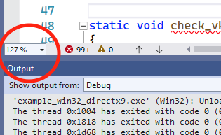

# Todo: It seems Microsoft Visual Studio provides "zoom" with a zoom drop-down as well as ctrl+shift+ '.' and ','?

```#9f5a4e5f``` *As of 2022-05-14 20:42*

[mail plain/text](mail.txt)


It is quite irritating that I failed to guess how to zoom the editor in Visual Studio (and had to google for a clue)

1) It seems to "zoom" in visual studio you can use short cuts &lt;ctrl&gt;+&lt;shift&gt;+ '.' and ',' (<https://stackoverflow.com/questions/3096600/is-there-a-way-to-zoom-the-visual-studio-text-editor-with-a-keyboard-shortcut> )?

==&gt; It seems there is a drop-down at the lower left corner of the editor window?



==&gt; It seems &lt;ctrl&gt;+&lt;shift&gt; + '.' zooms in and &lt;ctrl&gt;+&lt;shift&gt; + ',' to zoom out?

> ctrl+shift+. to Zoom In

  
> ctrl+shift+, to Zoom Out

...


