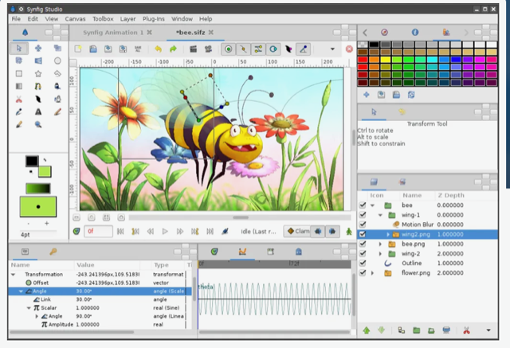

# Todo: Consider to try out Synfig 2D Editor (open source and cross platform)?

```#a12d52a1``` *As of 2022-01-20 12:44*

[mail plain/text](mail.txt)


I would like to be able to do 2D animations for youtube videos.

==&gt; Also see "Todo: Consider to delve into the Melt open source video editing backend (and compare with ffmpeg as base for my own composable video editor)?"

1) It seems Synfig 2D editor lives here (<https://www.synfig.org> )?

> 

2) Consider this Synfig 2D editor tutorial in english (<https://synfig.gumroad.com/l/synfig-course-v3-en> )?

...


