# Todo: Eget Ab - Överväg att dokumentera hur jag lämnar arbetsgivardeklaration för noll-lön till skatteverket?

```#a28bf624``` *As of 2019-08-16 13:48*

[mail plain/text](mail.txt)


Det är krångligt och otydligt vad jag måste fylla i i arbetsgivardeklarationen till skatteverket för att enklast möjligt deklarera noll-lön!

1) Överväg att dokumentera minst ett sätt som jag enkelt kan använda mig av för att deklarerar noll-lön till skatteverket?

==&gt; Dokumentera hur jag måste klicka "rätt" för att enkelt lämna in en arbetsgivardeklaration för noll-lön i skatteverkets e-tjänst?

> *Först måste jag "lägga till" betalningsmottagare genom att kopiera uppgifter på individnivå från förra månaden!*

> 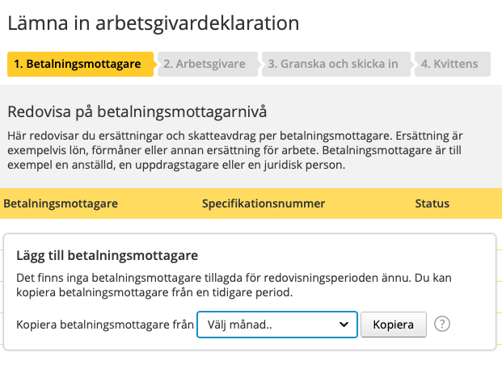  
> *För varje ny månad måste jag välja tidigare månad och trycka "kopiera" för att lägga till betalningsmottagare för att kunna lämna arbetsgivardeklaration*

> 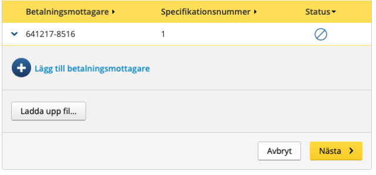  
> *Så här ser det ut i skatteverkets e-tjänst för att lämna arbetsgivardeklaration efter det att man lagt till mottagare från tidigare månad.*

> 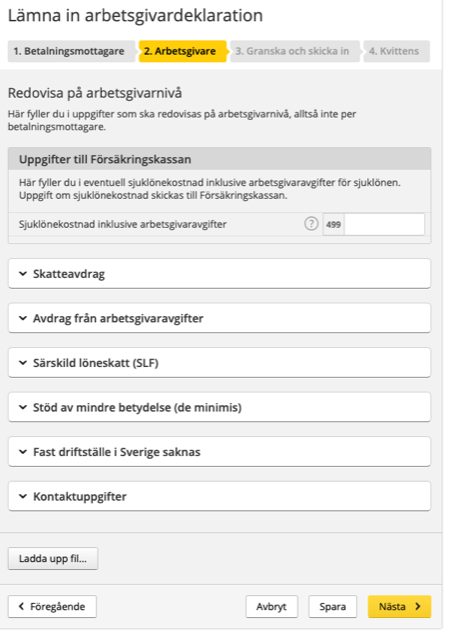  
> *Sedan är det viktigt att INTE klicka "Nästa" för då kommer man till deklaration på "Arbetsgivarnivå"!!*

> 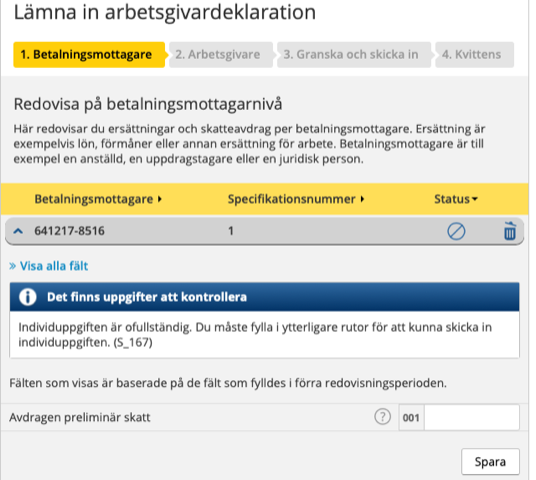  
> *I skatteverkets e-tjänst för arbetsgivardeklaration är det viktigt att börja med att klicka på en mottagare*

> 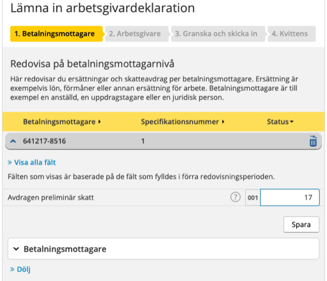  
> *Innan man tryckt "Spara" så kan man inte se om man behöver trycka "Spara" eller inte*

> 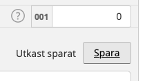  
> *Texten "Utkast Sparat" visas bara i några sekunder efter det att man tryckt på "Spara" (usch vad otydligt och dåligt)*

> 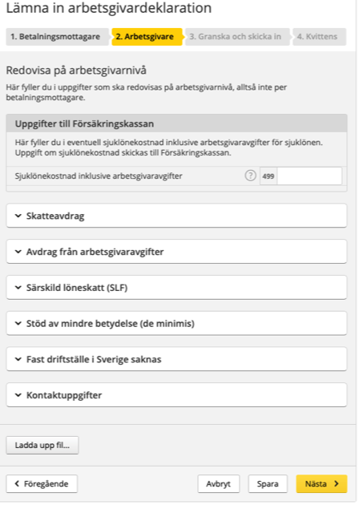  
> *Man behöver faktiskt inte fylla i något på arbetsgivarnivå (om man bara sett till att fylla i på individnivå)*

> 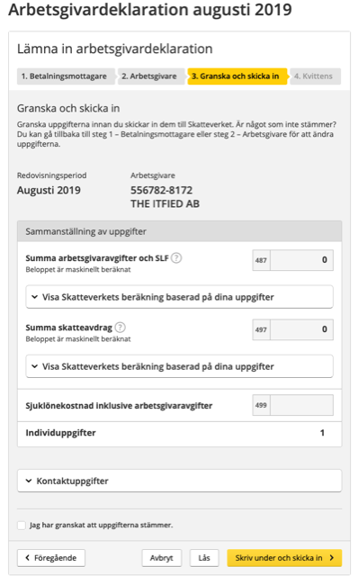  
> *Sista steget är att klicka i "Jag har granskat.." och sedan "Skriv under och skicka in"*

> 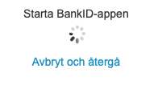  
> *Skatteverket kräver auktorisering via Mobilt BankID för att acceptera inlämnad arbetsgivardeklaration*

> 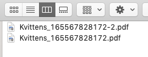  
> *Trots det konstiga namn som nerladdad kvittens har så får två olika rapporter samma namn!*

==&gt; Det verkar som om för att deklarerar noll-lön behöver jag fylla i rutan 001 "Avdragen preliminär skatt" på "betalningsmottagarnivå"?

> 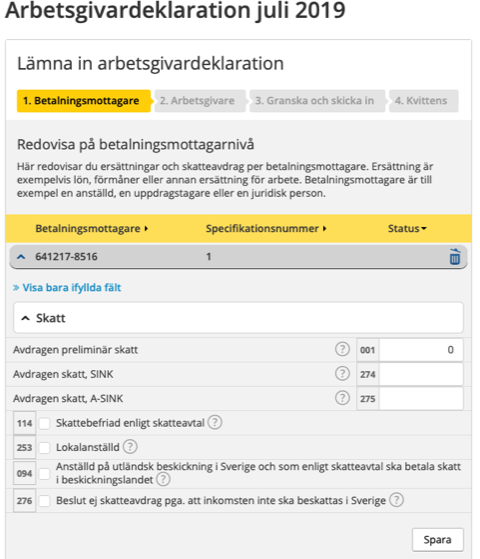  
> *För att deklarerar noll-lön behöver jag fylla i rutan 001 "Avdragen preliminär skatt" på "betalningsmottagarnivå"*

> 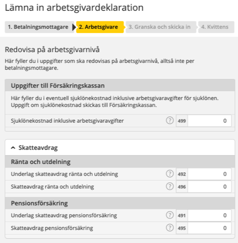  
> *Om man trycker "Nästa" efter "Redovisa på betalningsmottagarnivå" så fyller skatteverkets e-tjänst automatiskt i uppgifterna på "Arbetsgivarnivå"*

> 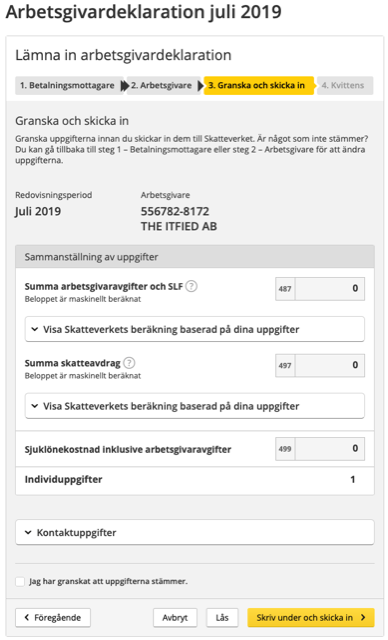  
> *Det sista steget i skatteverkets e-tjänst för att lämna in arbetsgivardeklaration*

> 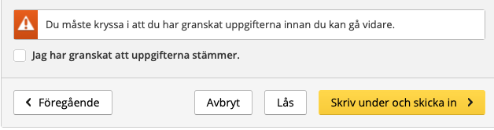  
> *Skatteverket håller "ryggen fri" genom att kräva att jag klickar i "Jag har granskat..."*

==&gt; Utskrift av kvittens av arbetsgivardeklarationen fungerar faktiskt och skapar automatiskt en filnedladdning (dock med en lite udda namn men ändå)!

> 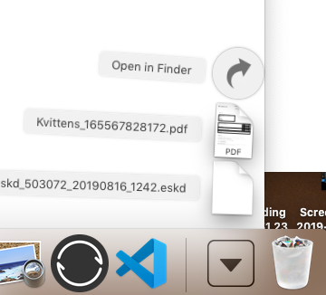  
> *Skatteverkets funktion "utskrift" av kvittens av inlämnad arbetsgivardeklaration laddar automatiskt ner en pdf av denna*

...


