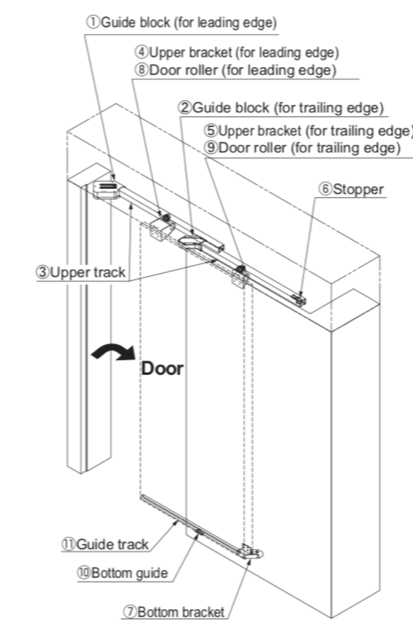
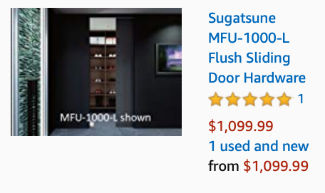
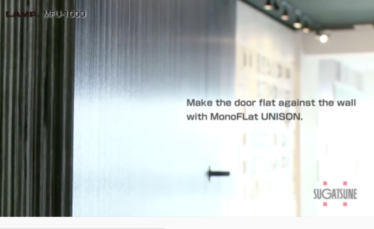
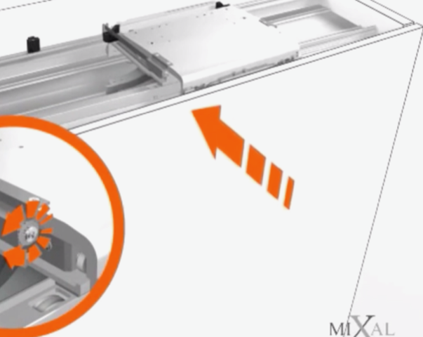

# Todo: Consider flush (coplanar) sliding door systems that exist preferably in Sweden or some design I can build myself?

```#a45ccca8``` *As of 2019-09-30 23:07*

[mail plain/text](mail.txt)


It would be a cool option for my wall build to insert a hidden flush fitted sliding door that when not used sits flush with the wall to the living room.

1) Consider the components of "flushslide" by UK based vendor Coburn (<https://www.coburn.co.uk/product/flushslide/> )?

==&gt; It seems Flushslide is for wardrobes and costs around £950?

> 

2) Consider the US based Sugatsune MFU-1000 system (<https://www.sugatsune.co.uk/s.nl/sc.34/category.283078/.f> )?

==&gt; Consider the mechanism of Sugatsune MFU flush

>   
> *The Sugatsune Monoflat Unison (MFU) flush (coplanar) close sliding door system*

==&gt; It seems the Sugatsune MFU (Monoflat Unison) is expensive with a price around $1100 (<https://www.amazon.com/Sugatsune-MFU-940-R-MonoFlat-Unison-Sliding/dp/B00CJXRTUA> )?

>   
> *Sugatsune MFU (Monoflat Unison) sells for around $1100 and ships only from US web stores*

==&gt; Consider the youtube video "MFU-1000 Flush Sliding Door System" (<https://youtu.be/D_3V6HvOY3M> )?

>   
> 

3) Consider the US and Canada based coplanar sliding door system by www.Richelieu (<https://www.richelieu.com/ca/en/category/sliding-door-systems-and-rolling-ladders/concealed-systems-for-sliding-doors/cabinet-systems/coplanar-system/1204161> )?

NOTE: Seems to only sell systems for furniture doors?

==&gt; Consider the youtube video "Richelieu Hardware - Coplanar Sliding Door Set For Wardrobe: Adjustments" (<https://www.youtube.com/watch?v=ue_2U6zBH6k> )?

4) Consider the Italian based MIXAL coplanar sliding door system (<https://mixal.it/sistemi-scorrevoli#2c498912-8877-43ae-9713-ae103e713335> )?

==&gt; Consider the youtube vidoe "MIXAL Online Coplanar System 意大利平移門" (<https://www.youtube.com/watch?v=-L79_GYzgdA> )?

>   
> *The MIXAL coplanar sliding door system seems to utilise a top carrige that is responsible to draw the door close*

...


