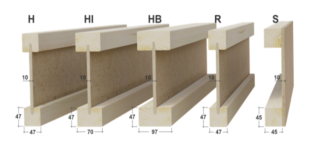

# Todo: House Build - Consider to use Masonite Beams from  Masonite Beams AB in Swedish Rundvik (where the original Masonite board factory was located)?

```#a54e5917``` *As of 2020-11-24 18:18*

[mail plain/text](mail.txt)


I want to find good components to design my house modules and light weight and natural material "Masonite Beams" seems like a good option.

1) Masonite Beams AB home page seems to be this URL (<https://masonite-beams.com> )?

>   
> *The product range of Masonite Beams from Masonite Beams AB in Swedish Rundvik*

==&gt; It seems Masonite Beams are good to prevent heat loss (<https://masonite-beams.com/masonite-beams-i-joist/walls/> )?

> *"Test reports show that the use of I-joists reduces heat losses by approximately 75% via thermal bridges and that the U-value is on average 15% lower than for conventional wooden stud structures. For a building with a wooden frame structure, the **total energy consumption** is thereby **reduced** by no less than **7%** simply by using the I-joist instead of traditional solid web."*

2) Consider where I can buy and find prices for Masonite Beams?

> *I failed to find any resellers. So I suppose I have to request an Offer directly from **Masonite Beams AB, *

3) Consider that the original Masonite Boards are no longer produced in Sweden but was in their original form used even for House Facades (<https://byggnadsvard.se/vard-och-underhall-av-masonit/> )?

> *"**I Rundvik har masoniten använts i vart och vartannat hus, till fasader, tak och interiörer. De flesta husen är byggda mellan 1929 och 1970 när Rundvik och masoniten hade sin absoluta höjdpunkt. Här finns en blandning av egnahem, tjänstemannabostäder och offentliga byggnader. Vissa hus byggdes enligt tidens funktionalistiska ideal medan andra tack vare masoniten kom att efterlikna hus i mer traditionella byggnadsstilar med fasader i träpaneler och slätputs.*

> *Ett ansenligt antal byggnader i Rundvik är fortfarande klädda med den ursprungliga masoniten och är i förvånansvärt bra skick trots materialets ålder på 60-70 år.**"*

...


