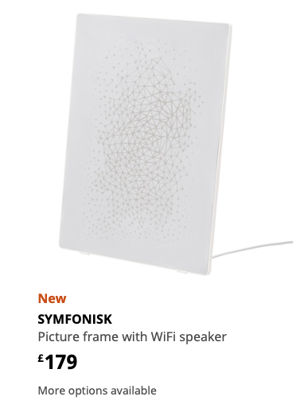
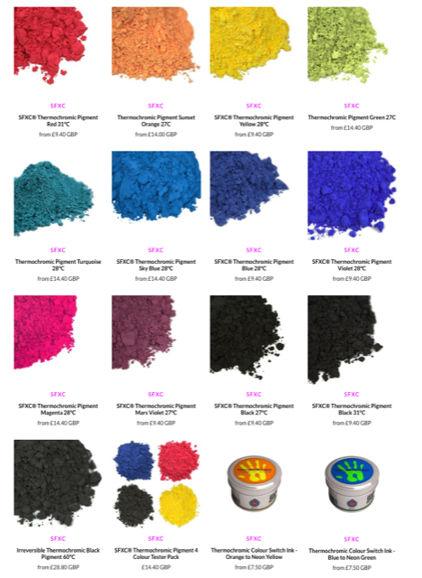
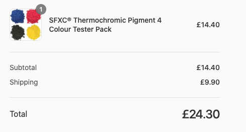
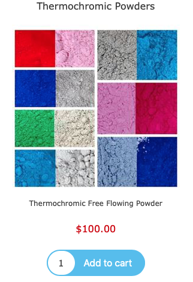
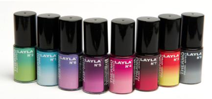

# Todo: Consider if it would be possible to dye fabric with Thermochromic inks and make IKEA SYMFONISK picture frame speaker with patterns that change with the music?

```#a5b00160``` *As of 2021-07-29 22:59*

[mail plain/text](mail.txt)


I have for a long time imagine a picture made of Thermochromic inks created by heating elements and maybe now its time to try as an IKE SYMFONISK picture frame front cover?

> So, the basic idea is to make a cover for the IKEA SYMFONISK pitcture frame speaker.

> 

> But we make it from a fabric coloured with Thermochromic inks and a backing heating element array that we control with say an Arduino?

> Not, in theory, we will be able to create a pattern on the fabric by heating the backing array in some patterns.

> The ultimate goal could then be too somehow have the fabric change colour and pattern in some relationship with the music played?

> Or, to show the room temperature by amplifying the temperature into the range of the used colours - say map 20 - 22 C to 28 - 31 degrees off the colour sample?

1) Consider the Wikipedia article on "Thermochromic ink" (<https://en.wikipedia.org/wiki/Thermochromic_ink> )?

2) Consider where to buy Thermochromic ink?

==&gt; Consider UK-based (<https://www.sfxc.co.uk/collections/thermochromatic-thermochromic-pigments-ink-paint> )?

> 

==&gt; I Ordered their four pigment test kit :)

> 

> This pack contains 5g each of:  
> [Blue 28C Thermochromic Pigment](https://www.sfxc.co.uk/products/blue-31c-thermochromic-pigment-powder)  
> [Red 31C Thermochromic Pigment](https://www.sfxc.co.uk/products/thermochromic-red-pigments-31c)  
> [Black 31C Thermochromic Pigment](https://www.sfxc.co.uk/products/black-31c-thermochromic-pigment)  
> [Yellow 28C Thermochromic Pigment](https://www.sfxc.co.uk/products/yellow-28c-thermochromic-pigment)

> SFXC Thermochromic pigment can be used with solvents and water based varnishes, binders and emulsions. Once mixed, the Thermochromic change can be enjoyed in printing, decorating and arts and crafts.

==&gt; Consider US-based ThermometerSite (<https://www.thermometersite.com/thermochromic-photochromic> )?

>   
> " *• Specially designed for use in **non-aqueous **based ink systems*  
> *• Can be used to formulate non aqueous based Flexographic, Screen, Offset, Gravure  
> and Epoxy Ink formulations  
> *  
> *• Pigments are available in various colors and activation temperatures  
> *  
> *• Pack Size: 50 grams*"

==&gt; Consider these nail polishes that changes colour with temperature (<https://www.highgrade.se/nagellack/nagellack-som-byter-farg-thermo-effect/> )?

> 

...


