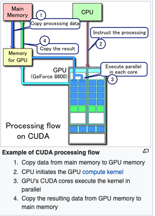
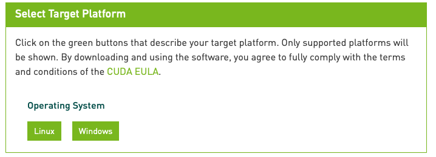
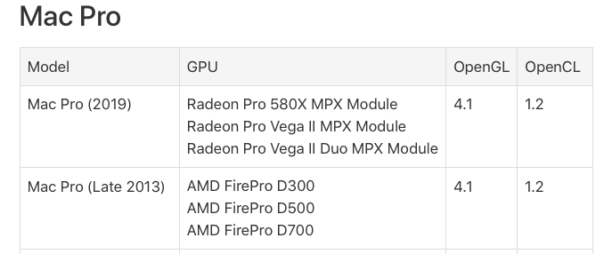

# Todo: Consider to delve into CUDA for leveraging GPU computing from CPU centric computer languages like C++?

```#a5f18344``` *As of 2020-10-21 11:47*

[mail plain/text](mail.txt)


I am interested in following the evolution of computer programming into multi-core, GPU and parallel processing challenges.

==&gt; Also see "[Todo: Dollow up on Deep Learning lecture at KTH 5 October 2015](../c74b568b/chime.md)"

==&gt; Also see "[Todo: Programming - Consider to study and try out a native Clang C++ compiler on windows?](../52b0d95e/chime.md)"

-1) It seems bottom line is that CUDA is NOT supported on latest macOS (and for older generations ONLY for NVidia graphics cards)?

> *See below.*

1) It seems the Clang compiler has switches for CUDA compilation of code (See Clang++ --help)

> kjell-olovhogdal@Kjell-Olovs-Mac-Pro ~ % **clang++ --help | grep cuda**  
> --cuda-compile-host-device  
> --cuda-device-only Compile CUDA code for device only  
> --cuda-gpu-arch=&lt;value&gt; CUDA GPU architecture (e.g. sm_35). May be specified more than once.  
> --cuda-host-only Compile CUDA code for host only. Has no effect on non-CUDA compilations.  
> --cuda-include-ptx=&lt;value&gt;  
> --cuda-noopt-device-debug  
> --cuda-path-ignore-env Ignore environment variables to detect CUDA installation  
> --cuda-path=&lt;value&gt; CUDA installation path  
> -fcuda-approx-transcendentals  
> -fcuda-flush-denormals-to-zero  
> -fcuda-short-ptr Use 32-bit pointers for accessing const/local/shared address spaces.  
> --no-cuda-gpu-arch=&lt;value&gt;  
> --no-cuda-include-ptx=&lt;value&gt;  
> --no-cuda-version-check Don't error out if the detected version of the CUDA install is too low for the requested CUDA gpu architecture.  
> -Xcuda-fatbinary &lt;arg&gt; Pass &lt;arg&gt; to fatbinary invocation  
> -Xcuda-ptxas &lt;arg&gt; Pass &lt;arg&gt; to the ptxas assembler  
> kjell-olovhogdal@Kjell-Olovs-Mac-Pro ~ %

2) COnsider the wikipedia article on CUDA (<https://en.wikipedia.org/wiki/CUDA> )?

> *"**CUDA (Compute Unified Device Architecture) is a parallel computing platform and application programming interface (API) model created by Nvidia.&#91;1&#93; It allows software developers and software engineers to use a CUDA-enabled graphics processing unit (GPU) for general purpose processing**"*

*==&gt; It seems CUDA data processing flows between main memory and GPU memory with the CPU only instructing the processing (the CPU does not receive result from the GPU but have to fetch it from main memory)?*

> 

==&gt; It seems CUDA is supported by LLVM and Clang for C++ developers?

> *"**C/C++ programmers can use 'CUDA C/C++', compiled to PTX with nvcc, Nvidia's LLVM-based C/C++ compiler.**"*

3) This seems to be NVidia web page for CUDA developers (<https://developer.nvidia.com/cuda-zone> )?

> *"**In GPU-accelerated applications, the sequential part of the workload runs on the CPU – which is optimized for single-threaded performance – while the compute intensive portion of the application runs on thousands of GPU cores in parallel. When using CUDA, developers program in popular languages such as C, C++, Fortran, Python and MATLAB and express parallelism through extensions in the form of a few basic keywords."*

> *"The CUDA Toolkit from NVIDIA provides everything you need to develop GPU-accelerated applications. The CUDA Toolkit includes GPU-accelerated libraries, a compiler, development tools and the CUDA runtime.**"*

==&gt; It seems CUDA is NOT supported on macOS - Linux and Windows support only (<https://developer.nvidia.com/cuda-downloads> )?

> 

> Also see <https://developer.nvidia.com/nvidia-cuda-toolkit-developer-tools-mac-hosts>

> *"**NVIDIA® CUDA Toolkit 11.0 no longer supports development or running applications on macOS. While there are no tools which use macOS as a target environment, NVIDIA is making macOS host versions of these tools that you can launch profiling and debugging sessions on supported target platforms.**"*

==&gt; It seems some form of CUDA development may be done on macOS with a set of prerequisites (<https://docs.nvidia.com/cuda/cuda-installation-guide-mac-os-x/index.html> )?

> *"*  
> *2. Prerequisites  
> 2.1. **CUDA-capable GPU**  
> To verify that your system is CUDA-capable, under the Apple menu select About This Mac, click the More Info … button, and then select Graphics/Displays under the Hardware list. There you will find the vendor name and model of your graphics card. If it **is an NVIDIA card** that is listed on the CUDA-supported GPUs page, your GPU is CUDA-capable.

> The Release Notes for the CUDA Toolkit also contain a list of supported products.

> 2.2. Mac OS X Version  
> The CUDA Development Tools require an Intel-based Mac running Mac OSX v. 10.13. To check which version you have, go to the Apple menu on the desktop and select About This Mac.

> Xcode Version  
> A supported version of Xcode must be installed on your system. The list of supported Xcode versions can be found in the System Requirements section. The latest version of Xcode can be installed from the Mac App Store.

> Older versions of Xcode can be downloaded from the Apple Developer Download Page. Once downloaded, the Xcode.app folder should be copied to a version-specific folder within /Applications. For example, Xcode 6.2 could be copied to /Applications/Xcode.

> Once an older version of Xcode is installed, it can be selected for use by running the following command, replacing &lt;Xcode_install_dir&gt; with the path that you copied that version of Xcode to:  
> sudo xcode-select -s /Applications/&lt;Xcode_install_dir&gt;/Contents/Developer  
> Command-Line Tools  
> The CUDA Toolkit requires that the native command-line tools are already installed on the system. Xcode must be installed before these command-line tools can be installed.

> The command-line tools can be installed by running the following command:  
> $ xcode-select --install  
> Note: It is recommended to re-run the above command if Xcode is upgraded, or an older version of Xcode is selected.

> You can verify that the toolchain is installed by running the following command:  
> $ /usr/bin/cc --version*  
> *"*

==&gt; It seems my Mac Pro 2013 AMD graphics card FirePro D700 is NOT supported by CUDA (<https://discussions.apple.com/thread/7832561> )

> *"**CUDA is NVIDIA proprietary and runs only on NVIDIA cards. Your graphic cards were made by AMD and they support OpenCL. Despite promises, adobe has not produced the software to make OpenCL truly competitive with CUDA.**"*  
> 

4) It seems NOT supporting CUDA means a number of popular ML frontends that uses CUDA is also ruled out (<https://towardsdatascience.com/gpu-accelerated-machine-learning-on-macos-48d53ef1b545> )?

> *"**Apple may not like NVIDIA cards, the solution is called PlaidML+OpenCL**"*

*==&gt; It seems PyTorch and Keras uses CUDA and is thus NOT supported on macOS with AMD graphics cards?  
*


> *"**The two most popular ML frameworks Keras and PyTorch support GPU acceleration based on the general-purpose GPU library NVIDIA CUDA. CUDA only works with NVIDIA GPU cards.**"*

==&gt; It seems (maybe) that plaidML (Keras with openCL as backend) is a python framework that may work on macOS with AMD GPUs?

> *"**Keras is one of the most popular deep learning frameworks. It’s very easy to define the architecture of a network using Keras’ functional APIs, run the training and execute inference. However, Keras does not perform the actual calculations by itself, but rather deploys other software libraries to define, optimize, and evaluate mathematical expressions involving multi-dimensional arrays. The most common ones are Theano and TensorFlow. In turn, these libraries execute parallel calculations on GPUs using CUDA. As previously states, this comes with the very strong hardware limitation that it works only on NVIDIA cards.**"*

5) This seems to be the home page for plaidML (<https://vertexai-plaidml.readthedocs-hosted.com/en/latest/index.html> )=

> # Welcome to plaidml’s documentation!<https://vertexai-plaidml.readthedocs-hosted.com/en/latest/index.html#welcome-to-plaidml-s-documentation>

  
> Contents:

- [Installation Instructions](https://vertexai-plaidml.readthedocs-hosted.com/en/latest/usage/install.html)
- [Building from source](https://vertexai-plaidml.readthedocs-hosted.com/en/latest/usage/building.html)
  - [Install Anaconda](https://vertexai-plaidml.readthedocs-hosted.com/en/latest/usage/building.html#install-anaconda)
  - [Install bazelisk](https://vertexai-plaidml.readthedocs-hosted.com/en/latest/usage/building.html#install-bazelisk)
  - [Configure the build](https://vertexai-plaidml.readthedocs-hosted.com/en/latest/usage/building.html#configure-the-build)
  - [Build the PlaidML Python wheel](https://vertexai-plaidml.readthedocs-hosted.com/en/latest/usage/building.html#build-the-plaidml-python-wheel)
  - [Install the PlaidML Python wheel](https://vertexai-plaidml.readthedocs-hosted.com/en/latest/usage/building.html#install-the-plaidml-python-wheel)
  - [PlaidML with Keras](https://vertexai-plaidml.readthedocs-hosted.com/en/latest/usage/building.html#plaidml-with-keras)
  - [Set up a build environment](https://vertexai-plaidml.readthedocs-hosted.com/en/latest/usage/building.html#set-up-a-build-environment)
  - [Build the PlaidML-Keras wheel](https://vertexai-plaidml.readthedocs-hosted.com/en/latest/usage/building.html#build-the-plaidml-keras-wheel)
  - [Install the PlaidML-Keras Python wheel](https://vertexai-plaidml.readthedocs-hosted.com/en/latest/usage/building.html#install-the-plaidml-keras-python-wheel)
  - [Testing PlaidML](https://vertexai-plaidml.readthedocs-hosted.com/en/latest/usage/building.html#testing-plaidml)

- [Contributing to PlaidML](https://vertexai-plaidml.readthedocs-hosted.com/en/latest/usage/contributing.html)
  - [Process](https://vertexai-plaidml.readthedocs-hosted.com/en/latest/usage/contributing.html#process)

- [Troubleshooting](https://vertexai-plaidml.readthedocs-hosted.com/en/latest/usage/troubleshooting.html)
  - [Common Issues](https://vertexai-plaidml.readthedocs-hosted.com/en/latest/usage/troubleshooting.html#common-issues)
  - [Run Backend Tests](https://vertexai-plaidml.readthedocs-hosted.com/en/latest/usage/troubleshooting.html#run-backend-tests)
  - [Enable Verbose Logging](https://vertexai-plaidml.readthedocs-hosted.com/en/latest/usage/troubleshooting.html#enable-verbose-logging)

- [Tile eDSL](https://vertexai-plaidml.readthedocs-hosted.com/en/latest/usage/edsl.html)
  - [Scope and Warning](https://vertexai-plaidml.readthedocs-hosted.com/en/latest/usage/edsl.html#scope-and-warning)
  - [How to Write Tile Code](https://vertexai-plaidml.readthedocs-hosted.com/en/latest/usage/edsl.html#how-to-write-tile-code)
  - [Reference](https://vertexai-plaidml.readthedocs-hosted.com/en/latest/usage/edsl.html#reference)

- [API](https://vertexai-plaidml.readthedocs-hosted.com/en/latest/api/index.html)
  - [Core](https://vertexai-plaidml.readthedocs-hosted.com/en/latest/api/core.html)
  - [EDSL](https://vertexai-plaidml.readthedocs-hosted.com/en/latest/api/edsl.html)
  - [Execution](https://vertexai-plaidml.readthedocs-hosted.com/en/latest/api/exec.html)

- [Configuration](https://vertexai-plaidml.readthedocs-hosted.com/en/latest/usage/configuration.html)

  
> [Next ](https://vertexai-plaidml.readthedocs-hosted.com/en/latest/usage/install.html)

==&gt; Python plaisML seems to require at least openCL 1.2 which is (so far) supported on my mac Pro 2013 "trashcan" (<https://vertexai-plaidml.readthedocs-hosted.com/en/latest/usage/install.html> )?

> *"**A computer listed on Apple’s compatibility list with support for OpenCL 1.2 is required; those from 2011 and later usually fit this requirement.**"*

> *For Official Apple support see below (Source *[*https://support.apple.com/en-us/HT202823](https://support.apple.com/en-us/HT202823) )*

6) This seems to be the Apple article defining Apple computers supporting openCL and openGL (<https://support.apple.com/en-us/HT202823> )?

>   
> *Mac Pro "Trashcan" (Late 2013) seems to support OpenCL 1.2 (including my model with D700 AMD FirePro graphics)?*

7) Consider Apple official documentation on Metal API for parallell computing (<https://developer.apple.com/documentation/metal/> )?

> ### Parallel Computation

  
> Process arbitrary calculations in parallel on the GPU.  
> [Processing a Texture in a Compute Function](https://developer.apple.com/documentation/metal/processing_a_texture_in_a_compute_function)  
> Perform data-parallel computations on texture data.  
> [Creating Threads and Threadgroups](https://developer.apple.com/documentation/metal/creating_threads_and_threadgroups)  
> Learn how Metal organizes compute-processing workloads.  
> [Calculating Threadgroup and Grid Sizes](https://developer.apple.com/documentation/metal/calculating_threadgroup_and_grid_sizes)  
> Calculate the optimum sizes for threadgroups and grids when dispatching compute-processing workloads.  
> ``[class MTLComputePipelineDescriptor](https://developer.apple.com/documentation/metal/mtlcomputepipelinedescriptor)  
> An object used to customize how a new compute pipeline state object is compiled.  
> ``[protocol MTLComputePipelineState](https://developer.apple.com/documentation/metal/mtlcomputepipelinestate)  
> An object that contains a compiled compute pipeline.  
> ``[class MTLComputePassDescriptor](https://developer.apple.com/documentation/metal/mtlcomputepassdescriptor)  
> A configuration for a compute pass, used to create a compute command encoder.  
> ``[protocol MTLComputeCommandEncoder](https://developer.apple.com/documentation/metal/mtlcomputecommandencoder)  
> An object used to encode commands in a compute pass.

...


