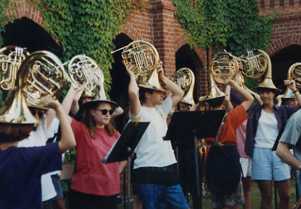
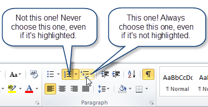
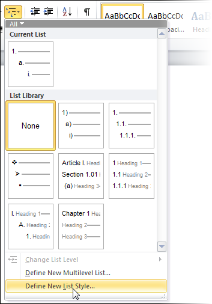
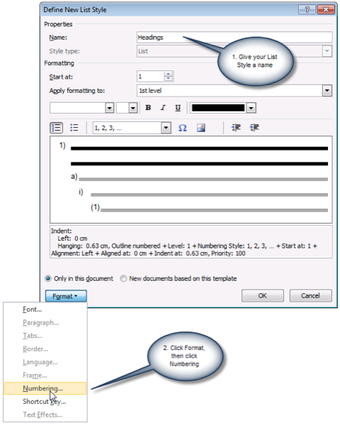
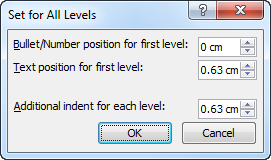
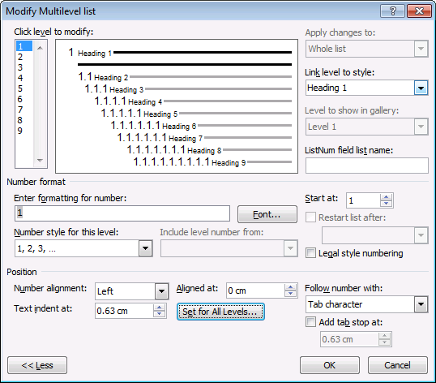
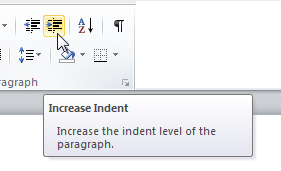
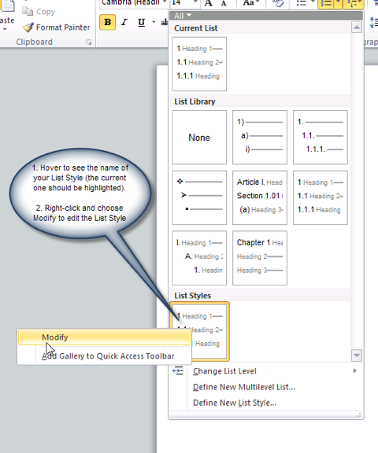

# Todo: Consider to understand how to best make word apply multilevel chapter numbering?

```#a5f4bdb1``` *As of 2021-03-25 13:20*

[mail plain/text](mail.txt)


It seems to me that words numbering scheme is very confusing and it is unclear how to make word correctly number chapters?

1) Consider til article "How to create numbered headings or outline numbering in Word 2007 and Word 2010" that seems to actually provide an explanation on how to make this work (<https://shaunakelly.com/word/numbering/numbering20072010.html?p=1768> )?

==&gt; Is this guide for word 2007 and 2010 still relevant?

> # How to create numbered headings or outline numbering in Word 2007 and Word 2010

> *How you set up numbered headings depends on [what version of Word you have](https://shaunakelly.com/word/management/what-version-of-word-do-i-have.html?p=1178). This page is about setting up numbered headings in Word 2007 and Word 2010. If you have Word 2003 or an earlier version, see [How to create numbered headings or outline numbering in Word 2003 and earlier versions](https://shaunakelly.com/word/numbering/numbering2003.html?p=1749).*

> ## Numbering run amok

> Word's paragraph numbering sometimes goes haywire. Just when you think you've got it organized, the numbering starts doing silly things. If Word's paragraph numbering were a group of orchestral musicians, it might look like this:

  
>   
> Musicians run amok

> ## What's needed?

  
> What's needed is someone to get those mad horn players organized and co-ordinated &#91;Lene Fredborg 12-Sep-2017: linked picture of orchestra removed - picture doesn't exist anymore&#93;. We don't need another player: we clearly have enough of those! What we need is a co-ordinator.

> In an orchestra, the conductor co-ordinates. For Word's numbering, the mechanism we use to organize and co-ordinate paragraph numbering is a List Style. The List Style co-ordinates. It doesn't do the actual work of formatting text. We leave that to paragraph styles.

> So, we need:

- a List Style as the co-ordinating mechanism for the numbering, and
- a paragraph style for each heading level (Word allows, actually requires, 9 levels).

  
> Understanding List Styles  
> A List Style has 9 levels. Each level can be linked to a paragraph style. And, each level stores information about how to number text to which that linked paragraph style has been applied.

> A List Style actually does two things.

- A List Style creates a set or group of styles. Word comes with built-in paragraph styles named Heading 1, Heading 2, Heading 3. But there is no connection between them. They just happen to share similar names. A List Style 'groups' those paragraph styles into some order. Only the List Style knows that Heading 1 is followed by Heading 2 and that it is followed by Heading 3. There are 9 levels in any List Style.
- A List Style stores the information about how to number each level. That includes the format of the number ( "1" or "a" or "i"), whether the number is preceded by text (eg "Chapter 1" or "Part A"), whether the number includes previous levels' numbers (eg paragraph 1.4.3), and the indents (the distance from margin to number and from number to text).

> ## Set up your Heading paragraph styles

> There are good reasons for [using the built-in Heading styles](https://shaunakelly.com/word/numbering/usebuiltinheadingstyles.html?p=16).

> Before you begin the numbering, make sure your Heading styles are set up appropriately.

> [Modify](https://shaunakelly.com/word/styles/modifyastyle.html?p=1420) the Heading 1 style so that it is based on "No style". Modify Heading 2 so it's based on Heading 1. Modify Heading 3 based on Heading 2. And so on. Not everyone does this, but I find it useful because of the way the formatting of Word's styles [cascade](https://shaunakelly.com/word/styles/howstylescascade.html?p=1485).

> Now, modify the Paragraph settings of every Heading style so that the Left Indent is 0, and the Special indent is set to (none). Do this even if you want your headings to be indented from the left margin, and even if you want a hanging indent. Why? Because for outline-numbered styles, we will set the paragraph indent and the hanging indents (if any) when we set up the numbering.

> ## Create a list style

> To create your list style, on the Home tab, in the Paragraph group, click the Multilevel list menu (Figure 1).

  
>   
> Figure 1: Choose the Multilevel list menu

> From the menu, choose Define New List Style (Figure 2).

  
>   
> Figure 2: On the Multilevel list menu, choose the Define New List Style option.

> In the Define New List Style dialog (Figure 3), do (only) two things:

1. Give your list style a name.  
>   Hint: Give it a *plural* name. That makes it clear that this is a list style that's controlling more than one paragraph style. And, give it a name directly related to the paragraph styles you're going to use. We're going to use paragraph styles Heading 1, Heading 2, Heading 3 etc. So **I suggest that you name the list style as Headings**.
2. On the Format menu, click Numbering.

  
>   
> Figure 3: In the Define New List Style dialog, give your list style a name and then click Format &gt; Numbering. Skip everything else in this dialog box. It's not for grown-ups.

> We're now in the Modify Multilevel List dialog box (Figure 5). The list style is the co-ordinating mechanism for the whole "set" of paragraph styles we'll use. So we set up all levels of numbering in this one dialog box.

> To set up the numbering:

1. In the Modify multilevel list dialog, **click the More button**.
2. **Attach the Heading paragraph styles** to the 9 levels in the list style. To do that:
  1. In the 'Click level to modify' list, select level 1. In the 'Link level to style' box, choose Heading 1. That attaches paragraph style Heading 1 to level 1 of the list style.
  2.  
>     In the 'Click level to modify' list, select level 2 and attach style Heading 2. And attach Heading 3 to level 3, Heading 4 to level 4 and so on.

3. Now we **tell Word about the numbering itself for Level 1**
  1. In the 'Click level to modify' list, click level 1.
  2. Delete anything in the 'Enter formatting for number" box.
  3. If you want the numbering to start with some text (eg to number a paragraph as "Chapter 1" or "Section 1") then enter the text including any space in the 'Enter formatting for number' box. Leave the insertion point *after* your text.
  4. From the Number style for this level list, choose the kind of numbering you want.

4. **Set up numbering for levels 2 to 9**.
  1. In the 'Click level to modify' list, choose Level 2.
  2. Delete anything in the 'Enter formatting for number" box.
  3. If you want to include a previous level's numbering, then use the 'Include level number from' box. If you want punctuation after each level, add it into the 'Enter formatting for number' box as you go.  
>     For example, for Level 2, I might want the numbering to be "1.1". That is, I want the Level 1 number and the Level 2 number. So, from the 'Include level number from' box, I choose 'Level 1'. Then I type a full stop (full point, period, whatever). Then I choose from the 'Number style for this level' box.  
>     You have to do each previous level separately. By the time you come to do Level 9, if you want paragraphs numbered 1.1.1.1.1.1.1.1.1, you need to add Level 1, Level 2, Level 3 etc, all the way to Level 8. This can get tedious, but hang in there!
  4. From the Number style for this level list, choose the kind of numbering you want for the current level.
  5. Repeat for each of levels 3 to 9. If you don't want numbering for a level, leave the 'Enter formatting for number' box empty.

5. Next, set up **the indents**: how far in from the left margin do you want the different levels to appear? The default indents are actually quite reasonable. If you prefer to change them, then you have two choices. The easy way is to click the "Set for all levels" button. You'll see the Set for All levels dialog (Figure 4).  
>     
>   Figure 4: Use the Set for All levels dialog to manage indents for your headings

>   The hard way is to set the 'Aligned at', 'Text indent at' and 'Add tab stop at' boxes individually. Just remember that they're all measured from the left margin.
6. My finished settings look like Figure 5.  
>     
>   Figure 5: The finished settings in the Modify Multilevel List dialog

7. OK, OK back to your document.

> ## How to apply the Heading styles to your text

> So you have set up your List Style. But we don't ever *use* the List Style. Instead, we format paragraphs using the Heading 1, Heading 2 etc paragraph styles. Because you linked the heading paragraph styles to the List Style, the heading styles will now use the numbering you set up in the List Style.

  
> Applying numbering  
> The conductor doesn't produce any sound: musicians do that. And you won't find a part for the conductor in the score.  
> The list style doesn't format your text: paragraph styles do that. And you won't find the list style in the Styles pane.  
> Apply your paragraph styles to text. We don't ever actually *use*the list style.

> ### How to apply Heading 1 style to a paragraph

> To apply the numbering to one or more paragraphs in your document:

1. click once within a paragraph, or select text from two or more paragraphs
2. on the Home tab, click the thumbnail for the Heading 1 style (or, for keyboard junkies, use Ctrl-Alt-1, which is the built-in keyboard shortcut for applying style Heading 1).

> ### How to create a lower-level heading (or: how to demote a heading)

  
>   
> Figure 6: Use the Increase Indent button to demote a paragraph (ie indent it to the right)

> You can create lower levels of headings by applying the paragraph styles Heading 2, Heading 3 etc. There are lots of ways to apply a paragraph style to your text. Here are three particularly relevant to headings:

- By default, the heading styles appear on the Quick Styles gallery as you need them. That is, once you've used, say, style Heading 4, then Heading 5 will automagically appear on the Quick Styles gallery. Click in your paragraph, click the thumbnail for the style you want and presto! the paragraph is numbered.
- Use the built-in keyboard shortcuts for the first three levels of headings: Alt-Ctrl-1, Alt-Ctrl-2, Alt-Ctrl-3.
- Use the Increase Indent button. It's on the Home tab, in the Paragraph group (Figure 6). And, to promote a paragraph (ie move it to the left), use the Decrease Indent button. Or, for keyboard junkies use Shift-Alt-Right arrow and Shift-Alt-Left arrow.  
>   There are three important things to note here:

- If you click in a paragraph in a Heading 1 style and click the Increase Indent button (or do Shift-Alt-Right arrow), you're not applying some kind of nasty direct formatting. Word will apply style Heading 2 to your text. Click Increase Indent again, and Word will apply style Heading 3. And so on.  
>   That is, Word is applying the appropriate paragraph styles to your paragraphs.
- The Increase Indent and Decrease Indent buttons (and Alt-Shift-Left and Alt-Shift-Right) only work in this special way because you attached your Heading paragraph styles to a list style. They don't work like this out-of-the-box.

> ## How to edit your numbering scheme

> Your numbering scheme is stored in your Headings list style. It's not stored in the individual paragraph styles. Therefore:

- **Edit the individual paragraph styles** if you want to change paragraph settings (eg space before or after) or the font of the text that follows the heading text (eg to make it big or pink or bold). To edit an individual paragraph style, see [How to modify styles in Microsoft Word](https://shaunakelly.com/word/styles/modifyastyle.html?p=1420).
- **Edit the list style** if you want to change the numbers, the position between number and text, the size of the number itself and so on. To edit your list style:
  - Click in a heading.
  - On the Home tab, in the Paragraph group, click the Multilevel list menu button (Figure 7)  
>       
>     Figure 7: Choose the Multilevel list menu

  - You will see the Headings list style highlighted at the bottom of the menu.
  - Right-click the thumbnail for the Headings list style and choose Modify. Format &gt; Numbering (Figure 8). You can how change any or all of your numbering settings.  
>       
>     Figure 8: To edit your list style, hover over the thumbnails for the list styles to identify the one you need, then right-click and choose Modify.

> ## Is all this really necessary? Can't I just use the List Library?

> If using the List Library on the Multilevel List menu (see Figure 2 or Figure 8 ) works for you, then go for it! For quick'n'dirty work, it may be just the thing.

> For a corporate template that will be used by hundreds or thousands of users, it's probably not the best solution. For really big complicated documents, or documents where you have to cut and paste from one document to another a lot, then the List Library may let you down.

> For more information, directly from Microsoft's Word development team, see &#91;NOTE: outdated links removed by Lene Fredborg 29-Dec-2016&#93;The Many Levels of Lists and Multilevel Lists vs List Styles.


> Too good to be true?

> Related articles on other sites

> All sounds too good to be true? It is. When you've finished getting your numbers just right, you might be interested to read some of the material MVPs have put together on numbering. Start at the [Microsoft Word MVP FAQ site](http://wordmvp.com/), click FAQ and then Numbering.

> And, read from people in [Microsoft's Word development team](https://blogs.office.com/word/) especially Stuart Stuple's [The Why Behind Our Styles and Lists Designs](https://blogs.office.com/2010/01/28/the-why-behind-our-styles-and-lists-designs/).

> Related articles on this site

> [How to create numbered headings or outline numbering in your Microsoft Word document. ](https://shaunakelly.com/word/numbering/outlinenumbering.html?p=1758)

> [How to number headings and figures in Appendixes in Microsoft Word](https://shaunakelly.com/word/numbering/numberingappendixes.html?p=1968)


> Photo info

> Photograph of horn players taken at National Music Camp, Geelong Grammar, January 1993. I have no recollection of why all the horn players were wearing silly hats, but National Music Camp has a fine tradition of encouraging innocent pranks and general merriment—as well as damned hard work—so it's not entirely surprising. What's more puzzing is why I kept the photo all these years!

> John Curro, conductor of the Queensland Youth Orchestra who taught me more than I'll ever know.

  
> Related subjects

> [Topic](https://shaunakelly.com/topics.html): [Numbering, headings, outlines](https://shaunakelly.com/topic/word/numbering.html)

  
> [Tags](https://shaunakelly.com/word/tag.html): [Headings](https://shaunakelly.com/word/tag/headings.html), [Keyboard shortcuts](https://shaunakelly.com/word/tag/keyboard-shortcuts.html), [Outline view](https://shaunakelly.com/word/tag/outline-view.html)

  
> [Interest](https://shaunakelly.com/interest.html): [For users](https://shaunakelly.com/interest/for-users.html)

> [Version](https://shaunakelly.com/version.html): [Word 2007](https://shaunakelly.com/version/word-2007.html) [Word 2010](https://shaunakelly.com/version/word-2010.html)

> Created 19 June 2010. Last updated 31 August 2011.


...


