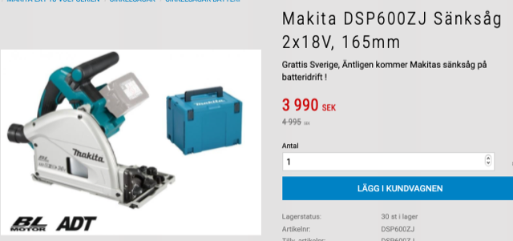
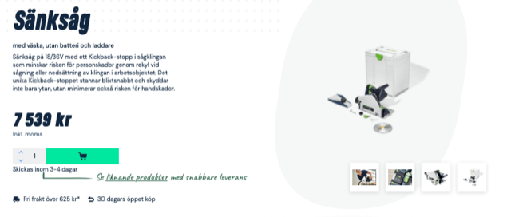
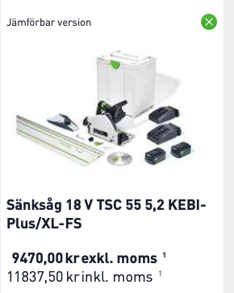
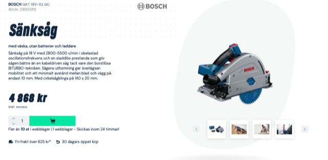

# Todo: Consider if I should buy a plunge saw for "dust free" more accurate indoor wood working cuts?

```#a697255e``` *As of 2021-07-11 22:21*

[mail plain/text](mail.txt)


1) Consider a Makita plunge saw for my Makita guide rail?

==&gt; Consider the cordless alternatives?

> DSP600ZJ seems to be the model without bluetooth dust collection starter mechanism?

> It seems Swedish Verktygsvaruguset sells it for 4000 SEK (<https://www.verktygsvaruhuset.se/product/makita-dsp600zj-sanksag-2x18v-165mm> )?

> 

==&gt; Consider the Festool rail flip mountings?

2) Consider a festool plunge saw and rail?

==&gt; Consider a Festool cordless option?

> 

==&gt; Consider a kit with plunge saw and MFT rails?

> It seems I can buy a kit with a guide rail, charger and batteries and the saw for around 12 000 SEK?

> 

3) Consider a Bosch plunge saw on my Makita guide rail?

==&gt; Consider a Bosch cordless option?

> It seems Bosch has one cordless option, the Bosch GKT 18V-52 GC Solo?

> 

...


