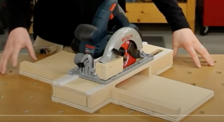
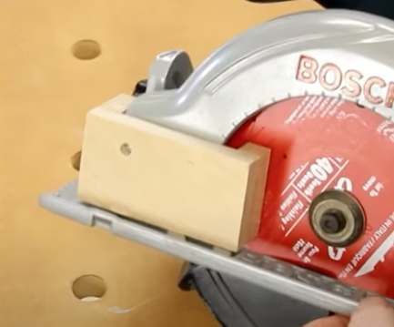
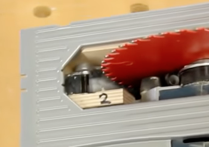
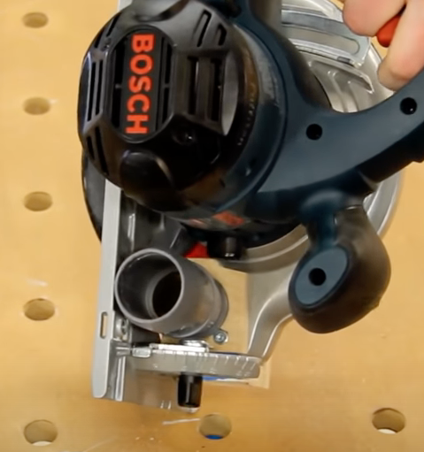
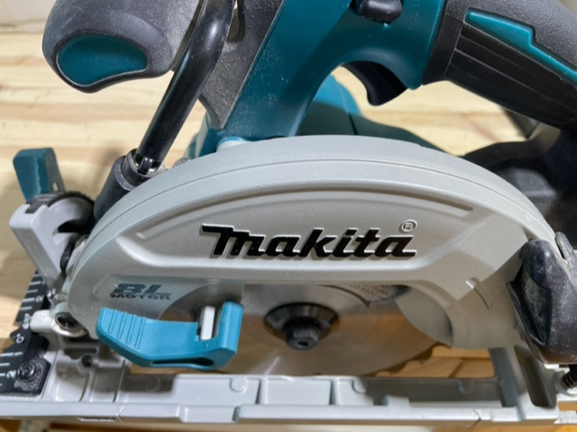
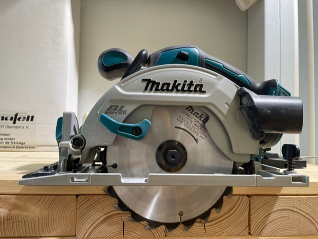
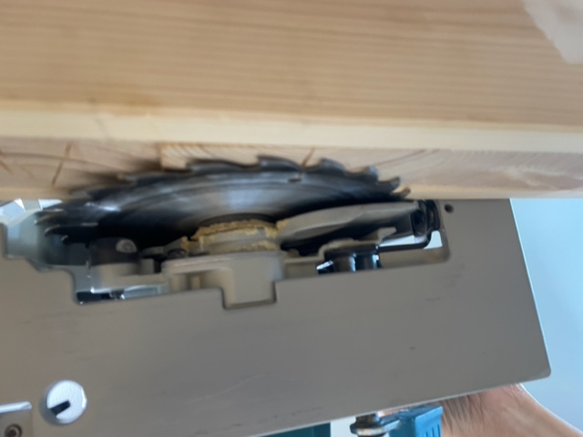
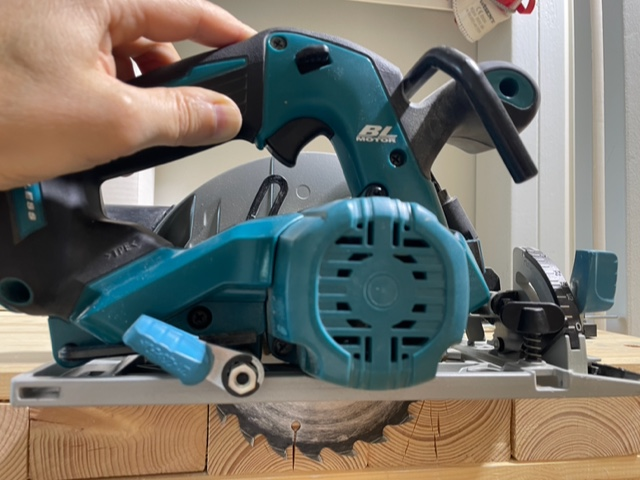

# Todo: Consider a zero clearance and dust extraction inlay for my Makita DHS680 brushless circular saw?

```#a8dd568f``` *As of 2022-07-31 16:42*

[mail plain/text](mail.txt)


I want to be able to make high accurate cuts with ease and with zero dust in my apartment with my Makita DHS680 circular saw.

1) Consider this youtube video "Circular Saw Cross-Cut Jig - Accurate & Dustless - Pt1" (<https://youtu.be/gjdoVtL248M?list=LL> )?

==&gt; It seems he makes dustless cuts by enclosing the front of the blade of the saw as well as the cut space of the jig?



*The jig seems to have an enclosed cutting space with air drawn in from the front of the blade of the saw*



*The saw seems enhanced with an enclosure of the front of the blade where the air and dust is drawn out?*



*The front of the blade enters into an enclosed space on the saw*



*On the Bosch he has room for the dust port on the motor side of the saw*

2) Consider the blogg article "HOW TO CUT LAMINATE FLOORING DUST-FREE WITH A CIRCULAR SAW" by Dan Pattison here (<https://www.danpattison.com/blog/2016/10/11/how-to-cut-laminate-flooring-dust-free-with-a-circular-saw> )

3) Consider the design of my Makita DHS680 brushless circular saw?

> *At first glance it seems we have to do some testing to see how much we need to do to make dust free cuts with the **Makita DHS680 brushless circular saw (See images below)?*

> *The existing dust port seems to suck at the top and back of the blade and maybe there is actually already enough suction available if we just close the gap at the front of the blade?*

> ***TEST 1: Make a cut on my Kreg cross cutting station and film and measure the amount of dust that escapes (maybe a simple guard is enough as long as only wood chips escape)?***

> ***TEST 2: Try to enclose the Kreg cross cutting jig in the same way as Dan Pattison did on his?***

> ***TEST 3: Try to add some flat guard at the front of the saw to close up the opening at the front of the to enhance dust extraction (and disable chips to escape)?***

> ***... ***



*The sole of the saw has some tricky (non flat) geometry?*



*We may be tempted to design the dust port on the non-motor side of the saw?*



*There seems to be some tricky geometry to adapt to to make the front of the blade (to the right in the picture) "airtight?*



*The space for a dust extraction on the motor side seems to be limited?*

...


