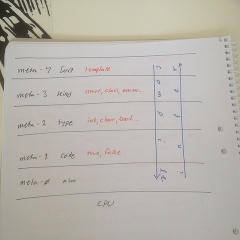

# Todo: Meta Stack - Consider "infer" is in fact the reciprocal (inverse) of "compile/Create" when viewed as meta-layer traversals?

```#a8ddc4a5``` *As of 2018-05-08 13:01*

[mail plain/text](mail.txt)


It seems like a good idea to view “infer” as a travel of the meta-stack in the reverse order as that of construct or compile?

1) Consider the meta-stack of the C++ type system?



==&gt; It would seem that when we compile we construct from meta-layer down to defacto layer iteratively until we have CPU machine code?

==&gt; But then we can note that to infer a meta-layer or a defacto instance we actually are trying to move the meta-stack in the reverse direction of “compile”?

==&gt; Consider C++ “auto” is in fact an “infer” operation from meta-1 (code) to meta-2 (type)?

auto x = 4; // infers meta-2 “int” from meta-1 “4”

auto a = 4.0; // infers meta-2 “float” from meta-1 “4.0”

…

2) Consider data serialisation and de-serialisation is in fact also a meta-layer stack travel?

==&gt; To serialise data we “construct” a meta-0 bit-stream from a meta-1 instance (byte/word vector) as required to preserve meta-2 data structure (type representation)?

==&gt; To de-serialise we in fact “infer” a meta-1 and meta-2 layer from the received meta-0 bit-stream?

…

3) Consider in some sense the meta-1 layer of C++ is in fact a bit composition layer (8 bit, 16 bit, 32 bit …) (the smallest build blocks of any programming environment and computer hardware)?

…

...


