# Todo: Consider youtube video "$200 Bullet-Proof Alaskan Chainsaw Mill Setup. Build Your Own! #80" by " Surviving Ringworm" on chain saw milling machine to inspire me for my own timber felling and house building adventures?

```#a8f6991b``` *As of 2023-11-22 12:40*

[mail plain/text](mail.txt)


I may want to cut my own limber from timber that grows on my lot.

1) Consider youtube video "$200 Bullet-Proof Alaskan Chainsaw Mill Setup. Build Your Own! #80" (<https://youtu.be/9Koc2l99Aog> )?

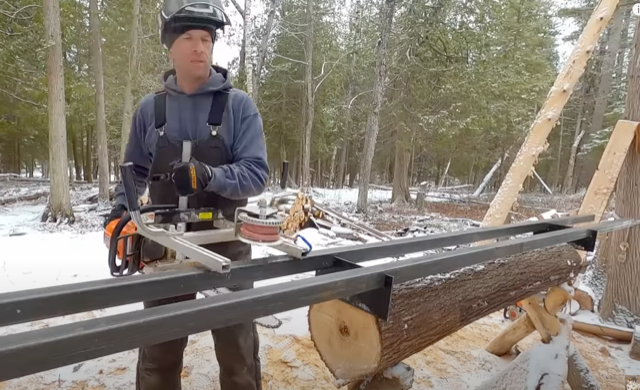

<https://youtu.be/9Koc2l99Aog?t=1002>

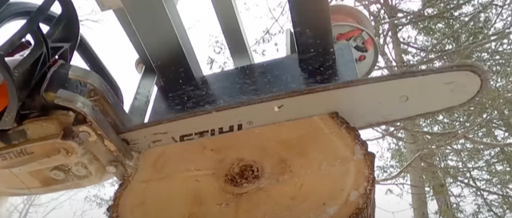

<https://youtu.be/9Koc2l99Aog?t=1018>

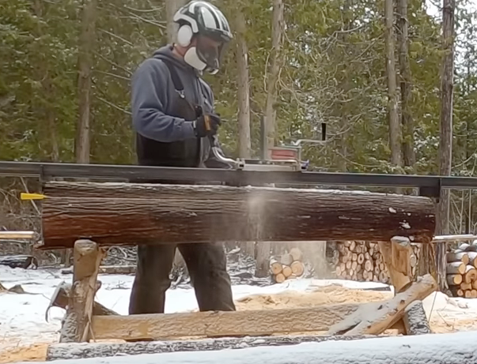

<https://youtu.be/9Koc2l99Aog?t=1026>

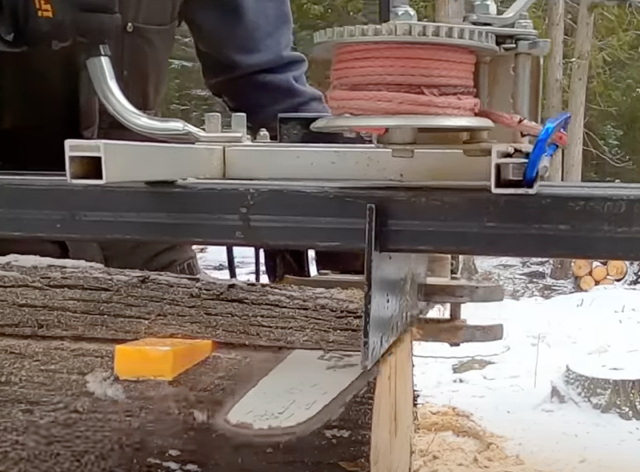

<https://youtu.be/9Koc2l99Aog?t=1039>

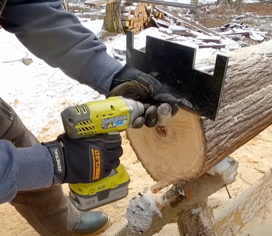

<https://youtu.be/9Koc2l99Aog?t=1054>

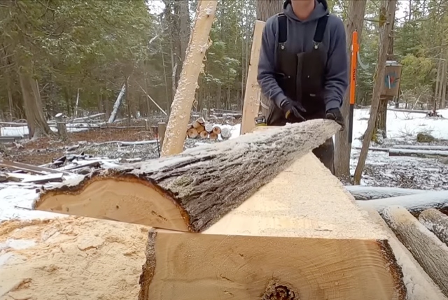

<https://youtu.be/9Koc2l99Aog?t=1067>

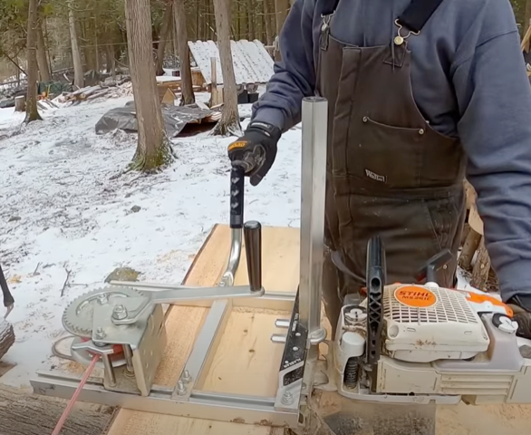

<https://youtu.be/9Koc2l99Aog?t=1426>

2) It seems swedish web-shop by "Redskapsboden" sell the "Granbergs" chain was milling machines ([https://redskapsboden.se](https://redskapsboden.se/) )?

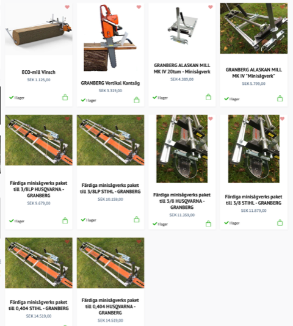

<https://redskapsboden.se/minisagverk/granbergs-sagverk?gad_source=1&gclid=Cj0KCQiA6vaqBhCbARIsACF9M6let5llz68jlssC8S6i7Lm6H_x_JEjWcozxmyZYuaddz7fYJtvzgxIaAhcTEALw_wcB>

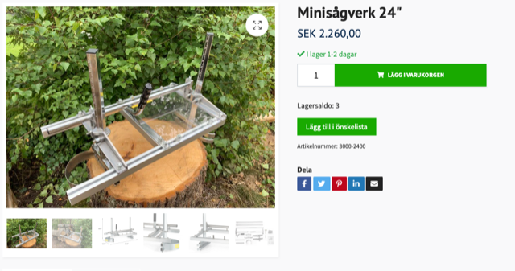

<https://redskapsboden.se/minisagverk/sagverk/minisagverk-24>

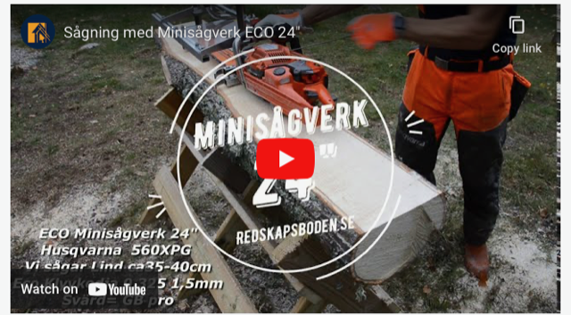

<https://youtu.be/Gmhd7R2Csaw>

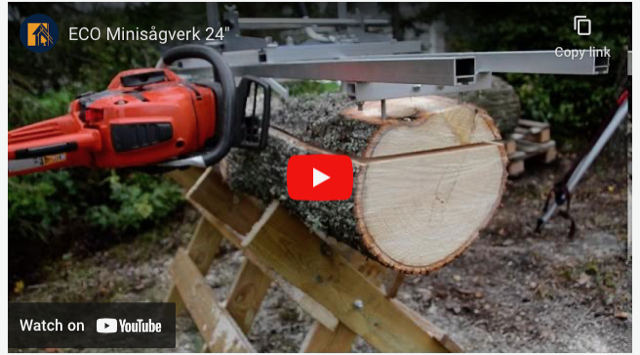

<https://youtu.be/o3R30r_sfxs>

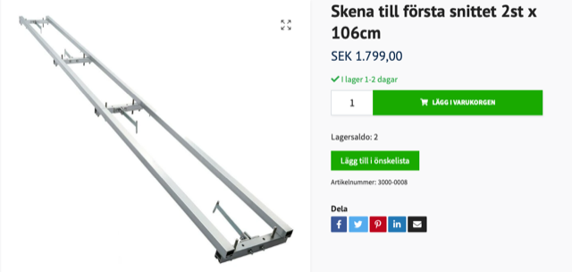

<https://redskapsboden.se/minisagverk/forstasnittet-skenor/skena-till-forsta-snittet>

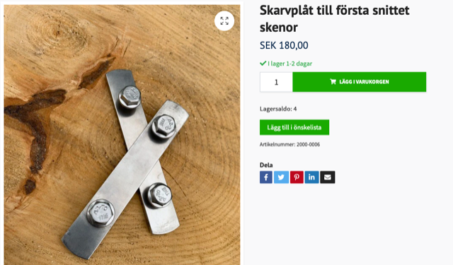

<https://redskapsboden.se/minisagverk/forstasnittet-skenor/skarvplat-till-forsta-snittet-skenor>

3) Consider a cordless chain saw?

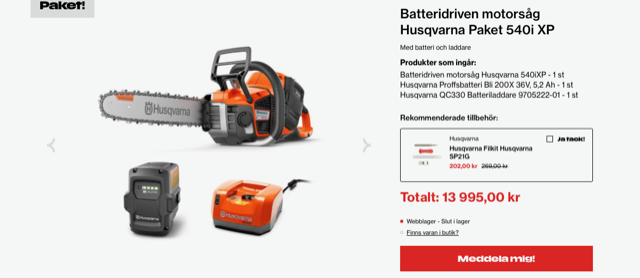

<https://duab.se/skog-tradgard/motorsagar-skarutrustning/motorsagar/husqvarna-batterimotorsagspaket-540i-xp>

4) Consider some chain saw sharpener tool?

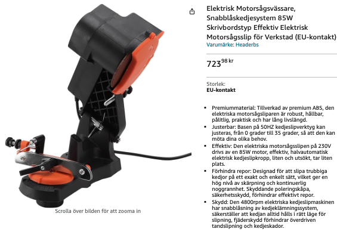

[https://www.amazon.se/Motorsågsvässare-Snabblåskedjesystem-Skrivbordstyp-Motorsågsslip-EU-kontakt/dp/B0C4LZTQZL/ref=sr_1_60_sspa?crid=1GXQXU289G7O1&keywords=motorsågsslip&qid=1700653020&sprefix=motorsågs%2Caps%2C116&sr=8-60-spons&sp_csd=d2lkZ2V0TmFtZT1zcF9idGY&psc=1](https://www.amazon.se/Motors%C3%A5gsv%C3%A4ssare-Snabbl%C3%A5skedjesystem-Skrivbordstyp-Motors%C3%A5gsslip-EU-kontakt/dp/B0C4LZTQZL/ref=sr_1_60_sspa?crid=1GXQXU289G7O1&keywords=motors%C3%A5gsslip&qid=1700653020&sprefix=motors%C3%A5gs,aps,116&sr=8-60-spons&sp_csd=d2lkZ2V0TmFtZT1zcF9idGY&psc=1)

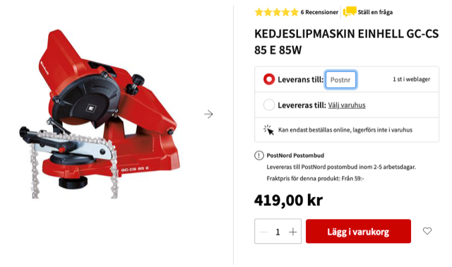

<https://www.bauhaus.se/kedjeslipmaskin-einhell-gc-cs-85-e-85w?gad_source=1&gclid=Cj0KCQiA6vaqBhCbARIsACF9M6nwHfS--_Btp8jaqv7puCrGhyKKQ4SajfdW8GNYN8jNwnC8yuFA1qkaAuk1EALw_wcB>

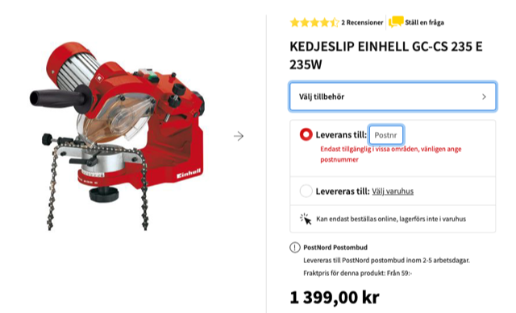

<https://www.bauhaus.se/kedjeslip-einhell-gc-cs-235-e-235w?gad_source=1&gclid=Cj0KCQiA6vaqBhCbARIsACF9M6no5q-9Y2fQFKDO447c5wjbiiHmIZPS0Zl388P_FseQ1KBF8JN6IqgaAh8tEALw_wcB>

...


