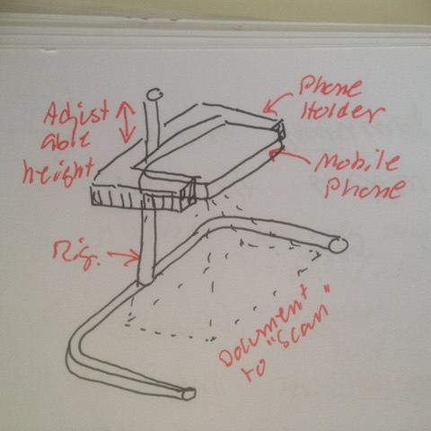

# Todo: DIY - Consider to 3D print and design a Mobile Phone Camera document scan rig (to capture drawings and documents)?

```#a98338a5``` *As of 2018-05-20 11:30*

[mail plain/text](mail.txt)


Could we imagine a simple way to design a camera rig for mobile phones to easily capture drawings and document?

1) Consider a mobile phone camera moment and drawing scan rig design?



2) Consider to use a threaded rod and nuts to adjust the camera height?

…


