# Todo: Python Win10 Powershell - Consider to document my solutions to get Python Virtual Environment in Powershell and VSCode to get up and running?

```#a9d89368``` *As of 2021-05-13 13:23*

[mail plain/text](mail.txt)


1) It seems I have to change the Powershell Execution Policy (which was easier said that done)

==&gt; It seems to be able to run the Python virtual environment activate bat-file I have to set execution policy to "Unrestricted"?

> PS C:\\git\\payex_hiso\\python&gt; **Set-ExecutionPolicy** -ExecutionPolicy Unrestricted

> Execution Policy Change  
> The execution policy helps protect you from scripts that you do not trust. Changing the execution policy might expose you to the security risks described  
> in the about_Execution_Policies help topic at https:/[go.microsoft.com/fwlink/?LinkID=135170](http://go.microsoft.com/fwlink/?LinkID=135170). Do you want to change the execution policy?  
> &#91;Y&#93; Yes &#91;A&#93; Yes to All &#91;N&#93; No &#91;L&#93; No to All &#91;S&#93; Suspend &#91;?&#93; Help (default is "N"): A  
> PS C:\\git\\payex_hiso\\python&gt; **Get-ExecutionPolicy**  
> Unrestricted  
> PS C:\\git\\payex_hiso\\python&gt; .\\python-environment\\Scripts\\**activate**  
> (python-environment) PS C:\\git\\payex_hiso\\python&gt;

==&gt; Setting execution policy to "Undefined" did NOT work

> PS C:\\git\\payex_hiso\\python&gt; Set-ExecutionPolicy -ExecutionPolicy **Undefined **-Force  
> PS C:\\git\\payex_hiso\\python&gt; Get-ExecutionPolicy  
> **Restricted**  
> PS C:\\git\\payex_hiso\\python&gt; Set-ExecutionPolicy

==&gt; Forcing execution policy to "Unrestricted" did NOT work

> PS C:\\git\\payex_hiso\\python&gt; Set-ExecutionPolicy -ExecutionPolicy Unrestricted **--Force**  
> Set-ExecutionPolicy : Cannot bind parameter 'Scope'. Cannot convert value "--Force" to type "Microsoft.PowerShell.ExecutionPolicyScope". Error: "Unable to  
> match the identifier name --Force to a valid enumerator name. Specify one of the following enumerator names and try again:  
> Process, CurrentUser, LocalMachine, UserPolicy, MachinePolicy"  
> At line:1 char:51  
> + Set-ExecutionPolicy -ExecutionPolicy Unrestricted --Force  
> + ~~~~~~~  
> + CategoryInfo : **InvalidArgument**: (:) &#91;Set-ExecutionPolicy&#93;, ParameterBindingException  
> + FullyQualifiedErrorId : CannotConvertArgumentNoMessage,Microsoft.PowerShell.Commands.SetExecutionPolicyCommand

> PS C:\\git\\payex_hiso\\python&gt;

2) VSCode seems to detect the virtual environment and ask me to use it when I open the folder with the environment sub-folder?

==&gt; Also see youtube video "VS Code Setup with Python Virtual Environments" (<https://youtu.be/TSH4C1Zipcs> )?

> 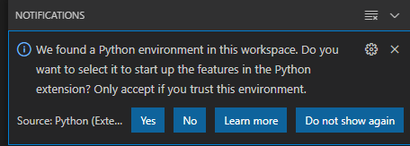

==&gt; It seems VSCode "automatically" executes "Activate" in the configured Python Environment before running a python script the first time (here a test.py file I wrote)

> 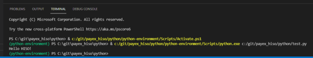

==&gt; It seems I can configure the VSCode interpreter from within VSCode by using the Command Palette "Python: Select Interpreter"?

> 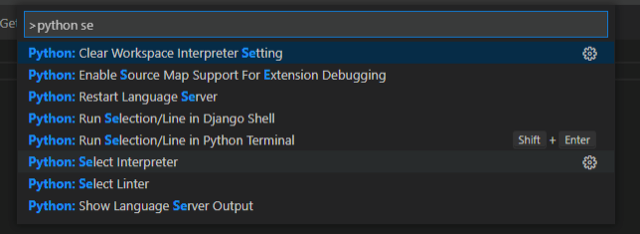

3) It seems I can configure VSCode to start from command line from the command palette in VSCode?

==&gt; Use &lt;View&gt; / &lt;Command Palette&gt; or (windows) Ctrl + Shift + P

> 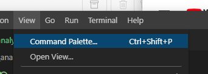

==&gt; But confusingly enough VSCode does NOT list the local environment interpreter?

> 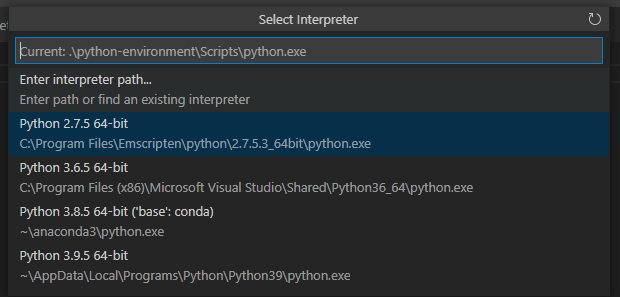

==&gt; It seems we can check the settings in "Workspace Settings"

> 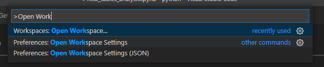

==&gt; And click the "Open Settings (JSON)" in the right upper corner

> 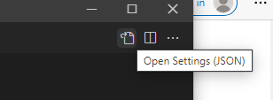

==&gt; And confusingly enough I have NO setting for the Python virtual environment?

> 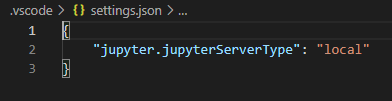

==&gt; I tried to add the setting for the python environment path but when I restarted VSCode it told me it had removed it (no longer used)

> 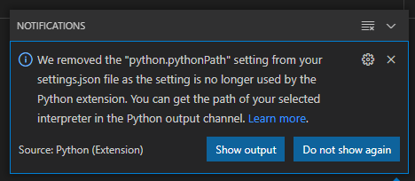

==&gt; Clicking on the link got me to the GitHub repository where they explained I should use "Python: Select Interpreter" (<https://github.com/microsoft/vscode-python/wiki/AB-Experiments> )?

> ## DeprecatePythonPath

> Hi👋 If you're one of the random people chosen in this experiment, this page is for you. We encourage you to provide feedback.

> ## <https://github.com/microsoft/vscode-python/wiki/AB-Experiments#tldr>TL;DR

> In short,

- `python.pythonPath` setting is being removed from all 3 scopes - User, workspace, workspace folder.
- A new *user* setting `python.defaultInterpreterPath` is introduced which is meant as a replacement for `python.pythonPath` in user scope, but not in workspace scope.
- A VSCode internal storage is introduced which will now store the interpreter settings in the workspace & workspace folder scope. i.e workspace settings are no longer stored in `settings.json`/`.code-workspace`, but an internal storage.
  - You can change the value stored in workspace settings using `Python: Select Interpreter` command.
  - See the Python output channel to check the value of the interpreter selected.
  - You can clear the value stored using `Python: Clear Workspace Interpreter Setting` command.

> *Note this means that you'll no longer be able to share or commit the workspace interpreter setting (formerly known as `python.pythonPath` setting). Please look at the [FAQ](https://github.com/microsoft/vscode-python/wiki/AB-Experiments#faq) on how to opt out of this experiment if you need to.*


==&gt; \*\*SIGH\*\* I seem to have been randomly selected to participate in an experiment where they have removed the previous Python Path mechanism?

4) It seems I can install the Jupyter kernel into the Python Virtual Environment (activate virtual environment + pip install...?

==&gt; Also see "Using jupyter notebooks with a virtual environment" (<https://anbasile.github.io/posts/2017-06-25-jupyter-venv/> )?

> PS C:\\git\\payex_hiso\\python&gt; .\\python-environment\\Scripts\\**activate**  
> (python-environment) PS C:\\git\\payex_hiso\\python&gt; **py -m pip install ipykernel**  
> Collecting ipykernel  
> Using cached ipykernel-5.5.4-py3-none-any.whl (120 kB)  
> Collecting ipython&gt;=5.0.0  
> Using cached ipython-7.23.1-py3-none-any.whl (785 kB)  
> Collecting traitlets&gt;=4.1.0  
> Using cached traitlets-5.0.5-py3-none-any.whl (100 kB)  
> Collecting tornado&gt;=4.2  
> Using cached tornado-6.1-cp39-cp39-win_amd64.whl (422 kB)  
> Collecting jupyter-client  
> Using cached jupyter_client-6.1.12-py3-none-any.whl (112 kB)  
> Requirement already satisfied: setuptools&gt;=18.5 in c:\\git\\payex_hiso\\python\\python-environment\\lib\\site-packages (from ipython&gt;=5.0.0-&gt;ipykernel) (56.0.0)  
> Collecting prompt-toolkit!=3.0.0,!=3.0.1,&lt;3.1.0,&gt;=2.0.0  
> Using cached prompt_toolkit-3.0.18-py3-none-any.whl (367 kB)  
> Collecting pygments  
> Using cached Pygments-2.9.0-py3-none-any.whl (1.0 MB)  
> Collecting colorama  
> Using cached colorama-0.4.4-py2.py3-none-any.whl (16 kB)  
> Collecting pickleshare  
> Using cached pickleshare-0.7.5-py2.py3-none-any.whl (6.9 kB)  
> Collecting backcall  
> Using cached backcall-0.2.0-py2.py3-none-any.whl (11 kB)  
> Collecting matplotlib-inline  
> Using cached matplotlib_inline-0.1.2-py3-none-any.whl (8.2 kB)  
> Collecting decorator  
> Using cached decorator-5.0.7-py3-none-any.whl (8.8 kB)  
> Collecting jedi&gt;=0.16  
> Using cached jedi-0.18.0-py2.py3-none-any.whl (1.4 MB)  
> Collecting parso&lt;0.9.0,&gt;=0.8.0  
> Using cached parso-0.8.2-py2.py3-none-any.whl (94 kB)  
> Collecting wcwidth  
> Using cached wcwidth-0.2.5-py2.py3-none-any.whl (30 kB)  
> Collecting ipython-genutils  
> Using cached ipython_genutils-0.2.0-py2.py3-none-any.whl (26 kB)  
> Collecting pyzmq&gt;=13  
> Using cached pyzmq-22.0.3-cp39-cp39-win_amd64.whl (1.2 MB)  
> Collecting jupyter-core&gt;=4.6.0  
> Using cached jupyter_core-4.7.1-py3-none-any.whl (82 kB)  
> Collecting python-dateutil&gt;=2.1  
> Using cached python_dateutil-2.8.1-py2.py3-none-any.whl (227 kB)  
> Collecting pywin32&gt;=1.0  
> Using cached pywin32-300-cp39-cp39-win_amd64.whl (9.2 MB)  
> Collecting six&gt;=1.5  
> Using cached six-1.16.0-py2.py3-none-any.whl (11 kB)  
> Installing collected packages: ipython-genutils, wcwidth, traitlets, six, pywin32, parso, tornado, pyzmq, python-dateutil, pygments, prompt-toolkit, pickleshare, matplotlib-inline, jupyter-core, jedi, decorator, colorama, backcall, jupyter-client, ipython, ipykernel  
> Successfully installed backcall-0.2.0 colorama-0.4.4 decorator-5.0.7 ipykernel-5.5.4 ipython-7.23.1 ipython-genutils-0.2.0 jedi-0.18.0 jupyter-client-6.1.12 jupyter-core-4.7.1 matplotlib-inline-0.1.2 parso-0.8.2 pickleshare-0.7.5 prompt-toolkit-3.0.18 pygments-2.9.0 python-dateutil-2.8.1 pywin32-300 pyzmq-22.0.3 six-1.16.0 tornado-6.1 traitlets-5.0.5 wcwidth-0.2.5  
> (python-environment) PS C:\\git\\payex_hiso\\python&gt;

==&gt; Now, when I configure VSCode to use the Jupyter kerner in my virtual environment it asks me to install "something" and does something I do not really understand?

==&gt; It seems to first run the activate script to activate the python virtual environment?

> PS C:\\git\\payex_hiso\\python&gt; & C:/git/payex_hiso/python/python-environment/Scripts/Activate.ps1

==&gt; It seems to then run the python interpreter in the virtual environment to install "something" (**pip install -U notebook**)?

==&gt; See "notebook 6.3.0" (<https://pypi.org/project/notebook/> )?

> (python-environment) PS C:\\git\\payex_hiso\\python&gt; & C:/git/payex_hiso/python/**python-environment/Scripts/python.exe** c:\\Users\\kjell-olovhogdahl\\.vscode\\extensions\\ms-python.python-2021.5.829140558\\pythonFiles\\pyvsc-run-isolated.py c:\\Users\\kjell-olovhogdahl\\.vscode\\extensions\\ms-python.python-2021.5.829140558\\pythonFiles\\shell_exec.py C:/git/payex_hiso/python/python-environment/Scripts/python.exe c:\\Users\\kjell-olovhogdahl\\.vscode\\extensions\\ms-python.python-2021.5.829140558\\pythonFiles\\pyvsc-run-isolated.py **pip install -U notebook** C:/Users/KJELL-~1/AppData/Local/Temp/tmp-7688hpOaoAszloTL.log

==&gt; The console output seems to indicate what it is doing?

> Executing command in shell &gt;&gt; C:/git/payex_hiso/python/**python-environment/Scripts/python.exe** c:\\Users\\kjell-olovhogdahl\\.vscode\\extensions\\ms-python.python-2021.5.829140558\\pythonFiles\\pyvsc-run-isolated.py pip install -U  
> notebook  
> Collecting notebook  
> Downloading notebook-6.3.0-py3-none-any.whl (9.5 MB)  
> |████████████████████████████████| 9.5 MB 2.2 MB/s  
> Requirement already satisfied: ipython-genutils in c:\\git\\payex_hiso\\python\\python-environment\\lib\\site-packages (from notebook) (0.2.0)  
> Collecting terminado&gt;=0.8.3  
> Downloading terminado-0.9.5-py3-none-any.whl (14 kB)  
> Requirement already satisfied: jupyter-core&gt;=4.6.1 in c:\\git\\payex_hiso\\python\\python-environment\\lib\\site-packages (from notebook) (4.7.1)  
> Collecting nbconvert  
> Downloading nbconvert-6.0.7-py3-none-any.whl (552 kB)  
> |████████████████████████████████| 552 kB 3.3 MB/s  
> Requirement already satisfied: ipykernel in c:\\git\\payex_hiso\\python\\python-environment\\lib\\site-packages (from notebook) (5.5.4)  
> Collecting prometheus-client  
> Downloading prometheus_client-0.10.1-py2.py3-none-any.whl (55 kB)  
> |████████████████████████████████| 55 kB 4.1 MB/s  
> Requirement already satisfied: jupyter-client&gt;=5.3.4 in c:\\git\\payex_hiso\\python\\python-environment\\lib\\site-packages (from notebook) (6.1.12)  
> Collecting jinja2  
> Downloading Jinja2-3.0.0-py3-none-any.whl (133 kB)  
> |████████████████████████████████| 133 kB 3.3 MB/s  
> Requirement already satisfied: traitlets&gt;=4.2.1 in c:\\git\\payex_hiso\\python\\python-environment\\lib\\site-packages (from notebook) (5.0.5)  
> Collecting nbformat  
> Downloading nbformat-5.1.3-py3-none-any.whl (178 kB)  
> |████████████████████████████████| 178 kB 2.2 MB/s  
> Requirement already satisfied: tornado&gt;=6.1 in c:\\git\\payex_hiso\\python\\python-environment\\lib\\site-packages (from notebook) (6.1)  
> Requirement already satisfied: pyzmq&gt;=17 in c:\\git\\payex_hiso\\python\\python-environment\\lib\\site-packages (from notebook) (22.0.3)  
> Collecting Send2Trash&gt;=1.5.0  
> Downloading Send2Trash-1.5.0-py3-none-any.whl (12 kB)  
> Collecting argon2-cffi  
> Downloading argon2_cffi-20.1.0-cp39-cp39-win_amd64.whl (42 kB)  
> |████████████████████████████████| 42 kB 379 kB/s  
> Requirement already satisfied: python-dateutil&gt;=2.1 in c:\\git\\payex_hiso\\python\\python-environment\\lib\\site-packages (from jupyter-client&gt;=5.3.4-&gt;notebook) (2.8.1)  
> Requirement already satisfied: pywin32&gt;=1.0 in c:\\git\\payex_hiso\\python\\python-environment\\lib\\site-packages (from jupyter-core&gt;=4.6.1-&gt;notebook) (300)  
> Requirement already satisfied: six&gt;=1.5 in c:\\git\\payex_hiso\\python\\python-environment\\lib\\site-packages (from python-dateutil&gt;=2.1-&gt;jupyter-client&gt;=5.3.4-&gt;notebook) (1.16.0)  
> Collecting pywinpty&lt;1,&gt;=0.5  
> Downloading pywinpty-0.5.7.tar.gz (49 kB)  
> |████████████████████████████████| 49 kB 3.2 MB/s  
> Collecting cffi&gt;=1.0.0  
> Downloading cffi-1.14.5-cp39-cp39-win_amd64.whl (179 kB)  
> |████████████████████████████████| 179 kB 3.3 MB/s  
> Collecting pycparser  
> Downloading pycparser-2.20-py2.py3-none-any.whl (112 kB)  
> |████████████████████████████████| 112 kB 3.3 MB/s  
> Requirement already satisfied: ipython&gt;=5.0.0 in c:\\git\\payex_hiso\\python\\python-environment\\lib\\site-packages (from ipykernel-&gt;notebook) (7.23.1)  
> Requirement already satisfied: decorator in c:\\git\\payex_hiso\\python\\python-environment\\lib\\site-packages (from ipython&gt;=5.0.0-&gt;ipykernel-&gt;notebook) (5.0.7)  
> Requirement already satisfied: pygments in c:\\git\\payex_hiso\\python\\python-environment\\lib\\site-packages (from ipython&gt;=5.0.0-&gt;ipykernel-&gt;notebook) (2.9.0)  
> Requirement already satisfied: matplotlib-inline in c:\\git\\payex_hiso\\python\\python-environment\\lib\\site-packages (from ipython&gt;=5.0.0-&gt;ipykernel-&gt;notebook) (0.1.2)  
> Requirement already satisfied: prompt-toolkit!=3.0.0,!=3.0.1,&lt;3.1.0,&gt;=2.0.0 in c:\\git\\payex_hiso\\python\\python-environment\\lib\\site-packages (from ipython&gt;=5.0.0-&gt;ipykernel-&gt;notebook) (3.0.18)  
> Requirement already satisfied: jedi&gt;=0.16 in c:\\git\\payex_hiso\\python\\python-environment\\lib\\site-packages (from ipython&gt;=5.0.0-&gt;ipykernel-&gt;notebook) (0.18.0)  
> Requirement already satisfied: colorama in c:\\git\\payex_hiso\\python\\python-environment\\lib\\site-packages (from ipython&gt;=5.0.0-&gt;ipykernel-&gt;notebook) (0.4.4)  
> Requirement already satisfied: pickleshare in c:\\git\\payex_hiso\\python\\python-environment\\lib\\site-packages (from ipython&gt;=5.0.0-&gt;ipykernel-&gt;notebook) (0.7.5)  
> Requirement already satisfied: setuptools&gt;=18.5 in c:\\git\\payex_hiso\\python\\python-environment\\lib\\site-packages (from ipython&gt;=5.0.0-&gt;ipykernel-&gt;notebook) (56.0.0)  
> Requirement already satisfied: backcall in c:\\git\\payex_hiso\\python\\python-environment\\lib\\site-packages (from ipython&gt;=5.0.0-&gt;ipykernel-&gt;notebook) (0.2.0)  
> Requirement already satisfied: parso&lt;0.9.0,&gt;=0.8.0 in c:\\git\\payex_hiso\\python\\python-environment\\lib\\site-packages (from jedi&gt;=0.16-&gt;ipython&gt;=5.0.0-&gt;ipykernel-&gt;notebook) (0.8.2)  
> Requirement already satisfied: wcwidth in c:\\git\\payex_hiso\\python\\python-environment\\lib\\site-packages (from prompt-toolkit!=3.0.0,!=3.0.1,&lt;3.1.0,&gt;=2.0.0-&gt;ipython&gt;=5.0.0-&gt;ipykernel-&gt;notebook) (0.2.5)  
> Collecting MarkupSafe&gt;=2.0.0rc2  
> Downloading MarkupSafe-2.0.0-cp39-cp39-win_amd64.whl (14 kB)  
> Collecting nbclient&lt;0.6.0,&gt;=0.5.0  
> Downloading nbclient-0.5.3-py3-none-any.whl (82 kB)  
> |████████████████████████████████| 82 kB 2.9 MB/s  
> Collecting bleach  
> Downloading bleach-3.3.0-py2.py3-none-any.whl (283 kB)  
> |████████████████████████████████| 283 kB 3.2 MB/s  
> Collecting pandocfilters&gt;=1.4.1  
> Downloading pandocfilters-1.4.3.tar.gz (16 kB)  
> Collecting testpath  
> Downloading testpath-0.4.4-py2.py3-none-any.whl (163 kB)  
> |████████████████████████████████| 163 kB 3.3 MB/s  
> Collecting defusedxml  
> Downloading defusedxml-0.7.1-py2.py3-none-any.whl (25 kB)  
> Collecting jupyterlab-pygments  
> Downloading jupyterlab_pygments-0.1.2-py2.py3-none-any.whl (4.6 kB)  
> Collecting mistune&lt;2,&gt;=0.8.1  
> Downloading mistune-0.8.4-py2.py3-none-any.whl (16 kB)  
> Collecting entrypoints&gt;=0.2.2  
> Downloading entrypoints-0.3-py2.py3-none-any.whl (11 kB)  
> Collecting async-generator  
> Downloading async_generator-1.10-py3-none-any.whl (18 kB)  
> Collecting nest-asyncio  
> Downloading nest_asyncio-1.5.1-py3-none-any.whl (5.0 kB)  
> Collecting jsonschema!=2.5.0,&gt;=2.4  
> Downloading jsonschema-3.2.0-py2.py3-none-any.whl (56 kB)  
> |████████████████████████████████| 56 kB 4.1 MB/s  
> Collecting attrs&gt;=17.4.0  
> Downloading attrs-21.2.0-py2.py3-none-any.whl (53 kB)  
> |████████████████████████████████| 53 kB 4.1 MB/s  
> Collecting pyrsistent&gt;=0.14.0  
> Downloading pyrsistent-0.17.3.tar.gz (106 kB)  
> |████████████████████████████████| 106 kB 3.2 MB/s  
> Collecting packaging  
> Downloading packaging-20.9-py2.py3-none-any.whl (40 kB)  
> |████████████████████████████████| 40 kB 2.6 MB/s  
> Collecting webencodings  
> Downloading webencodings-0.5.1-py2.py3-none-any.whl (11 kB)  
> Collecting pyparsing&gt;=2.0.2  
> Downloading pyparsing-2.4.7-py2.py3-none-any.whl (67 kB)  
> |████████████████████████████████| 67 kB 4.8 MB/s  
> Using legacy 'setup.py install' for pywinpty, since package 'wheel' is not installed.  
> Using legacy 'setup.py install' for pandocfilters, since package 'wheel' is not installed.  
> Using legacy 'setup.py install' for pyrsistent, since package 'wheel' is not installed.  
> Installing collected packages: pyrsistent, attrs, pyparsing, jsonschema, webencodings, pycparser, packaging, nest-asyncio, nbformat, MarkupSafe, async-generator, testpath, pywinpty, pandocfilters, nbclient, mistune, jupyterlab-pygments, jinja2, entrypoints, defusedxml, cffi, bleach, terminado, Send2Trash, prometheus-client, nbconvert, argon2-cffi, notebook  
> Running setup.py install for pyrsistent ... done  
> Running setup.py install for pywinpty ... done  
> Running setup.py install for pandocfilters ... done  
> Successfully installed MarkupSafe-2.0.0 Send2Trash-1.5.0 argon2-cffi-20.1.0 async-generator-1.10 attrs-21.2.0 bleach-3.3.0 cffi-1.14.5 defusedxml-0.7.1 entrypoints-0.3 jinja2-3.0.0 jsonschema-3.2.0 jupyterlab-pygments-0.1.2 mistune-0.8.4 nbclient-0.5.3 nbconvert-6.0.7 nbformat-5.1.3 nest-asyncio-1.5.1 notebook-6.3.0 packaging-20.9 pandocfilters-1.4.3 prometheus-client-0.10.1 pycparser-2.20 pyparsing-2.4.7 pyrsistent-0.17.3 pywinpty-0.5.7 terminado-0.9.5 testpath-0.4.4 webencodings-0.5.1  
> (python-environment) PS C:\\git\\payex_hiso\\python&gt;

==&gt; It seems I can now select the "interpreter" in my virtual environment as the Jupyter interpreter?

> 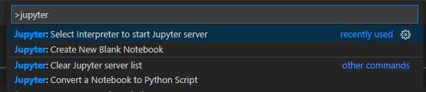

> 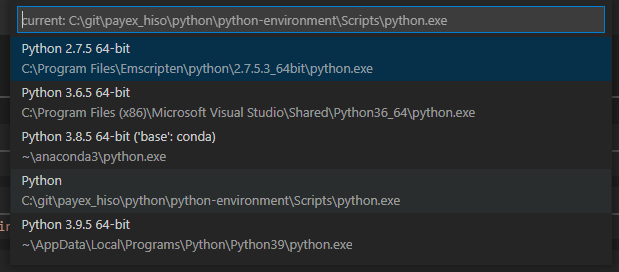

==&gt; VSCode seems to have restarted the jupyter server and also asks me to reload the "page" (and now it seems jupyter uses the "kernel" (python interpreter) in my virtual environment)?

> 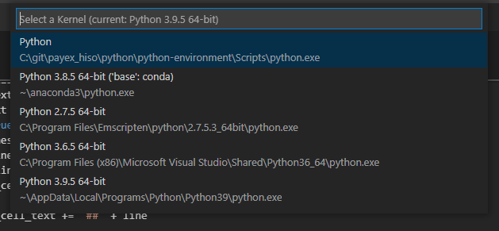

5) It seems in Powershell I use $env:Path -split ';' to inspect the PATH environment variable?

> (python-environment) PS C:\\git\\payex_hiso\\python&gt; $env:Path -split ';'  
> C:\\git\\payex_hiso\\python\\python-environment\\Scripts  
> C:\\Program Files (x86)\\Parallels\\Parallels Tools\\Applications  
> C:\\Program Files (x86)\\Embarcadero\\Studio\\20.0\\bin  
> C:\\Users\\Public\\Documents\\Embarcadero\\Studio\\20.0\\Bpl  
> C:\\Program Files (x86)\\Embarcadero\\Studio\\20.0\\bin64  
> C:\\Users\\Public\\Documents\\Embarcadero\\Studio\\20.0\\Bpl\\Win64  
> C:\\Program Files (x86)\\Embarcadero\\Studio\\19.0\\bin  
> C:\\Users\\Public\\Documents\\Embarcadero\\Studio\\19.0\\Bpl  
> C:\\Program Files (x86)\\Embarcadero\\Studio\\19.0\\bin64  
> C:\\Users\\Public\\Documents\\Embarcadero\\Studio\\19.0\\Bpl\\Win64  
> C:\\Program Files (x86)\\Embarcadero\\Studio\\18.0\\bin  
> C:\\Users\\Public\\Documents\\Embarcadero\\Studio\\18.0\\Bpl  
> C:\\Program Files (x86)\\Embarcadero\\Studio\\18.0\\bin64  
> C:\\Users\\Public\\Documents\\Embarcadero\\Studio\\18.0\\Bpl\\Win64  
> C:\\Program Files (x86)\\CollabNet  
> C:\\Program Files\\LLVM\\bin  
> C:\\ProgramData\\Oracle\\Java\\javapath  
> C:\\WINDOWS\\system32  
> C:\\WINDOWS  
> C:\\WINDOWS\\System32\\Wbem  
> C:\\WINDOWS\\System32\\WindowsPowerShell\\v1.0\\  
> C:\\Program Files (x86)\\Windows Kits\\10\\Windows Performance Toolkit\\  
> C:\\Program Files (x86)\\Embarcadero\\HTML5 Builder\\6.0\\apache-ant-1.8.2\\bin  
> C:\\Users\\kjell-olovhogdahl\\.dnx\\bin  
> C:\\Program Files\\Microsoft DNX\\Dnvm\\  
> C:\\Program Files\\Microsoft SQL Server\\120\\Tools\\Binn\\  
> C:\\TDM-GCC-64\\bin  
> C:\\Program Files\\Microsoft SQL Server\\130\\Tools\\Binn\\  
> C:\\Program Files\\Emscripten\\emscripten\\1.35.0  
> C:\\Program Files\\Emscripten  
> C:\\Program Files\\Emscripten\\clang\\e1.35.0_64bit  
> C:\\Program Files\\Emscripten\\node\\0.12.2_64bit  
> C:\\Program Files\\Emscripten\\python\\2.7.5.3_64bit  
> C:\\Program Files\\Emscripten\\java\\7.45_64bit\\bin  
> C:\\Program Files\\Emscripten\\crunch\\1.03  
> C:\\Program Files\\Emscripten\\mingw\\4.6.2_32bit  
> C:\\Program Files\\nodejs\\  
> C:\\Program Files\\SafeNet\\Authentication\\SAC\\x64  
> C:\\Program Files\\SafeNet\\Authentication\\SAC\\x32  
> C:\\Program Files\\CMake\\bin  
> C:\\Program Files\\dotnet\\  
> C:\\Program Files\\Git\\cmd  
> C:\\WINDOWS\\System32\\OpenSSH\\  
> C:\\Program Files\\TortoiseSVN\\bin  
> C:\\Program Files\\TortoiseGit\\bin  
> C:\\ProgramData\\chocolatey\\bin  
> C:\\Users\\kjell-olovhogdahl\\AppData\\Roaming\\npm  
> C:\\Program Files (x86)\\Microsoft VS Code\\bin  
> C:\\Users\\kjell-olovhogdahl\\AppData\\Local\\Microsoft\\WindowsApps  
> C:\\Program Files\\OpenSSL\\bin  
> C:\\Users\\kjell-olovhogdahl\\AppData\\Local\\Programs\\Microsoft VS Code\\bin  
> (python-environment) PS C:\\git\\payex_hiso\\python&gt;

6) It seems I have to remove an older path to VS Cade in my PATH environment variable?

==&gt; Hard to find but I used Windows 10 &lt;Settings&gt; and entered "PATH" into the search dialog and clicked "Edit the system environment variables"

> 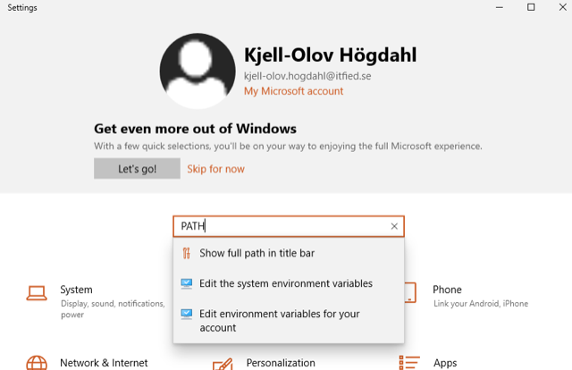

> 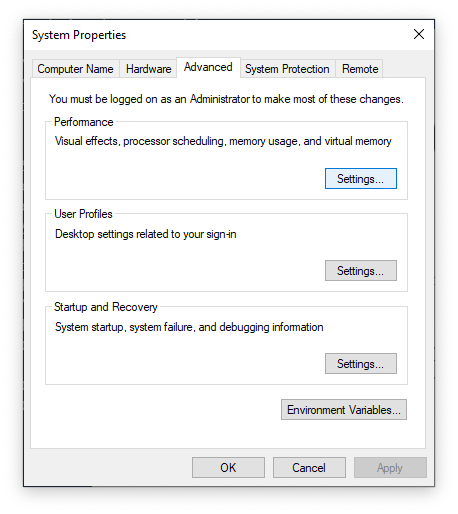

==&gt; I clicked "Environment Variables" and selected "Path" in "User variables" (NOT System variables) in the dialog

> 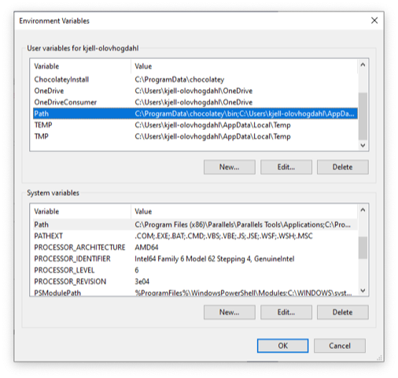

==&gt; I deleted the entry "C:\\Program Files (x86)\\Microsoft VS Code\\bin" (Which seems to override the later "C:\\Users\\kjell-olovhogdahl\\AppData\\Local\\Programs\\Microsoft VS Code\\bin"

> 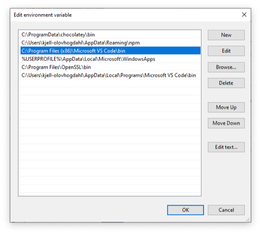

==&gt; I reopened the PowerShell Windows and now it seems I can start VSCode from the command line ok?

7) It seems I can open a PowerShell from the File Explorer by clicking &lt;File&gt; / &lt;Open Windows PowerShell&gt;

> 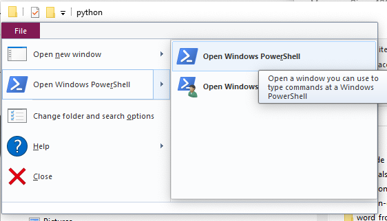

...


