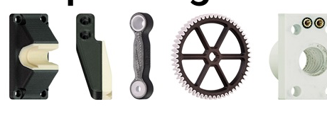
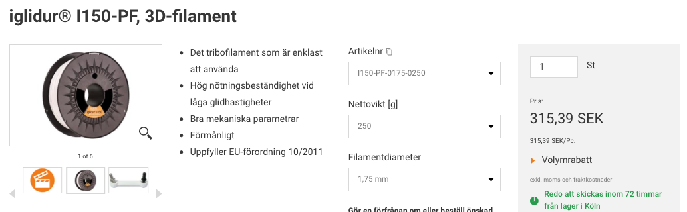
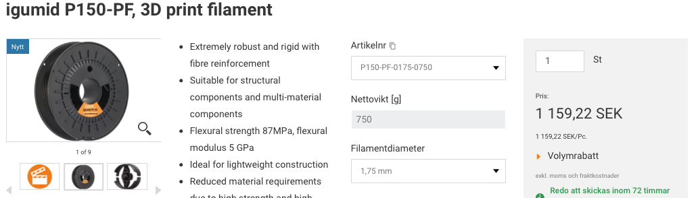
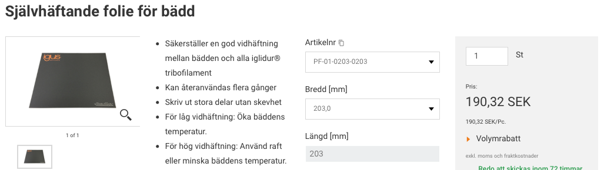
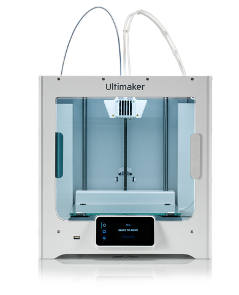

# Todo: Consider what I can 3D print with Igus polymer filaments like high strength igumid P150-PF and Iglidur low friction series?

```#aa0384b7``` *As of 2021-08-07 14:58*

[mail plain/text](mail.txt)


0) Consider some ideas of what I can 3D print in Igus polymer plastic?

- Consider a custom Pinion grip gear shifter (an MTB handlebar)?
- Consider front fork shock absorber bushings?

1) Consider the youtube video "Multimaterial-3D-Printing for intelligent or extreme rigid parts" (<https://youtu.be/HP4RBUg6bFk> )?


2) Consider Igus article "3D printing with several filaments" (<https://www.igus.eu/info/multiple-component-3d-printing> )?

> 

3) Consider the Igus article "Design tips: multi-material parts from the 3D printer" (<https://blog.igus.eu/design-tips-multi-material-parts-from-the-3d-printer/> )?

==&gt; It seems Cura has support for multi-material slicing?

> *"**For the design the Autodesk Inventor is used, a new-generation Ultimaker as a 3D printer with two material nozzles and the matching slicer software Cura in its latest version.**"*

4) It seems rs-online sells Igus 3D Print filaments (<https://se.rs-online.com/web/c/computing-peripherals/3d-printing-scanning/3d-printing-materials/?applied-dimensions=4294966006> )?

==&gt; Consider the entry price Iglidur I150-PF (<https://www.igusab.se/product/12404?artNr=I150-PF-0175-0250> )?

> 

==&gt; Consider the robust and rigid Igimud P150-PF (<https://www.igusab.se/product/20469?artNr=P150-PF-0175-0750> )?

> 

==&gt; Consider the self adhesive reusable Bed Mat to have Igus filaments stick to the bed (<https://www.igusab.se/product/12406?artNr=PF-01-0203-0203> )?

> 

5) It seems Igus has a Swedish web shop that sells Igus 3D Filaments (<https://www.igusab.se/3d-print-material/3d-print-material> )?

6) Consider the Ultimaker S3 for dual extrusion 3D Printing (<https://ultimaker.com/3d-printers/ultimaker-s3> )?

> 

...


