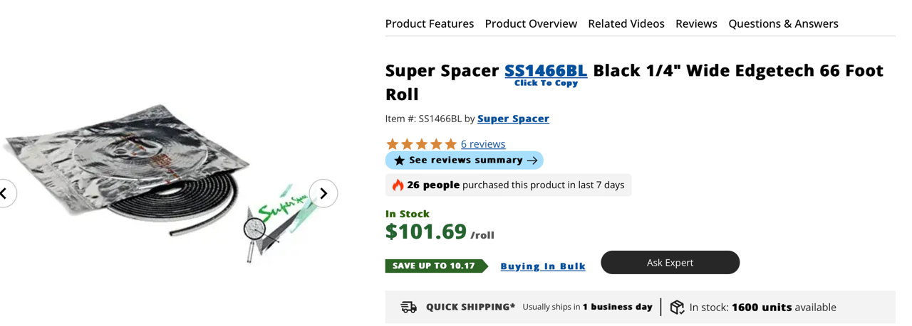
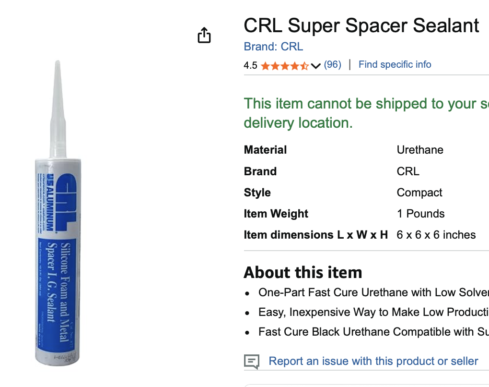
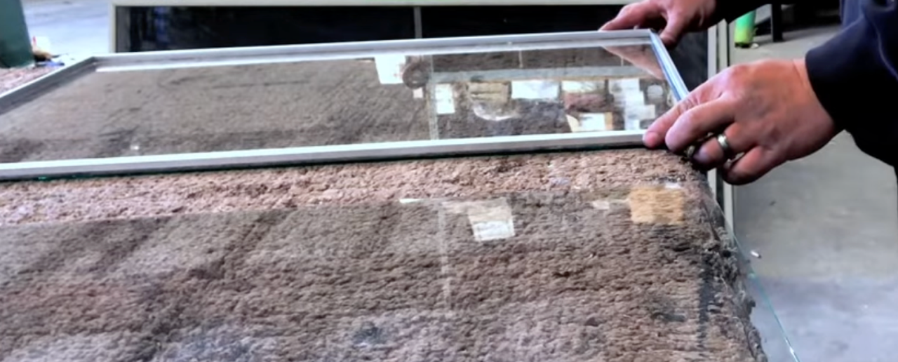
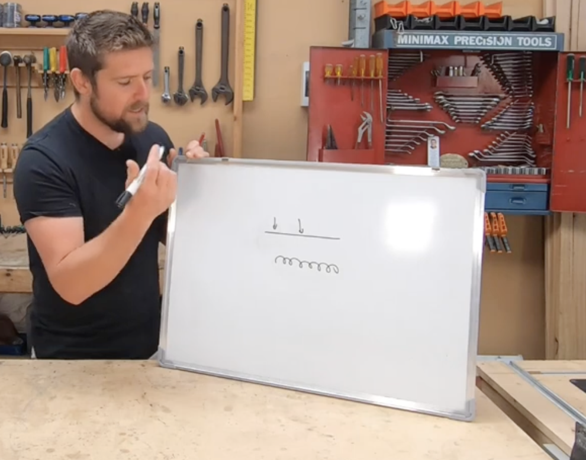
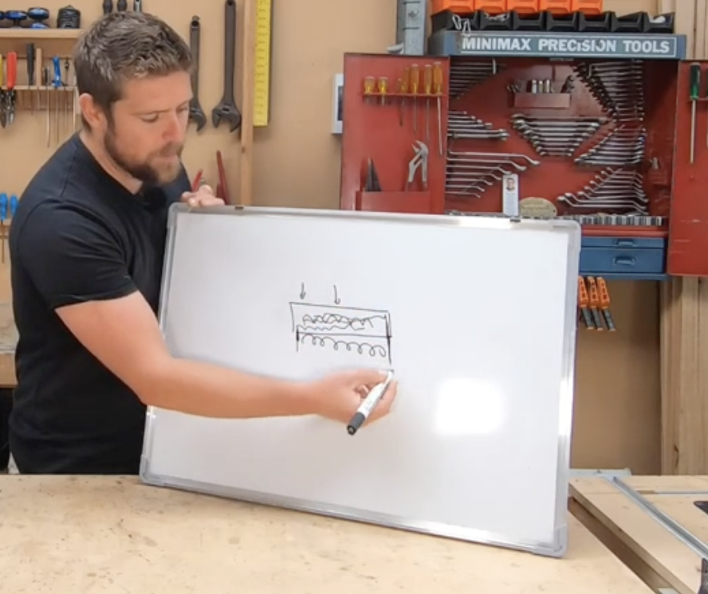
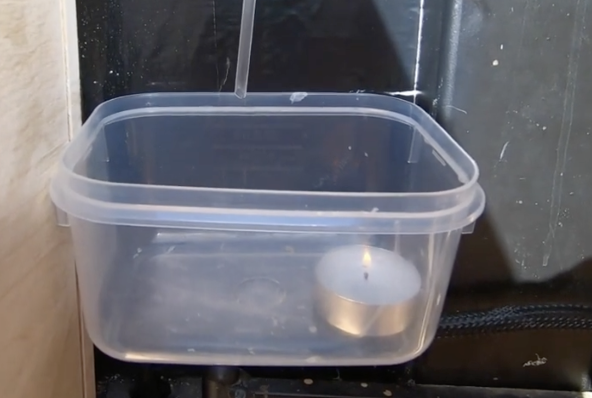
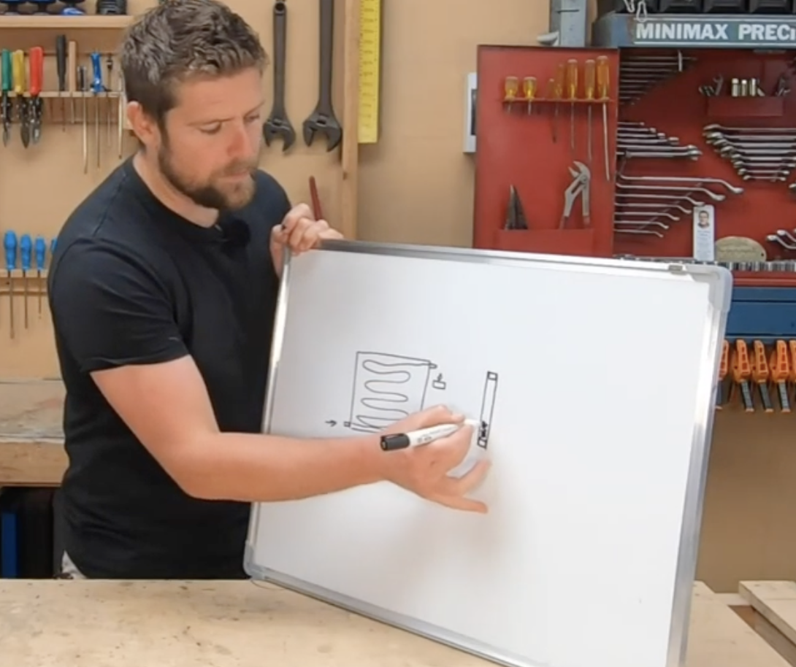

# Todo: Consider to DIY dubber isolated glass panes (windows)?

```#aa600ba5``` *As of 2025-10-31 15:19*

[mail plain/text](mail.txt)


I want to build my house to be cost effective, low maintenance and easy to repair.

1) Consider til youtube video "DIY Double Insulated Glass || Save Money &#91;How To&#93;" (https://youtu.be/DXcnbdHcrps )?

==&gt; Consider the show notes and links to used products?

> Safe a lot of money and make your own double insulated glass.

> Channel of a guy doing this same thing but with aluminum frames :  
> [  / @alexrubioonyoutube ](https://www.youtube.com/channel/UCUyylv1c2Dj84g2bFLJhrUw)

> Video of making these with Aluminum :  
> [  • Making an insulated unit (full process)or ... ](https://www.youtube.com/watch?v=09h_-3E_2Xo)

> Super Spacer Roll :  
> [https://www.dkhardware.com/black-1-4-...](https://www.youtube.com/redirect?event=video_description&redir_token=QUFFLUhqbmo0SkM3dEs0clZmcC1lbjJnMDZiVGZOZ0dld3xBQ3Jtc0tuZnJZbVdNcWd5WDBiY1FvNW01cFg3TGNvWDJkbENsTTJ5bUJVaVJKdkIyTUVodW9YUk03X19yYXNuLVNXVEF5MFVzM09rSkZGdTU3bk81YzF3UFAyMV90OUx0ZWNmeFJzYzV2YTRkLUpDbDNMa2VLbw&q=https%3A%2F%2Fwww.dkhardware.com%2Fblack-1-4-wide-edgetech-super-spacer-66-foot-roll-ss1466bl-product-7941.html&v=DXcnbdHcrps)

> CRL Super Spacer Sealant :  
> [https://www.amazon.com/dp/B006JFKTUQ?...](https://www.youtube.com/redirect?event=video_description&redir_token=QUFFLUhqazlKdWFVYVJ5Q3VFNXJScV8yejRQSk5jTjFwd3xBQ3Jtc0tsVWp0YVhDb0s2T2ZnQTJPb05GZUpMTUl2UmRlaHNRMDJDbllVUDB4dXBPNENsS0JQd2gyd25oR2NmRnJ4emlUa1pYdTNRc0ZyNWNlV1ZHQUhSckktZ3ZDQ1RpMWV2SWQ2NW5vWC1GTUo5RDR6dEU5Zw&q=https%3A%2F%2Fwww.amazon.com%2Fdp%2FB006JFKTUQ%3Fpsc%3D1%26ref%3Dppx_yo2ov_dt_b_product_details&v=DXcnbdHcrps)

==&gt; It seems she made her gigs based on reverse engineering gigs you can buy?

2) Consider the "super spacer" with silica gel that goes as spacer between the glass (https://www.dkhardware.com/black-1-4-wide-edgetech-super-spacer-66-foot-roll-ss1466bl-product-7941.html )?



3) Consider the "CRL Super spacer sealant" (https://www.amazon.com/dp/B006JFKTUQ?psc=1&ref=ppx_yo2ov_dt_b_product_details )?



4) Consider the youtube video "Making an insulated unit (full process)or double pane window" (https://www.youtube.com/watch?v=09h_-3E_2Xo )?



5) Consider youtube video "https://www.youtube.com/watch?v=-jPKoi5Ff0Y" (https://www.youtube.com/watch?v=-jPKoi5Ff0Y )?

==&gt; Consider how he talks about condensation of warm air on cold glass?



(https://youtu.be/-jPKoi5Ff0Y?t=149 )

==&gt; Consider at around 3:43 how he talks about filling inert gas heavier than air from the bottom op?



(https://youtu.be/-jPKoi5Ff0Y?t=223 )

==&gt; Consider at around 5:50 how he fills the space between the glass with Argon and pipes the outlet to a candle to see it go out when Argon comes out?



==&gt; COnsider at around 6:37 he sugests filling the space with the window vertically to really fill it properly?



(https://youtu.be/-jPKoi5Ff0Y?t=397 )

...


