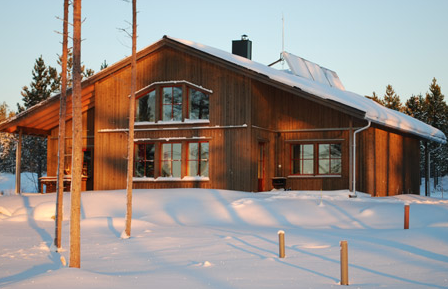

# Todo: Own house build - Consider to study the house "Villa Falk" in "MåBraByn" in Robertsfors municipality?

```#aa825f71``` *As of 2019-10-08 21:49*

[mail plain/text](mail.txt)


I need more information to decide if I want to build and move to MåBraByn in Robertfors municipality.

==&gt; Also see "Todo: House Build - Consider the Umeå municipal initiative "Energieffektivt byggande i kallt klimat"

1) Consider this article on "Villa Falk" (<https://www.umea.se/umeakommun/byggaboochmiljo/energiochuppvarmning/projektochnatverk/energieffektivtbyggandeikalltklimat/villafalk.4.774fe05812efd4e09598000821.html> )?

==&gt; Abstract: It seems this house is NOT self sufficient in energy consumption?

>   
> *The 175 square meters house "Villa Falk" in Robertsfors*

==&gt; It seems the sewage is semi-circular with dry compostable "bags" for faeces and a tank for urine?

> *"Avloppslösningen är Separett toalett där fekalier förvaras i påsar (av majsstärkelse) som sedan komposteras och återförs till tomten/naturen. Urin förvaras i tank av betong på 2,6 m3. BDT vatten renas med kompaktfilter (infiltration). Fosforfattiga tvätt- och diskmedel ska användas. "*

> *"Trädgården "halva kretsloppet" kommer att anpassas efter det avloppskrav som Kommunen har, så att både urin och fekalier kan användas på tomten i symbios med träd, växter och blommor."*

==&gt; This house seems to be one of few in the whole world that experimentally is isolated with

> *"**Typ a isolering: Plattan, väggarna, taket till bygganden är uppförd med så kallade cellglaselement. Cellglas som även benämns foamglas och består av glas och kol och som är tillverkad som block efter grundens och husets behov. Det finns bara tre hus i Världen i detta material och detta hus är det enda i sitt slag som är isolerad som ett NNE-hus. (NäraNollEnergihus) **"*

==&gt; It seems Villa Falk for two inhabitants annually consume almost 11 MWh for heating and hot water and then 3,3 MWh in household electricity?

> *"Uppmätt energianvändning: 10 700 kWh/år för uppvärmning och tappvarmvatten. Användning av hushållsel uppgår till 3 260 kWh/år."*

==&gt; This house was quite expensive with a build cost of 3,6 MSEK (Around 21 000 SEK per square meter)

> *"Produktionskostnad: Ca 3,6 milj inkl grundarbeten, avloppssystem samt förråd och carport "*

==&gt; If I manage to build a 70 square meter house for 21 000 SEK per square meter my cost would be around 1,5 MSEK?

...


