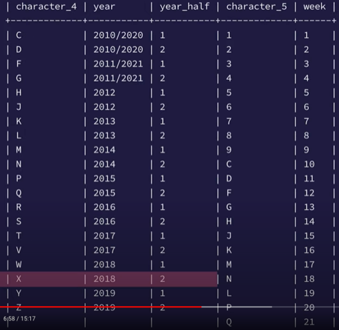
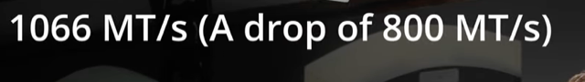
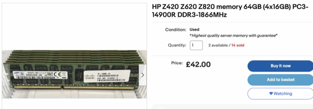
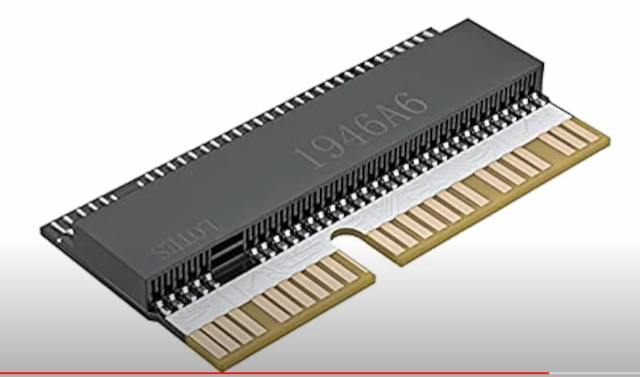
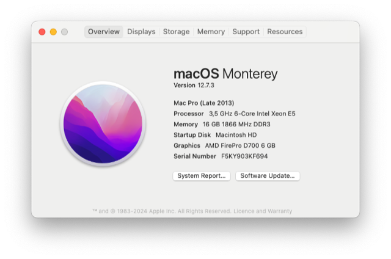
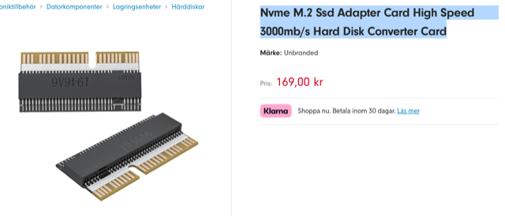
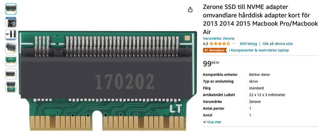
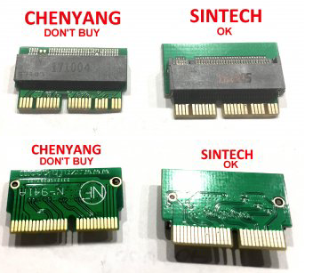
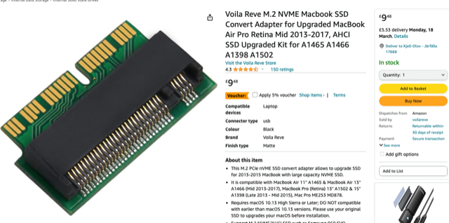
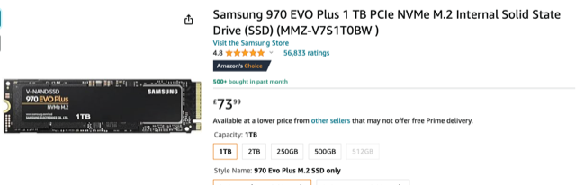

# Todo: Consider the information about how to determine when a Mac Pro 2014 is made and what components can go into it?

```#aaa7b46e``` *As of 2024-03-18 17:21*

[mail plain/text](mail.txt)


I have a mac Pro 2014 "trash can" and like information on how to maintain it.

==&gt; Also see "[Todo: mac Pro 2013 PCIe SSD - Consider the Amfeltec Angleshark Carrier Board to expand existing SSD with two standard M.2 SSD slots?](../64d58572/chime.md)"

==&gt; Also see "[Todo: mac pro 2013 - Consider to understand the DDR3 memory system on the Mac Pro "Trashcan"?](../65d23643/chime.md)"

==&gt; Also see "[Todo: Mac Pro 2013 - Consider to understand the system architecture of the Apple Mac Pro 6.1 "Trashcan"?](../fa664541/chime.md)"

1) Consider youtube video "When was your 2013 Mac Pro actually made?" (<https://youtu.be/jRcxkHIVH60> )?

==&gt; At around 06:58 he seems to show a mapping from fourth and fifth character in serial number to production year and week (<https://youtu.be/jRcxkHIVH60?t=418> )?



<https://youtu.be/jRcxkHIVH60?t=418>

==&gt; At around 8:36 he seems to suggest putting more than 64 GB RAM into Mac Pro 2014 it will throttle the RAM access (<https://youtu.be/jRcxkHIVH60?t=516> )?

> *He seems to suggest that running four 16 GB matched DIMS the mac pro will run the RAM access at 1866 "mega transfers" per second.*

> *Whilst, putting more RAM in will reduce the RAM access to 1066 MHz?*

>   
> <https://youtu.be/jRcxkHIVH60?t=534>

==&gt; At around 10:17 he seems to sugest I can get ECC 1866MHz DDR3 64 GB ram on ebay for less than £50 (<https://youtu.be/jRcxkHIVH60?t=617> )?



==&gt; At around 18:33 he seems to suggest that used memory that has been on 24/7 has the least wear and tear (<https://youtu.be/jRcxkHIVH60?t=638> )?

> *The argument being that turning RAM off and on puts the most stress on the components? I do not know if this makes me buy the conclusion it is better to have the RAM always on though? I mean, we have to weigh the stress for turning on the components against the stress of having them running for a long time?*

==&gt; At around 12:24 he seems to show an image of an SSD nvme adapter usable for putting an nvme SSD drive into the mac Pro proprietary connector (<https://youtu.be/jRcxkHIVH60?t=744> )



<https://youtu.be/jRcxkHIVH60?t=744>

> *It seems the adapter shows an interface with 4 tungs, a space, 6 tungs, 1 cut tung and the slot, then 7 tungs, a space, 4 tungs, a space and finally 3 tungs?*

2) Consider what I can tell about my own Mac Pro 2014?



==&gt; Given that the fourth and fifth characters are 'Y' and '9' should mean it is made 2019 week 9

> *This should basically mean my Mac Pro was made very close to when I ordered it and also - ver close to its end of production?!*

> *This would make my Mac Pro a somewhat rare item :)*

3) Consider the nvme SSD adapter I can find on the web if I would like to put an nvme SSD into my Mac Pro?

==&gt; Consider Frugoo "Nvme M.2 Ssd Adapter Card High Speed 3000mb/s Hard Disk Converter Card" (<https://www.fruugo.se/nvme-m2-ssd-adapterkort-hog-hastighet-3000mb-s-harddisk-omvandlare-kort/p-190282266-406317487> )?



> *This product has THE SAME MARKINGS 1946A6 as the image provided by the youtube video "When was your 2013 Mac Pro actually made?" (*  
> [*https://youtu.be/jRcxkHIVH60?t=744](https://youtu.be/jRcxkHIVH60?t=744) **)!*

> *"Lämplig för *

- *MacBook Air/Pro 2013-2016-serien bärbar dator. *
- *Lämplig för Macbook Pro A1502(2013)/retina A1502 A1398(2014). *
- *Lämplig för MacBookAir A1465 A1466(2016 ). *
- *För MacBook Air AJ1465 A1466 ( 2017 )."*

==&gt; Consider the "Zerone SSD till NVME adapter " may fit my Mac Pro 2014 connector (<http://tinyurl.com/3v22fvzy> )?



==&gt; Hm... It seems the slot is NOT in the right place (compared to the image shown by youtuber Constant Geekery above)?

> *From what I can see the image shows 7 whole tungs before the slot, while the image above for the Mac Pro adapter shows 6 tungs and the seventh tung cut by the slot? So this adapter would NOT fit?*

4) Consider this mac Rumors article on SSD to nvme adapters for Mac Pro (<https://forums.macrumors.com/threads/upgrading-2013-2015-macbook-pro-ssd-to-m-2-nvme.2034976/> )?

==&gt; Also see "[Todo: mac Pro 2013 PCIe SSD - Consider the Amfeltec Angleshark Carrier Board to expand existing SSD with two standard M.2 SSD slots?](../64d58572/chime.md)"

> *"4 - The M.2 to Apple "gumstick" adapters - the good and the fake ​*

> *Apple uses a proprietary "gumstick" 12+16 PCIe interface in its 2013-2017 MacBook Airs and Pro computers. The rest of the PC industry uses the "M.2" NGFF connector which is very common."*

> *"*  
> *The "Chenyang" or "CableCC" adapters (and assimilates) are still sold today but they do not have the proper wiring letting NVMe SSD work well.. Using it will cause reboot issues, sleep issues.  
> DO NOT BUY THEM**"*

> *"But now, as of early 2019, I can confirm that every adapt*er shipped from Sintech have the proper wirings and works perfectly.*"*

> 

5) Consider youtube video "A SURPRISING Performance Difference!" (<https://youtu.be/Wk5Z1f_iM60> )?

==&gt; He seems to link to this amazon M.2 NVME converter to fit in Mac Pro (<https://www.amazon.co.uk/dp/B08HPGZL8S?psc=1&linkCode=sl1&tag=constantgeeke-21&linkId=3571e69118b8cf5abc25a4ed8b403831&language=en_GB&ref_=as_li_ss_tl?> )?



==&gt; He seems to link to this Samsung EVO 970 SSD to fit the adapter and work in Mac Pro 2013?



==&gt; He seems to recommend Intel Xeon E52667V2 (<https://youtu.be/Wk5Z1f_iM60?t=672> )?

Also see <https://www.intel.com/content/www/us/en/products/sku/75273/intel-xeon-processor-e52667-v2-25m-cache-3-30-ghz/specifications.html>

...


