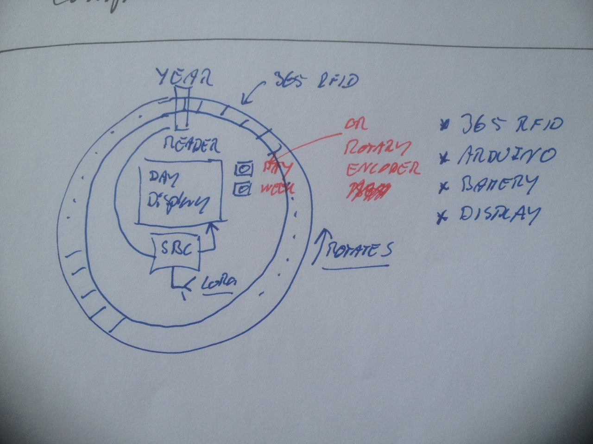

# Todo: Consider to build an physical representation of the "gear-almanack" that uses 365 RFID to detect day and Micro Controller/SBC + Display to show schedules?

```#aafa04a4``` *As of 2018-05-04 16:49*

[mail plain/text](mail.txt)


Could it be fun to actually physically build the year-week-day scheduler using RFID on wheels to detect and show schedule on a display?

==&gt; Also see “Todo: Programming - Consider to visualise a calendar as gear of days within gear of weeks within gear of months within gear of years within gear of 10 years and life?”

1) Consider a design with a year-wheel/gear with 365 RFID tags?



==&gt; By turning the wheel a new RFID tag moves into the reader and is picked up by micro controller?

==&gt; The micro controller is in deep sleep until interrupted by someone pushing a button or turning the wheel?

==&gt; The micro controller uses LoRa to synchronise internal schedule with personal domain (e.g., an app on a desktop)?

==&gt; The Micro Controller shows schedule on a (touch?) display?

==&gt; Consider to have the wheel spin to correctly show the current date and time?

2) Consider to build a PoC using only a year-wheel?

…

3) Consider to expand the design to one that actually has the year-week and day wheels?

…


