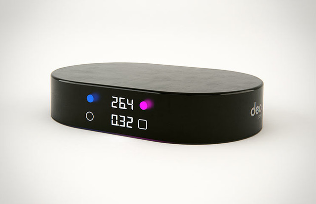
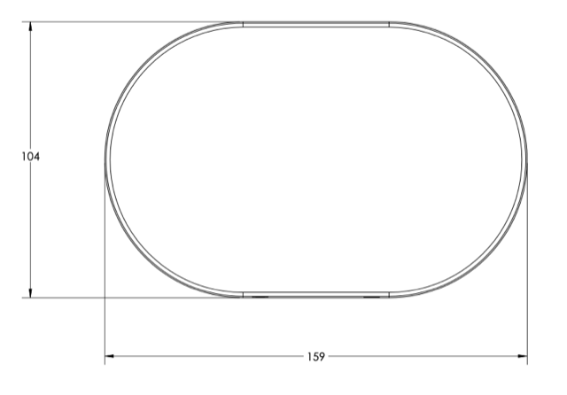
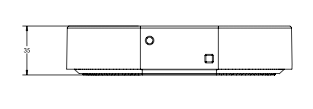

# Todo: Consider to make an iPhone App for the Decent Coffee "open" kitchen / Espresso scale?

```#ab64b15c``` *As of 2021-06-19 16:36*

[mail plain/text](mail.txt)


1) The documentation for the Decent scale seems to live here (<https://decentespresso.com/scale> )?



==&gt; The manual seems to live here (<https://decentespresso.com/img/decent_scale_manual.pdf> )?

==&gt; The 2D Drawing seem to live here (<https://decentespresso.com/img/decent_scale_dims.pdf> )?



==&gt; The STEP file seems to live here (<https://decentespresso.com/img/decent_scale_v10.stp> )?

==&gt; The Bluetooth API seems to live here (<https://decentespresso.com/decentscale_api> )?

> ### BLE Overview

> Decent scale packets come in on "0000FFF4-0000-1000-8000-00805F9B34FB"

> All BLE packets to/from the Decent Scale have the following 7 byte structure:

> BYTE 1BYTE 2BYTE 3BYTE 4BYTE 5BYTE 6BYTE 7Model

> ---

> 03 = DecentType

> ---

> 0A=LED on/off  
> 0B=Timer on/off  
> 0F=TareCommand / data (1)Command / data (2)Command / data (3)Command / data (4)XOR validation

> ---

> 6 byte XOR for validation  
> More detail about each command and information type is given below.

> Here is a Tcl procedure which builds the 7 character binary package to send to the Decent Scale. It is built first as a text string, which is then converted to a 7 byte binary at the end of the procedure:

>   ```
>   proc decent_scale_make_command {cmdtype cmdddata {cmddata2 {}} } {
>       if {$cmddata2 == ""} {
>           msg "1 part decent scale command"
>           set hex [subst {03${cmdtype}${cmdddata}000000[decent_scale_calc_xor "0x$cmdtype" "0x$cmdddata"]}]
>       } else {
>           msg "2 part decent scale command"
>           set hex [subst {03${cmdtype}${cmdddata}${cmddata2}0000[decent_scale_calc_xor4 "0x$cmdtype" "0x$cmdddata" "0x$cmddata2"]}]
>       }
>       msg "hex is '$hex' for '$cmdtype' '$cmdddata' '$cmddata2'"
>       return [binary decode hex $hex]
>   }
>   ```

> ### XOR Calculation

> To calculate the XOR, you should do a mathematical XOR of the first 6 bytes.

> Here is Tcl programming code that calculates the XOR for a simple command that takes only one parameter, such as TARE:

>   ```
>   proc decent_scale_calc_xor {cmdtype cmdddata} {
>       set xor [format %02X [expr {0x03 ^ $cmdtype ^ $cmdddata ^ 0x00 ^ 0x00 ^ 0x00}]]
>       msg "decent_scale_calc_xor for '$cmdtype' '$cmdddata' is '$xor'"
>       return $xor
>   }

>   ```

> Here is Tcl programming code that calculates the XOR for a two-parameter command, such as enabling the LEDs:

>   ```
>   proc decent_scale_calc_xor4 {cmdtype cmdddata1 cmdddata2} {
>       set xor [format %02X [expr {0x03 ^ $cmdtype ^ $cmdddata1 ^ $cmdddata2 ^ 0x00 ^ 0x00}]]
>       msg "decent_scale_calc_xor4 for '$cmdtype' '$cmdddata1' '$cmdddata2' is '$xor'"
>       return $xor
>   }

>   ```

> ---

> ### Receiving Weight

> Receiving weight data is a slightly special case, as the weight is sent as a two-byte signed Short integer of grams weight \* 100:

> BYTE 1BYTE 2BYTE 3BYTE 4BYTE 5BYTE 6BYTE 7Model

> ---

> 03 = DecentType

> ---

> CE=weight stable  
> CA=weight changingData (1)

> ---

> Grams weight \* 100

> High byte of a signed Short integerData (2)

> ---

> Grams weight \* 100

> Low byte of a signed Short integerData (3)

> ---

> Change \* 100

> High byte of a signed Short integerData (4)

> ---

> Change \* 100

> Low byte of a signed Short integerXOR validation

> ---

> 6 byte XOR for validation  
> Notes:
1. current weight arrives as a two-byte short big-endian signed integer on data bytes 1 and 2.
2. Weight change per second arrives as a two-byte unsigned big-endian short. However, this feature is currently buggy and not recommended for use. If you need weight change data, you should calculate it yourself
3. Weight data is sent at 10hz.

> ---

> ### Receiving Button Taps

> BYTE 1BYTE 2BYTE 3BYTE 4BYTE 5BYTE 6BYTE 7Model

> ---

> 03 = DecentType

> ---

> AAData (1)

> ---

> 01=button 0  
> 02=button 1Data (2)

> ---

> 01=short tap  
> 02=long pressData (3)Data (4)XOR validation

> ---

> 00Notes:
1. when you have a BLE connection, the buttons taps have no functional effect on the scale, and can be programmed to have any function you like, guided by your programming.

> ---

> ### Receiving Timer Info

> BYTE 1BYTE 2BYTE 3BYTE 4BYTE 5BYTE 6BYTE 7Model

> ---

> 03 = DecentType

> ---

> 0CData (1)

> ---

> Minutes elapsedData (2)

> ---

> Seconds elapsedData (3)

> ---

> 00Data (4)

> ---

> 00XOR validationNotes:
1. Timer data is automatically sent when the timer is started
2. You can use this timer data to synchronize your app's timer to the scale.

> ---

> ### Sending the Tare Command (reset weight to zero)

> BYTE 1BYTE 2BYTE 3BYTE 4BYTE 5BYTE 6BYTE 7Model

> ---

> 03 = DecentType

> ---

> 0FData (1)

> ---

> Incremented integerData (2)

> ---

> 00Data (3)

> ---

> 00Data (4)

> ---

> 00XOR validation

> ---

> calculatedNotes:
1. Each tare must have a unique integer in BYTE 2
2. A common strategy is to use an integer counter (0 to 255)
3. At FF you can go back to 00
4. However, a random(255) integer will work equally well, as long as the same integer is not used twice in quick succession.
5. Make sure you correctly calculate the XOR for BYTE 7 or the TARE command will be ignored

> Here are several sample BLE tare commands, as HEX, that you can use to test that you are correctly forming your tare commands. Note how the tare counter goes back to 00 after if goes over FF:

>   ```
>   030FFD000000F1
>   030FFE000000F2
>   030FFF000000F3
>   030F000000000C
>   030F010000000D
>   030F020000000E
>   030F030000000F
>   030F0400000008
>   030F0500000009
>   030F060000000A
>   030F070000000B

>   ```

> And here is a code fragment showing you how to build a 7 byte tare command:

>   ```
>   proc tare_counter_incr {} {

>       if {[info exists ::decent_scale_tare_counter] != 1} {
>           set ::decent_scale_tare_counter 0
>       } elseif {$::decent_scale_tare_counter >= 255} {
>           set ::decent_scale_tare_counter 0
>       } else {
>           incr ::decent_scale_tare_counter
>       }

>       # alternatively: the tare counter can in fact be any not-recently-used integer, such as this random digit-picker
>       # set ::decent_scale_tare_counter [expr {int(rand() * 255)}]

>   }

>   proc decent_scale_tare_cmd {} {
>       tare_counter_incr
>       set cmd [decent_scale_make_command "0F" [format %02X $::decent_scale_tare_counter]]
>       return $cmd
>   }

>   ```

> The Decent Scale will send an answer back after a Tare command. That answer has this structure:

> BYTE 1BYTE 2BYTE 3BYTE 4BYTE 5BYTE 6BYTE 7Model

> ---

> 03 = DecentType

> ---

> 0FData (1)

> ---

> Tare counterData (2)

> ---

> 00Data (3)

> ---

> 00Data (4)

> ---

> FEXOR validation

> ---

> ### Sending Commands to turn LEDs on or off

> BYTE 1BYTE 2BYTE 3BYTE 4BYTE 5BYTE 6BYTE 7Model

> ---

> 03 = DecentType

> ---

> 0AData (1)

> ---

> Weight LED on/off  
> 00=off  
> 01=onData (2)

> ---

> Timer LED on/off  
> 00=off  
> 01=onData (3)

> ---

> 00Data (4)

> ---

> 00XOR validation

> ---

> calculatedNotes:
1. Battery life is extended by keeping LEDs off
2. The scale will continue to function, even with both LEDs off.
3. The single LED that shows "weight is changing" [will light up](https://decentespresso.com/img/ledlightup_example.jpg), even if both LEDs have been turned off

> Example: all LED On Command:

>   ```
>   03 0A 01 01 00 00 09

>   ```

> Example: all LED Off Command:

>   ```
>   03 0A 00 00 00 00 09

>   ```

> The Decent Scale will send an answer back after an LED on/off command, with grams vs oz information, and battery power level. That answer has this structure:

> BYTE 1BYTE 2BYTE 3BYTE 4BYTE 5BYTE 6BYTE 7Model

> ---

> 03 = DecentType

> ---

> 0AData (1)

> ---

> 00Data (2)

> ---

> Weight units on LED  
> 00=grams  
> 01=ozData (3)

> ---

> Battery level  
> Between 3% (low) 100% (full).Data (4)

> ---

> FEXOR validation

> ---

> ### Sending Commands to control the timer

> BYTE 1BYTE 2BYTE 3BYTE 4BYTE 5BYTE 6BYTE 7Model

> ---

> 03 = DecentType

> ---

> 0BData (1)

> ---

> Timer start/stop/reset  
> 00=stop  
> 02=reset to zero  
> 03=startData (2)

> ---

> 00Data (3)

> ---

> 00Data (4)

> ---

> 00XOR validation

> ---

> calculatedNotes:
1. Timer data will be sent at 10hz, whenever the timer is on.
2. See "Receiving Timer Info" in this document.

> Example: Timer Start Command

>   ```
>   03 0B 03 00 00 00 0B

>   ```

> Example: Timer Stop Command

>   ```
>   03 0B 00 00 00 00 08

>   ```

> Example: Timer Reset Command

>   ```
>   03 0B 02 00 00 00 0A

>   ```

> ---

> ### Large sample code for receiving various data from the Decent Scale

> The follow code fragment (in the Tcl language, but hopefully you can understand it) can:
1. receive weight information
2. receive a button press
3. receive the current timer value

> ```
> set ::de1(cuuid_decentscale_read) "0000FFF4-0000-1000-8000-00805F9B34FB"

> if {$cuuid eq $::de1(cuuid_decentscale_read)} {
>     # decent scale
>     parse_decent_scale_recv $value weightarray

>     if {[ifexists weightarray(command)] == [expr 0x0F] && [ifexists weightarray(data6)] == [expr 0xFE]} {
>         # tare cmd success is a msg back to us with the tare in 'command', and a byte6 of 0xFE
>         msg "- decent scale: tare confirmed"

>         return
>     } elseif {[ifexists weightarray(command)] == 0xAA} {
>         msg "Decentscale BUTTON $weightarray(data3) pressed"
>         if {[ifexists $weightarray(data3)] == 1} {
>             # button 1 "O" pressed
>             decentscale_tare
>         } elseif {[ifexists $weightarray(data3)] == 2} {
>             # button 2 "[]" pressed
>         }
>     } elseif {[ifexists weightarray(command)] != ""} {
>         msg "scale command received: [array get weightarray]"

>     }

>     if {[info exists weightarray(weight)] == 1} {
>         set sensorweight [expr {$weightarray(weight) / 10.0}]
>         #msg "decent scale: ${sensorweight}g [array get weightarray] '[convert_string_to_hex $value]'"
>         #msg "decentscale recv read: '[convert_string_to_hex $value]'"
>         ::device::scale::process_weight_update $sensorweight $event_time
>     } else {
>         msg "decent scale recv: [array get weightarray]"
>     }
> }

> proc parse_decent_scale_recv {packed destarrname} {
>     upvar $destarrname recv
>     unset -nocomplain recv

>        ::fields::unpack $packed [decent_scale_generic_read_spec] recv bigeendian

>        if {$recv(command) == 0xCE || $recv(command) == 0xCA} {
>            unset -nocomplain recv
>            ::fields::unpack $packed [decent_scale_weight_read_spec2] recv bigeendian
>        } elseif {$recv(command) == 0xAA} {
>            msg "Decentscale BUTTON pressed: [array get recv]"
>        } elseif {$recv(command) == 0x0C} {
>            unset -nocomplain recv
>            ::fields::unpack $packed [decent_scale_timing_read_spec] recv bigeendian
>            msg "Decentscale time received: [array get recv]"
>        }
> }

> proc decent_scale_generic_read_spec {} {
>     set spec {
>         model {char {} {} {unsigned} {}}
>         command {char {} {} {unsigned} {}}
>         data3 {char {} {} {unsigned} {}}
>         data4 {char {} {} {unsigned} {}}
>         data5 {char {} {} {unsigned} {}}
>         data6 {char {} {} {unsigned} {}}
>         xor {char {} {} {unsigned} {}}
>     }
>     return $spec
> }

> proc decent_scale_weight_read_spec2 {} {
>     set spec {
>         model {char {} {} {unsigned} {}}
>         wtype {char {} {} {unsigned} {}}
>         weight {Short {} {} {signed} {}}
>         rate {Short {} {} {unsigned} {}}
>         xor {char {} {} {unsigned} {}}
>     }
>     return $spec
> }
> ```


...


