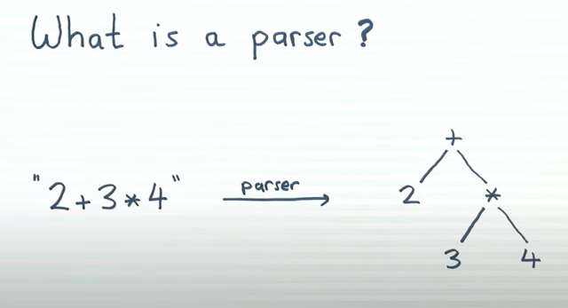

# Todo: Consider to understand ways to quickly implement Functional Parsing (also combinators parsing or parser combinators) in C++ (to implement when required and not use a library e.g., for parsing advent of code puzzle inputs)?

```#ab7f61c5``` *As of 2022-01-14 20:06*

[mail plain/text](mail.txt)


I haver a hunch I may be able to write functional parsers and parser combinators "on the fly" when I need them for some small parsing task?

1) Consider computerphile video "Functional Parsing - Computerphile" (<https://youtu.be/dDtZLm7HIJs> )?

==&gt; Consider a parser as a thing that takes a string and returns a tree (<https://youtu.be/dDtZLm7HIJs?t=19> )?

>   
> *An example of a parser that transform a string representation of a structure of "values" and returns a tree structure representation of these "values"*

==&gt; Consider to implement a parser as a function Tree f(string) (<https://youtu.be/dDtZLm7HIJs?t=146> )?

> *In C++ the naive approach at this stage would be:*

> // The naive approach is to parse a std::string into a Tree of strings  
> // Shortcommings:  
> // 1) We can't communicate (handle) failure to parse  
> // 2) We can't keep track of how much a parsers has consumed (so that we can cpmbine parsers to consume different parts of the input)

> struct Node {  
> std::string value;  
> std::pair&lt;std::shared_ptr&lt;Node&gt;,std::shared_ptr&lt;Node&gt;&gt; child;  
> };

> using Tree = Node;

> Tree parser_parse(std::string const& s) {  
> Tree result;  
> return result;  
> }

==&gt; Consider to extend parser to communicate how much it consumed so far by being pair&lt;Tree,string&gt; parse(string) (<https://youtu.be/dDtZLm7HIJs?t=201> )?

> *The return type is now a pair of the Tree we created so far plus the unconsumed part of the input string.*

> *In C++ this could be:*

> // The naive approach to communmicate the unconsumed part of the string

> struct Node {  
> std::string value;  
> std::pair&lt;std::shared_ptr&lt;Node&gt;,std::shared_ptr&lt;Node&gt;&gt; child;  
> };

> using Tree = Node;

> std::pair&lt;Tree,std::string&gt; parser_parse(std::string const& s) {  
> std::pair&lt;Tree,std::string&gt; result;  
> // return teh Tree we created so far plus the uncomsumed part of the input string  
> return result;  
> }

==&gt; Consider to extend the parser to be able to communicate that it failed by returning a list of Trees, e.g., vector&lt;pair&lt;Tree,string&gt;&gt; parse(string) (<https://youtu.be/dDtZLm7HIJs?t=223> )?

> *The idea with this refinement is that by returning a list of Tree we can communicate that we failed by returning an empty list. AND, we can also return several results if the input is ambiguous and several to parse matches the input)*

> *In C++ this could be:*

> // The naive approach to also communmicate if we failed by being able to return an empty list of parse results.  
> // This also enables us to communicate if several Trees maches the input (ambigous input and grammar)

> struct Node {  
> std::string value;  
> std::pair&lt;std::shared_ptr&lt;Node&gt;,std::shared_ptr&lt;Node&gt;&gt; child;  
> };

> using Tree = Node;

> std::vector&lt;std::pair&lt;Tree,std::string&gt;&gt; parser_parse(std::string const& s) {  
> std::vector&lt;std::pair&lt;Tree,std::string&gt;&gt; result;  
> // return teh Tree we created so far plus the uncomsumed part of the input string  
> return result;  
> }

==&gt; Consider to parameterize on the Tree type to express that the parser returns "a type" defined elsewhere (<https://youtu.be/dDtZLm7HIJs?t=301> )?

> // Refine our parser to be able to define how to parse a string into any type I like

> template &lt;typename T&gt;  
> std::vector&lt;std::pair&lt;T,std::string&gt;&gt; parser_parse(std::string const& s) {  
> std::vector&lt;std::pair&lt;T,std::string&gt;&gt; result;  
> // return teh Tree we created so far plus the uncomsumed part of the input string  
> return result;  
> }

> auto test(std::string const& s) {  
> using MyTree = std::vector&lt;int&gt;;  
> return parser_parse&lt;MyTree&gt;(s);  
> }

==&gt; Consider to separate a "Parser" from a function "parse" that takes a parser and a string to parse and return the parse result (<https://youtu.be/dDtZLm7HIJs?t=466> )?

> // Refine our framework to have a "Parser" object and a "parse" function to apply a parser to a string and return the result

> template &lt;typename P&gt;  
> class Parser {  
> public:  
> std::vector&lt;std::pair&lt;P,std::string&gt;&gt; parse(std::string const& s) {  
> std::vector&lt;std::pair&lt;P,std::string&gt;&gt; result;  
> // return teh Tree we created so far plus the uncomsumed part of the input string  
> return result;  
> }  
> };

> template &lt;typename P&gt;  
> std::vector&lt;std::pair&lt;P,std::string&gt;&gt; parse(Parser&lt;P&gt;& parser,std::string s) {  
> return parser.parse(s);  
> }

> auto test(std::string const& s) {  
> using P = std::vector&lt;int&gt;;  
> Parser&lt;P&gt; parser{};  
> return parse&lt;P&gt;(parser,s);  
> }

2) Consider youtube video "No Nonsense Monad & Functor - The foundation of Functional Programming by César Tron-Lozai" to be able to combine Parsers as Monads (<https://youtu.be/e6tWJD5q8uw?list=LL> )?

==&gt; Consider we make Parser into a Functor by adding map without thinking so much about it yet!

> *PROBLEM: Where is the functor? Our Parser is a function parameterized on the return type. *

> *If we compare it with say the Maybe monad it is not clear what corresponds to "Maybe" in our parser case??*

> *TODO: Figure out where the Functor and Monad is in our Parser case!*

3) Consider video "What is a Monad? - Computerphile" to understand how to make the Parsers combine as Monads (<https://youtu.be/t1e8gqXLbsU> )?

...

...


