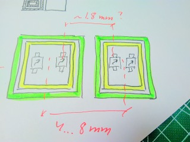
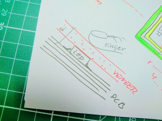

# Todo: Mui Lab Wood Surface Calm Interface - Consider to investigate, understand and possibly DIY the wood capacitive touch screen display developed by Mui Lab (CES 2019 award)?

```#ac0e9ad5``` *As of 2019-01-07 23:51*

[mail plain/text](mail.txt)


I was intrigued by the Mui Lab calm wood interface that looks like a piece of wood until you touch it and a shine-through pixel display shows up through the wood. How does it work and can I build something like it myself?

==&gt; Also see “Todo: Consider to understand "projected capacitive sensors" for capacitive touch screens and track pads?”

==&gt; Also see “Todo: Capacitive Touch Screen - It seems transparent touch screen overlays uses transparent conductive coats like Indium Tin Oxide?"

1) It seems the Mui calm interface lives here (<https://mui.jp/#en>)?


==&gt; It seems the actual display is 200 x 32 dots over ?

> Display View Area W 360 x H 57.6 (mm)  
> &#91;W 14.2 x H 2.3 (inch)&#93;

> Dots M-UI Gen2 Display 200 x 32

> Color M-UI White

> Input Capacitive Touch Panel M-UX Material Tocuh

==&gt; It seems the 1,8 mm LED pitch size corresponds to 0,5 inch 7 LEDs size (a 7x7 LED module would have to be 0,5” x 0,5” or 12,6 x 12,6 mm)?

==&gt; Consider a cost effective 200 x 32 LED dot matrix can be built with 29 x 5 = 145 pieces of 5 x 7 LED dot matrix modules of size 9 x 12,6 mm or 0,35” x 0,5” (diagonal 16,6 mm or 0,65”)?

==&gt; We can then program it so that only the 200 x 32 matrix is used?

==&gt; Consider 200 LED dots over 360 mm width means a width dot pitch of 1,8 mm?

5 dot width = 9 mm module width

8 dot width = 14,4 mm module width

32 dot width = 57,6 mm

64 dot width = 115,2 mm

==&gt; Consider 32 LED dots over 57,6 mm height means a height dot pitch of 1,8 mm (So the matrix LEDs are evenly spaced 1,8 x 1,8 mm)?

7 dot height = 12,6 mm module height

8 dot height = 14,4 mm module height

32 dot height = 57,6 mm

64 dot height = 115,2 mm

==&gt; It seems the Mui LED Dot matrix is 200 x 32 LED dots with 1,8 mm spacing over an area of 360 x 57,6 mm?

160 pieces of 5 x 7 dot module of 10,8 x 14,4 in 40 x 4 configuration creates a 200 x 28 dot display with 1,8 mm dot pitch over an area of 360 x 50,5 mm?

100 pieces of 8 x 8 modules of 14,4 x 14,4 mm in a 25 x 4 configuration creates a 200 x 32 led dot matrix with 1,8 mm pitch over an area of 360 x 57,6 mm?

==&gt; Consider if the Mui LED dot display is made from some combination of existing 4:3 or 16:9 or other “standard” Led dot modules?

==&gt; Consider a 4:3 matrix is approximately 42x32 (correct height) or exactly 200/150 (correct width) - But neither seems to fit the 200 x 32 size?

==&gt; Consider a 16 : 9 matrix is approximately 56 x 32 (correct height) or approximately 200/112 (correct width) - But neither seems to fit the 200 x 32 size?

==&gt; Consider using 8 x 8 LED dot matrixes. This would require 25 x 4 = 100 modules to create a 200 x 32 display?

==&gt; Consider the Mui display is actually four rows of 200 x 16 dots (with some spacing between the rows)?

==&gt; Or, Consider the Mui display is in fact a continuous 200 x 32 LED dot display?

==&gt; But it seems at least the middle two rows are NOT spaced (but creates a continuous 200 x 16 display?


*Mui display of large “7” and “2"uses 8x14 and small “6” and “8” uses 4x7 LED dots?*

2) It seems the Mui calm interface originated as a kickstarter here (<https://www.kickstarter.com/projects/1391686171/mui-interactive-wood-panel-for-peaceful-digital-li>)?


==&gt; It seems we can guess that the Mui LED dot display is in fact a continous rectangle LED dot matrix pixels (of 200 x 32 pixels as specified)?


Mui display uses 7 pixels height for small fonts with widths between 4 to 7 pixels?


3) Consider ways to design this kind of wood surface display with shine-though pixel display and capacitive touch screen abilities?

==&gt; Consider it may be possible to treat a thin veneer of wood so that is is transparent enough for a pixel display to shine through?

==&gt; Consider it may be possible to treat a thin veneer of wood so that it allows a capacitive touch display to use the wood surface as the torch interface?

==&gt; Consider we just need to adjust the capacitive sensitivity to allow detection some distance from the touch display glass surface?

==&gt; Consider we may need to treat threat the wood veneer so that is is capacitively permeable?

…

4) Consider to try my touch-screen PCB developer kit with some wood surface to see if touch detection is still possible?

==&gt; Also see “Todo: Consider to understand "projected capacitive sensors" for capacitive touch screens and track pads?"

TODO: Set up the touch PCB development kit with an Arduino and select some wood veneers to try out what may work?

==&gt; It seems my evaluation kit is for the IQS550 ProxSense chip (<http://www.azoteq.com/images/stories/pdf/iqs572ev02_datasheet.pdf>)?

==&gt; It seems to come with an 8x8 diamond sensor pattern?

> “The IQS572EV02 uses an 8x8 diamond sensor pattern to detect user proximity and touch,  
> identify finger position co-ordinates, and generate gesture outputs based on the finger interaction."

==&gt; The sensor board seems to be designed to fit as a shield on an Arduino Uno?


…

5) Consider LED dot matrixes I can use to create the shine-through monochrome display?

==&gt; It seems we need 6400 LED dots to create the Mui specified 200 x 32 LED dot display?

==&gt; It seems LED Dot matrix uses the term P1.8 for 1.8 mm pixel pitch?

==&gt; It seems Mouser defines character size in the height module height ([https://www.mouser.se/Optoelectronics/Displays/LED-Displays-Accessories/_/N-6j73b?P=1yzvvp2Z1z0iz7rZ1z0iz7pZ1z0iz7o&Ns=Pricing%7C0](https://www.mouser.se/Optoelectronics/Displays/LED-Displays-Accessories/_/N-6j73b?P=1yzvvp2Z1z0iz7rZ1z0iz7pZ1z0iz7o&Ns=Pricing|0))?

==&gt; Consider 7 pixel and 12,6 mm (0,5”) character height modules (would mean 1,8 mm pixel pitch)?

==&gt; Consider 8 pixels and 14,4 mm (0,57”) character height modules (would mean 1,8 mm pixel pitch)?

==&gt; It seems ELFA smallest LED dot matrix are 2mm LEDs ([https://www.elfa.se/search?q=LED+matrix&sort=Price%3Aasc&filter_categoryCodePathROOT%2Fcat-L2-3D_525341%2Fcat-DNAV_0203=cat-L2-3D_1687010&filter_categoryCodePathROOT%2Fcat-L2-3D_525341=cat-DNAV_0203&filter_categoryCodePathROOT%2Fcat-L2-3D_525341%2Fcat-DNAV_0203%2Fcat-L2-3D_1687010=cat-DNAV_PL_020303&filter_categoryCodePathROOT=cat-L2-3D_525341&page=1&pageSize=10](https://www.elfa.se/search?q=LED+matrix&sort=Price:asc&filter_categoryCodePathROOT/cat-L2-3D_525341/cat-DNAV_0203=cat-L2-3D_1687010&filter_categoryCodePathROOT/cat-L2-3D_525341=cat-DNAV_0203&filter_categoryCodePathROOT/cat-L2-3D_525341/cat-DNAV_0203/cat-L2-3D_1687010=cat-DNAV_PL_020303&filter_categoryCodePathROOT=cat-L2-3D_525341&page=1&pageSize=10))?


==&gt; It seems Mouser lists their modules as “single character” with the most common ones being 5x7 pixels and 17,4 (0,7”) height ([https://www.mouser.se/Optoelectronics/Displays/LED-Displays-Accessories/_/N-6j73b?P=1z0iz7rZ1z0iz7pZ1z0iz7oZ1z0j4jx&Ns=Pricing%7C0](https://www.mouser.se/Optoelectronics/Displays/LED-Displays-Accessories/_/N-6j73b?P=1z0iz7rZ1z0iz7pZ1z0iz7oZ1z0j4jx&Ns=Pricing|0))?


No White 1,8 mm pitch LED dot matrix from Mouser?

==&gt; Consider DigiKey provided 70 SEK Adafruit 8x8 white LED dot matrix (<https://www.digikey.se/product-detail/en/adafruit-industries-llc/1821/1528-1953-ND/6827076>)?

> “Dot Matrix Display Module 8 x 8 Common Cathode White 1.20" L x 1.20" W x 0.30" H (30.48mm x 30.48mm x 7.62mm)"


==&gt; A 200 x 32 matrix would require 100 modules in 25x4 configuration with total cost 6000 SEK !! (Expensive)

==&gt; A 200 x 32 matrix would be 762 x 122 mm (TOO LARGE) :)

==&gt; Consider DigiKey provided 19 SEK Amber-Yellow 5x7 LED dot matrix (<https://www.digikey.se/product-detail/en/lite-on-inc/LTP-747KY/160-1556-5-ND/408229>)?


==&gt; Consider with using 5 x 7 LED dot matrixes we can create a 200 x 28 pixel dot display using 160 modules for 3040 SEK (Expensive!!)

NOTE: There are fewer white LED dot matrixes than less expensive RED, GREEN and ORANGE ones!

==&gt; Consider an ORANGE or AMBER-Yellow LED dot matrix may look good and pleasing behind a wood veneer surface?

==&gt; Consider the 23 SEK Yellow/Green EADDM288GA2 8x8 LED dot matrix (<https://www.digikey.se/product-detail/en/everlight-electronics-co-ltd/EADDM288GA2/EADDM288GA2-ND/5141941>)?

==&gt; A 200 x 32 matrix would require 100 modules in 25 x 4 configuration with price 2300 SEK?

==&gt; Consider DigiKey “cheapest” RED 5 x 7 LED dot matrix (<https://www.digikey.se/product-detail/en/everlight-electronics-co-ltd/EADDM070RA1/EADDM070RA1-ND/5141939>)?

> “Dot Matrix Display Module 5 x 7 Common Anode Row, Common Cathode Column Red 2V 0.50" L x 0.70" W x 0.24" H (12.70mm x 17.70mm x 6.10mm)"

NOTE: NOT in stock?

==&gt; A 200 x 28 dot matrix would then be 508 x 70,8 mm (TO LARGE) :)

==&gt; Consider a cost effective 200 x 32 LED dot matrix can be built with 29 x 5 = 145 pieces of 5 x 7 LED dot matrix modules of size 9 x 12,6 mm or 0,35” x 0,5”?

6) Consider to design my own PCB with surface mount LEDs and Capacitive touch screen traces?

==&gt; Consider it may be fun and good learning to try and design my own PCB with surface mount LEDs and traces for capacitive touch display for my own wood veneer surface touch screen display interface?

==&gt; Consider to use the Azoteq IQS550 ProxSense chip (<http://www.azoteq.com/images/stories/pdf/iqs572ev02_datasheet.pdf>)?

==&gt; Consider to use the Azoteq IQS572EV02 8x8 capacity sensor board evaluation kit as inspiration for my own PCB touch screen design (<http://www.azoteq.com/design/11-products/254-iqs572b000ev02.html>)?


==&gt; Consider the Azoteq IQ572EV02 touch screen evaluation kit “user manual” data sheet (<http://www.azoteq.com/images/stories/pdf/iqs572ev02_datasheet.pdf>)?

==&gt; Consider we need to design a 4 layer PCB to allow the capacitive touch grid on the from surface to be shielded from the back-end LED driver traces?

==&gt; It seems we may have a problem in that the PCB trackpad uses diamonds that leaves no room for surface mounted LEDs?


==&gt; But it seems the good news is that the evaluation kit comes with a Plexiglas glass cover of considerable thickness (meaning we may use a similarly thick wood veneer instead)?

Q: Will the PCB trackpad diamond pattern work if we reduce the diamond copper area to mound LEDs inside the diamond pattern?

==&gt; Consider that because the capacitive proxy sensor measures the capacitance over the gap we may get away with having the inside of the “diamonds” hollowed out (enabling placement of surface mount LEDs)?

...

==&gt; Consider possible LED patterns that can fit “inside” the capacitive touch screen from surface (the diamond pattern)?

==&gt; Consider the design characteristics of the Azoteq proxysense product line-up (<http://www.azoteq.com/products/proxsense/11-products/177-products-proxsense-iqs572-b000.html>)?

> “*The IQS572-B000 is a firmware upgrade from the IQS572-A000. The IQS572 is a projected capacitive touch and proximity trackpad/touchscreen controller implementation on the IQS5XX platform. The IQS572 features best in class sensitivity, signal-to-noise ratio and automat*ic tuning of electrodes. Low power proximity detection allows extreme low power operation. The IQS572-BL contains a bootloader to enable loading of the B000 firmware. IQS572-A000 devices can be upgraded to the IQS572-B000 firmware via the bootloader."

==&gt; It seems an 8x8 diamond torch sense grid can produce a 2048 x 1792 max resolution?

> “Features:

> • Proximity, touch and snap on each channel  
> • Multi-touch support up to 5 fingers  
> • Single and multi-finger gestures  
> • 2048 x 1792 max resolution  
> • 9 x 8 rows and columns  
> • Scale, orientation and electrode layout selection  
> • I2C communications interface  
> • ATI: automatic tuning for optimum sensitivity  
> • Event and streaming modes  
> • Internal voltage regulator and reference capacitor  
> • On-chip noise detection and suppression  
> • 1 Finger gestures  
> • Forward swipe - Next  
> • Backward swipe - Previous  
> • Upward swipe - Volume Increase  
> • Downward swipe - Volume Decrease  
> • Tap - Play/Pause  
> • Press and hold  
> • 2 Finger gestures  
> • Pinch & Zoom  
> • 2 Finger scroll  
> • 2 Finger pan  
> • 2 Finger tap  
> • 3 Active and 2 low power modes  
> • Proximity and pin wake up from low power  
> • Supply Voltage 1.65V to 3.6V  
> • Proximity low power operation (&lt;10uA) "

==&gt; Consider the Azoteq Proxsense trackpad design guide (<http://www.azoteq.com/images/stories/pdf/azd068-trackpad_design_guide.pdf>)?


==&gt; It seems it is ok and even advisable to put ground planes inside the diamond patterns?

> “*Handheld devices with FR4 substrates*

> *For handheld devices it is beneficial to create a small ground island inside of the diamonds on the sensor layer to improve the coupling of a user to the ground plane of the PCB.*"


*Figure 11: The technique to embed ground islands inside a sensor pattern is illustrated above. The ground islands are shown in green and the sensor electrodes are shown in red. The ground islands are connected using vias.*

==&gt; Thus, it is at least possible le for us to consider to mount LEDs in ground islands inside the diamond sensor pattern?

==&gt; It seems the actual trackpad size possible can be determined from the min and max pitch and gap specification?

 

==&gt; 9 x 8 sensors with sensors pitch 4 mm = 36 x 32 mm and with pitch 8 mm = 72 x 64 mm?

==&gt; Hm… With 1,8 mm LED pitch a 36 x 32 trackpad maps to 20 x 18 LEDS and a 72 x 64 mm trackpad maps to 40 x 35 LEDs?

==&gt; Consider if it is possible to place LEDs with pitch 1.8 mm inside trackpad sensor pattern with pitch 4…8 mm?



*1.8 mm LED pitch in a 4..8 mm trackpad sensor pitch?*

==&gt; The gap between each sensor must be 0.1 .. 0.5 mm (where we want the larger gap to extend touch detection out from the grid)?

==&gt; With 0.5 mm gap we have 1.3 mm left for left and right sensor rim plus the actual left and right LED themselves?

==&gt; It seems we will have a hard time to fit both the LEDs and the trackpad sensor pattern on the same PCB surface (and still not have the distance to the touchable surface above LED height and wood veneer thickness)?



*Distance d = LED height plus veneer thickness will be too great?*

==&gt; Also, I don’t think I do want to manually surface mount 200 x 32 LEDs with 1.8 mm pitch (6400 LEDs of &lt; 0.4 mm size)?

7) Consider where to buy wood veneer?

==&gt; Consider the Swedish site “Slöddetaljer” (<https://www.slojd-detaljer.se/sortiment/tra-metallslojd/virke-faner-naver/faner-4718>)?


NOTE: Minmum quantity 1 m^2 = 350 SEK.

…

Consider to delve into this idea of trying to build my own wood surface shine-through capacitive touch pixel display?


