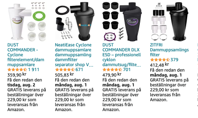
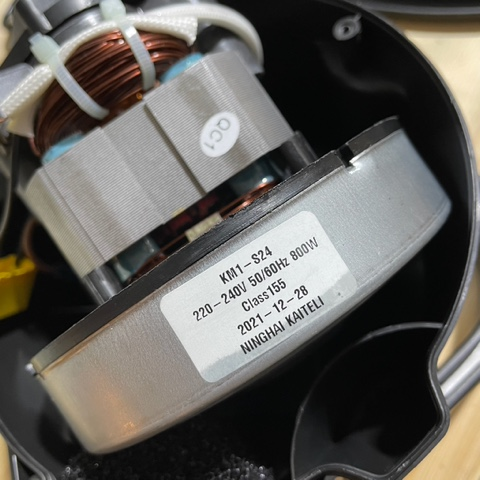
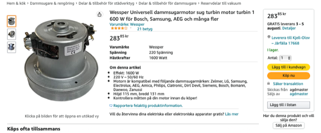

# Todo: Consider if I can buy a stand-alone vacuum cleaner motor and design a small and quiet dust extraction system for my indoor woodworking workspace?

```#ac6d2710``` *As of 2022-07-25 23:43*

[mail plain/text](mail.txt)


I bought the "Nedis Asksug 800 W" from Swedish web-shop KJell&Co and found the motor was easily removable and I started thinking...

0) Consider a DIY dust extraction system based on sewer pipes and a stand-alone vacuum cleaner motor?

> *So, the basic idea is to consider if we can mount a vacuum cleaner motor inside a sewage pipe?*

> *I imagine we could insert a cyclone in series with the pipe with the pipe mounted vacuum motor on top and thus have the saw dust fall down into the bottom of the sewage pipe for easy removal?*

> *This design would be very compact as the thickest place will be the width of the cyclone. And existing cyclones are NOT that wide in the first place?*

> 

1) Consider the "Nedis Asksug 800 W" has a motor from ([https://www.kataly.com](https://www.kataly.com/) )?



2) It seems I can find vacuum motors on Alibaba (<https://www.alibaba.com/trade/search?fsb=y&IndexArea=product_en&CatId=&SearchText=vacuum+motor> )?


3) It seems I can actually find vacuum cleaner motors on Swedish web sites and on Swedish Amazon?

> <https://shop.electrolux.se/dammsugare/dammsugare/motorer/c/115>

> <https://www.amazon.se/Wessper-Universell-dammsugarmotor-turbin-Samsung/dp/B08XBX74GV/ref=asc_df_B08XBX74GV/?tag=shpngadsglede-21&linkCode=df0&hvadid=476453211970&hvpos=&hvnetw=g&hvrand=8855461543940551766&hvpone=&hvptwo=&hvqmt=&hvdev=c&hvdvcmdl=&hvlocint=&hvlocphy=9062474&hvtargid=pla-1211606224306&psc=1>



...


