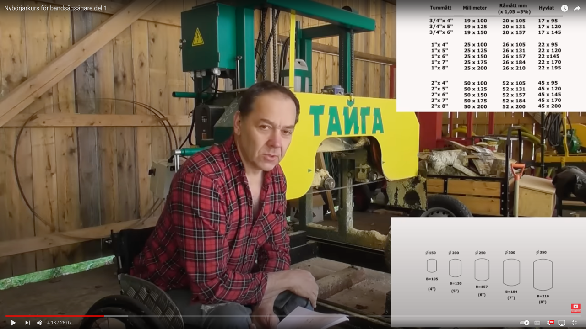

# Todo: Bandsaw milling - Consider Swedish youtube channel "Backby-Anders" about how to measure timber to 4..8 inch wide lumber?

```#ad866606``` *As of 2023-11-28 13:35*

[mail plain/text](mail.txt)


i want to learn how to cut up timber into lumber for my house build projects.

1) Consider youtube video "Nybörjarkurs för bandsågsägare del 1" about how to identify a core cut to slice into lumber of some optimal width (<https://youtu.be/6cD6jUn3bhU> )?

==&gt; It seems like good advice to identify a core suitable for some max width timber in the range 4..8 inches (<https://youtu.be/6cD6jUn3bhU?t=258> )?



==&gt; He seems to use a russian made bandsawmill "Tanta"

NOTE: I seem to fail to google this brand?

2) Consider the youtube channel "Backby-Anders" (<https://www.youtube.com/@backby-anders> )?

...


