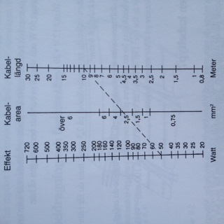

# Todo: Mörkö - Solpaneler, överväg att hitta bra information på nätet för att välja utrustning?

```#af647466``` *As of 2017-09-19 14:44*

[mail plain/text](mail.txt)


Så, vad finns för information på nätet för att beräkna solcellsbehov samt köpa produkter?

==&gt; Se även ”[Todo: Mörkö - Överväg att köpa extra portabla solpaneler (egna) samt monetär med MC4 kontakter till befintlig anläggning?](../792a0c4b/chime.md)"

-5) Överväg att hitta ställen att köpa DC-särkingar för DIN-skena och andra 12V produkter anpassade för solcellsanläggning?

==&gt; Legoelektronik verkar ha DC dvärgbrytare (<https://www.legoelektronik.se/elcentral-bygg-den-sjalv.html>)?

==&gt; Beställde en 10A säkring för DIN-skena för att se tillverkare och använda för belysningsgrupp i stuga (1,5 mm2 kabel)

==&gt; Voltpower verkar vara en bra web-shop för 12V DC grejer (<https://www.voltpower.se/fi/solcell/batterimonitorer/batteriovervakare-bmv-700.html>)?

==&gt; Beställde batteriövervakare BMW-700 (<https://www.victronenergy.se/upload/documents/Datasheet-BMV-700-series-SE.pdf>)

...

-4) Överväg att dra billigare kabel till lampor (under 10A förbrukning)

==&gt; Det verkar som om man kan säkra av upp till 10A på 1,5 mm2 kabel (<http://24volt.eu/kalkyl_kabelarea.php>)?


-3) Kolla upp hur det blir om vi använder Normcentral-grejor (DIN montage av säkringar och huvudbrytare) till vår 12V elcentral?

==&gt; Vad jag kan förstå av den fysiska funktionen hos AC automatsäkringar så är det egentligen bara förmåga att bryta ljusbågen som behöver bedömas ([https://sv.wikipedia.org/wiki/Dvärgbrytare](https://sv.wikipedia.org/wiki/Dv%C3%A4rgbrytare))?

> ”*Termomagnetiska dvärgbrytare är vanliga i elcentraler och använder sig av båda teknikerna, där elektromagneten reagerar på korta, stora strömökningar och bimetallen reagerar på mindre extrema men långvariga överströmstillstånd. När en kortslutning sker och kontakterna bryts kan en ljusbåge uppstå, vilket tillåter överströmmen att flöda. Därför måste dvärgbrytare tillverkas med anordningar för att dela upp och släcka ljusbågen.*"

==&gt; Vi verkar kunna anta att eftersom en normsäkring klara att bryta bågen för AC 240V, då klarart den också att bryta DC 12V (ingen strömpaus men mycket lägre spänning)?

==&gt; I den här tråden anger en (trovärdig) elingenjör att det är OK (<http://www.fluxio.se/forum/elmaterial/12688.html>)?

> ”*När man använder en dvärgbrytare avsedd för AC-kretsar i DC-kretsar blir den magnetiska funktionen, kortslutningsskyddet, **trögare**. Normalt anger tillverkarna att funktionsströmmen ökar med **38-42%**.*

> *Om jag har en dvärgbrytare **AC** 10 A, karakteristik C ska den i en växelströmskrets lösa för strömmen 10 ggr 10 A, dvs **100 A**. Men när den används i en **likströmskrets** blir funktionsströmmen 1,4 ggr 10 ggr 10 dvs **140 A**.

> I just ELV-kretsar blir detta ofta extra känsligt då den drivande spänningen är låg och kortslutningsströmmen är redan från början liten.

> Tröghetsfenomenet gäller endast den magnetiska funktionen, inte för bimetallen, överlastskyddet.

> Om man i stället använder en dvärgbrytare DC 10 A karakteristik C erhålls funktionsströmmen vid 100 A.

> Vi har i en annan tråd diskuterat kontroll för idrifttagning. Detta är ett typexempel när kontrollen ska göras mot tillverkarens anvisningar. Se andra strecksatsen i punkt 61.2.2 i SS 4364000.

> Mats Jonsson, Eltrygg Miljö AB*  
> "

==&gt; Eller inte (<http://www.fluxio.se/forum/elmaterial/12688.html>)?

> ”*Just därför är mitt föregående inlägg av vikt att veta. Det tog telekombranschen några år att förstå varför deras anläggningar brann och **dvärgbrytarna inte löste ut.** Men nu vet vi!*

> *Se även faktor vid DC-användning i bifogad fil

> Mats Jonsson, Eltrygg Miljö AB*  
> "

==&gt; Men om vi använder 10A DC-dvärgbrytare så har vi marginal till 25A som vi måste säkra av för att vara säkra?

==&gt; 25A DC skall lösa ut vid 250 A DC funktionsström.

==&gt; 10A AC kommer lösa ut vid 1,4 x 100 = 140 A (god marginal)?

...

==&gt; Det här verkar vara en bra beskrivning av hur Termomagnetiska dvärgbrytare fungerar (<https://www.phoenixcontact.com/online/portal/se?1dmy&urile=wcm:path:/sesv/web/main/products/technology_pages/subcategory_pages/circuit_breaker/86f66c83-9314-443b-8cb4-e7ea80c2c07e/86f66c83-9314-443b-8cb4-e7ea80c2c07e>)?


==&gt; Kurvan anger ”utlösningsfaktor = gånger märkström”?

==&gt; Den termomagnetiska automatsäkringen fungerar alltså för både DC (grå kurva)) och AC (blå kurva)?

==&gt; AC löser inte ut termiskt (ingen blå-kurva i del a)?

==&gt; Kurvan anger inte hur stor spänning brytaren klarar att bryta!

==&gt; Det verkar vara standard DIN EN 60934 som reglerar installationer?

> ”Automatsäkringar är konstruerade för användning i lågspänningsanläggningar. För dessa gäller standarden DIN EN 60934. Tekniska förutsättningar för automatsäkringar finns angivna i standarden, förutsättningar som är nödvändiga för att säkert skydda kablar och enheter. Standarden anger att automatsäkringar bör ha en högre kopplingsförmåga än nödvändig för överlastvillkoren. I samverkan med en fastställd kortslutningsenhet har de en villkorsmässig kortsslutningsström."

==&gt; Och det verkar gå att räkna på installationens säkerhet och säkrings-behov med ”vanlig” elkunskap ([https://www.phoenixcontact.com/online/portal/se?1dmy&urile=wcm%3apath%3a/sesv/web/main/products/technology_pages/subcategory_pages/circuit_breaker/f8d86030-3d6e-4064-a9c5-9b1c292afe81/f8d86030-3d6e-4064-a9c5-9b1c292afe81](https://www.phoenixcontact.com/online/portal/se?1dmy&urile=wcm:path:/sesv/web/main/products/technology_pages/subcategory_pages/circuit_breaker/f8d86030-3d6e-4064-a9c5-9b1c292afe81/f8d86030-3d6e-4064-a9c5-9b1c292afe81))

> ## Kabelberäkning

> ##

> Följande data är nödvändiga för kunna beräkna maximalt användbar kabellängd:

> Rmaxmaximalt totalmotståndUMärkspänningICBAutomatsäkringens märkströmxIUtlösningsfaktor enligt strömkurva / multiplicering av märkströmRLmaxmaximal kabelresistansRCB1AAutomatsäkringens märkström 1ALmaxmaximal kabellängdAKabeldiameterρspecifik kabelresistans Rho, (Cu 0,01786)

> ## Exempel

  
> För följande räkneexempel finns dessa värden:

> U24 V DCxI15 (från M1-kurva)ICB1 ARCB1A1,1 (från tabellen för märkström och innermotsrång för termomagnetiska automatsäkringar)P0,01786 (koppar)A1,5 mm2 (förmodad)

==&gt; I detta exempel så blir Max kabellängd 42 m 1,5 kvdrat ledning (1A säkring med M1-kurva)?


==&gt; R max verkar vara kretsens teoretiska kortslutningsmotstånd för den ström säkringen löser ut (15 gånger märkström enligt M1-kurva i detta fall)

==&gt; R L max verkar vara kabelns kabelns maximala resistans efter avdrag för säkringens motstånd (Rcb1a) vid utlösnings-strömmen?

==&gt; Kabelns maximala längd kan nu beräknas med hjälp av koppars resistans per meter?

==&gt; På detta sätt säkerställs att inte kabeln blir för överhettad vid utlösningsströmmen?

==&gt; Testa att räkna på vår anläggning (6 kvadrat och 1A säkring)?

==&gt; Rmax = 12/15 = 0,8 Ohm.

==&gt; R L max = 0,8 - 1,1 = - 0,3 Ohm !! (Hm…)

==&gt; Hur kan vi tolka att kretsens resistans Rmax blir mindre än den säkringen själv har?

==&gt; Måste vara något fel på detta exempel (En elsäkerhetsingenjör anger att AC-säkringar funkar med DC nedan)?

==&gt; Den här tråden visar att det finns de som gör så i båtar med gott resultat ([http://www.maringuiden.se/forum/topic/58929-vanliga-dvärgbrytare-for-12v-1pn-eller-2p/](http://www.maringuiden.se/forum/topic/58929-vanliga-dv%C3%A4rgbrytare-for-12v-1pn-eller-2p/))?

==&gt; De verkar anse att om man använder 230V AC automatsärkingar för 12V DC så löser säkringen ut för 1,44 x märkströmmen?

==&gt; Samt att automatsärkingen klarar färre utlösningar (släcker inte bågen lika bra för likström som för växelström)

==&gt; I vat fall verkar det finnas 12V DC säkringar för DIN Montage (<https://www.legoelektronik.se/sortiment/sol-vind/montering/elcentral.html>)?

==&gt; Den här tråden anger vikten av avskiljare för både solceller och batteri (<http://solcellforum.18852.x6.nabble.com/Fr-gor-om-automatsakring-amp-DC-brytare-td5001600.html>)?

==&gt; De hänvisar också till säkerhetsnormer för DC-installation (kostar 1000 SEK )

> ”  
> *Letade upp Elinstallationsreglerna **SS436 40 00** avsnitt 712 där finns klara besked om vad som gäller i denna fråga.

> 712.412. Skyddsåtgärder: Dubbel eller **förstärkt isolering**.

> På likströmssidan bör företrädesvis skydd genom extra isolering användas.  
> (Har själv lagt + respektive - ledarna i varsin installationsslang 16mm och inga skarvar eller kopplingar på väg ned till omriktaren)

> 712.433 Skydd mot överlast på likströmssidan. (Säkring)

> 712.433.01 **Överlastskydd får utelämnas** för sträng och blockkablar om deras strömvärde efter hela kabellängden är större än eller lika med 1,25XIsc stc.

> 712.434 Skydd mot kortslutning. (Säkring)

> 712.434.01 Solcellsmatarkabel skall vara **skyddad på växelströmssidan** av ett överlastskydd som är installerat vid anslutningen till växelströmsnätet. (solcellsmatarkabel den som matar från elnätet)

> 712.536.2 Frånskiljning.

> 712.536.2.1.1 **Frånskiljare** skalla anordnas vid **såväl likström- som växelströmssidan** av solcellsomriktaren, så att arbete utan spänning kan utföras på den.

> 712.536.2.2.5  
> En lastfrånskiljare ska anordnas på likströmssidan om solcellsomriktaren.

> Isc stc, är den kortslutningsström som enl. normerade provningsförhållanden solcellsmodulen kan leverera.  
> Strömvärde, är den högsta ström som ledningen får utsättas för kontinuerligt, denna beror på area och förläggningssätt.  
> I en solcellsanläggning dimensionera man kablarna för minimala förluster och får då ett högre strömvärde än för en normal villa installation. Detta resulterar då i att **strömvärden** för kablarna i en **solcellsanläggning ligger betydligt över 1,25** av Isc stc.  
> Så säkringar fyller inte någon funktion och krävs inte heller av någon myndighet, monteras en säkring som skall lösa vid kortslutning måste den ha ett så lågt värde att den skapar bara en effektförlust. (Som nelos har antytt)

> **Lastfrånskiljare** är en brytare som klarar bryta gällande last vid rådande spänning, och **där duger inga automatsäkringar för växelström/växelspänning**. *  
> "

==&gt; Hm… vad betyder det att ”inga säkringar krävs”?

==&gt; Avses DC-sidan från solcellerna (som ju inte kan ge mer än nominell ström från solcell = självbegränsande även vid kortslutning)?

==&gt; MEN - Vi behöver fortfarande säkra av batterikretsen (säkring på batterikabeln)?

==&gt; Antingen ser vi till att batterisäkringen går vid överbelastning av förbrukare (kabel till förbrukare klarar överbelastningsströmmen)?

==&gt; Eller, så säkrar vi av förbrukarna separat (och behöver ingen batter-huvudsäkring)?

==&gt; Beslut: Säkra av förbrukare och AC-konverter separat!

==&gt; Verkar som det är viktigt att separera DC-polean ordentligt (Vår batterikabel är i par = inte ok)?

==&gt; Dra isär batterikabeln och montera i var sitt elrör till batteri?

==&gt; Montera i två separat skenor i DIN-skåpet?

==&gt; Det här verkar vara det allmänna schemat för solcellsinstallation enligt föreskrift SS 436 40 00 utgåva 1?


-2) Överväg att räkna på kabelareor och längder för solpanelsanläggningen?

==&gt; Notera: Man säkrar av för att skydda kabelns dimension (för att set till att säkringen går innan kabeln blir för varm)

==&gt; Så även om man kan belasta 16 kvadrat med 125 A så måste man säkra av den med 60-80 A (<https://www.garaget.org/forum/viewtopic.php?id=124848>)?

==&gt; Det här verkar vara en bra tabell från min bok ”Ström Ombord” av Jon Winge?



==&gt;

==&gt; Enligt denna sida kan vi dra 63 A ur batteriet genom 2 x 1.75 m 16 kvadrat kabel (<http://24volt.eu/kalkyl_kabelarea.php>)?


==&gt; Med 6 kvadrat kabel och 2 X 5 m från centralen kan vi belasta med 8 A.

==&gt; Men 6 kvadrat kabel kräver säkring 25A säkring.


==&gt; Med 6 kvadrat kabel kan vi belasta befintliga 20 A (regulatorn klarar 20 A förbrukare) upp till 5m från elskåpet.

==&gt; Notera: Säkerhetsmässigt (överlastsäkring) 20 A kräver 4 kvadrat kabel oavsett längd (så 6 kvadrat är för att minska förlusten, inte för brandrisken)


-1) Överväg att publicera listan på Mörkö fb-grupp?

> Panel 395 (<http://www.erlandsonsbrygga.se/Hemsida/El_Laddning/Solcell_Vindkraft/Solcell_Regulator/SOLPANEL_SOLARMARE_25W?id=06042>)  
> Regulator 395 (<http://www.erlandsonsbrygga.se/Hemsida/El_Laddning/Solcell_Vindkraft/Solcell_Regulator/10A_PWM-REGULATOR_SOLARMARE?id=06072>)  
> Batteri 895 (<http://www.erlandsonsbrygga.se/Hemsida/El_Laddning/Batteri_Tillbehor/TUDOR_STANDARD_65Ah?id=05465>)  
> Omformare 418 (<http://www.erlandsonsbrygga.se/Hemsida/El_Laddning/Batteriladdare_Landstrom/Omformare_Inverter/OMFORMARE_150W_12-230V?id=05566>)  
> Kabel Rö 8m 158 (<http://www.erlandsonsbrygga.se/Hemsida/El_Laddning/Installationsmaterial/Elkabel/ELKABEL_FORTENNT_ROD_8M_6MM?id=10332>)  
> Kabel Sv 8m 158 (<http://www.erlandsonsbrygga.se/Hemsida/El_Laddning/Installationsmaterial/Elkabel/ELKABEL_FORTENNT_SVART_8M_6MM?id=10333>)  
> —————————————  
> TOT 2419 SEK

> Låda ??  
> Fäste tak ??  
> Kabeldragning ??

1) Överväg web-sidan från Solar AB (<http://solarlab.se/solpanel/solcellspaket/sommarstuga-12volt.html>)?

==&gt; Dom verkar ha en beräkningssida som beräknar panel och bettiribehov för olika förbrukning samt placering av panel (<http://solarlab.se/solpanel/berakna-solcells-behov.php>)?

==&gt; För 116 Wh (4 lampor 1W 4 timmar per dygn plus dator 20 W 5 timmar = 166 Wh) verkar det behövas 35-45 W panel plus 48 Ah batteribank?


2) Överväg att titta på Erlandsons Brygga (<http://www.erlandsonsbrygga.se/Hemsida/El_Laddning/Solcell_Vindkraft/Solcell_Regulator>)?

==&gt; Det här verkar vara en bra regulator (<http://www.erlandsonsbrygga.se/Hemsida/El_Laddning/Solcell_Vindkraft/Solcell_Regulator/10A_PWM-REGULATOR_SOLARMARE?id=06072>)?

==&gt; Det här verkar vara en bra solpanel (<http://www.erlandsonsbrygga.se/Hemsida/El_Laddning/Solcell_Vindkraft/Solcell_Regulator/SOLPANEL_SOLARMARE_25W?id=06042>)?

==&gt; 25 W, 1,45 A (tillräcklig för test)?

395 SEK

==&gt; 10 A laddning med separata anslutningar för panel, batteri och förbrukare (inklusive säkring för förbrukning 10 A)!

395 SEK

==&gt; Och här ett bra batteri från Tudor (<http://www.erlandsonsbrygga.se/Hemsida/El_Laddning/Batteri_Tillbehor/TUDOR_STANDARD_65Ah?id=05465>)?

==&gt; 65 Ah (bra pris)

895 SEK

==&gt; Det här verkar vara bra automatsäkringar?

==&gt; Automatsäkring 5 A (<http://www.erlandsonsbrygga.se/Hemsida/El_Laddning/Installationsmaterial/Sakring_Sakringsdosa/AUTOMATSAKRING_5A?id=05579>)?

39 SEK.

==&gt; Och här en enkel Omformare till 220 (<http://www.erlandsonsbrygga.se/Hemsida/El_Laddning/Batteriladdare_Landstrom/Omformare_Inverter/OMFORMARE_150W_12-230V?id=05566>)?

==&gt; 150 W trappstegs-sinus (borde inte spela någon roll för laddare och andra apparater)?

418 SEK

==&gt; Det här verkar vara bra kabel?

==&gt; Enligt denna sida räcker 6 mm2 kabel för 25 A ström (<http://24volt.eu/kalkyl_kabelarea.php>)

==&gt; Röd 8 Meter 6 mm2 (<http://www.erlandsonsbrygga.se/Hemsida/El_Laddning/Installationsmaterial/Elkabel/ELKABEL_FORTENNT_ROD_8M_6MM?id=10332>)

==&gt; Svart 8 Meter 6 mm2 (<http://www.erlandsonsbrygga.se/Hemsida/El_Laddning/Installationsmaterial/Elkabel/ELKABEL_FORTENNT_SVART_8M_6MM?id=10333>)

2 x 8 m = 2 x 158 SEK =

==&gt; Läslampor verkar inte helt billiga dock?

==&gt; (<http://www.erlandsonsbrygga.se/Hemsida/El_Laddning/Belysning_Interiort/Armaturer_LED/KABINLAMPA_LED_RF?id=05206>)?

==&gt; 23 Lumen 12 LED x ?? förbrukning

==&gt; Varmt ljus?

==&gt; Eller (

==&gt; 154 Lumen, 16 x 0,2W (3,2 W = 12 V x 0,3 A)?

==&gt; Vitt Ljus?

395 SEK

==&gt; Fattas bara ”låda” att montera allting i?

**…??**

==&gt;  Panel 395

Regulator 395

Batteri 895

Omformare 418

Kabel Rö 8m 158

Kabel Sv 8m 158

—————————————

TOT 2419 SEK

Låda ??

Fäste tak ??

Kabeldragning ??

...


