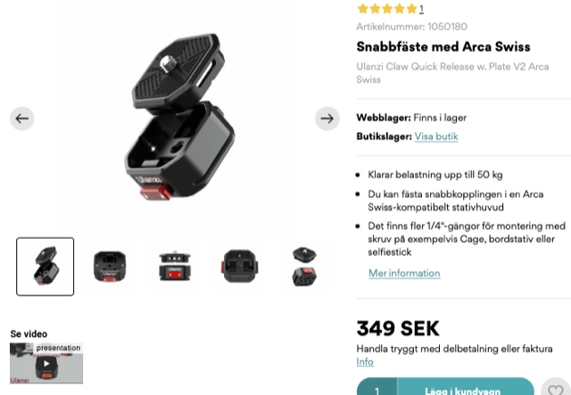
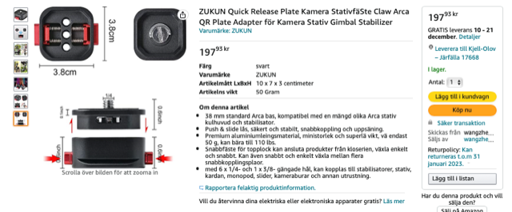
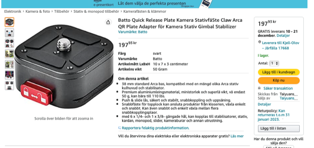
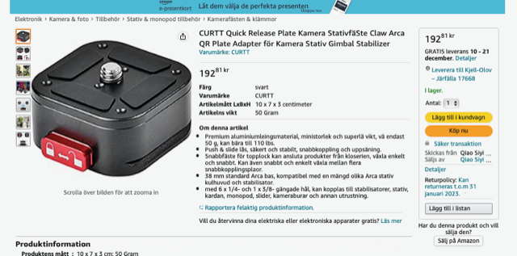
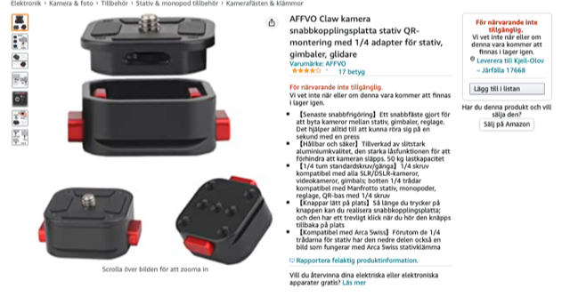

# Todo: Consider how the Ulanzi fast CLAW quick release for camera equipment is just a branded generic product from china (available under many brands on amazon)?

```#b09c5c60``` *As of 2022-11-06 22:11*

[mail plain/text](mail.txt)


Brands does not seem to matter anymore?

> *So, I bought the Ulanzi Fast Claw to try as a quick release solution for my camera and different rigs.*

> 

> [*https://www.scandinavianphoto.se/ulanzi/claw-quick-release-w.-plate-v2-arca-swiss-1050180?gclid=CjwKCAjwtp2bBhAGEiwAOZZTuGErmvC43nopl5vQSObE8VgdlSaEoJtUtPEeOcNA4WEk8C2c50VSkxoCOGoQAvD_BwE](https://www.scandinavianphoto.se/ulanzi/claw-quick-release-w.-plate-v2-arca-swiss-1050180?gclid=CjwKCAjwtp2bBhAGEiwAOZZTuGErmvC43nopl5vQSObE8VgdlSaEoJtUtPEeOcNA4WEk8C2c50VSkxoCOGoQAvD_BwE) *

> *Then I made a quick search on Swedish amazon site and soon found the seemingly exact ssame product under a variety of brands and to much lower prices.*

> 

> 

> 

> 


