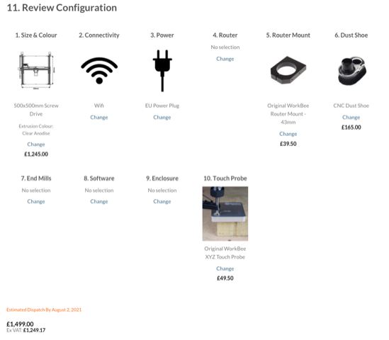
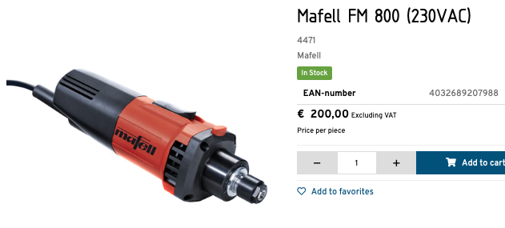
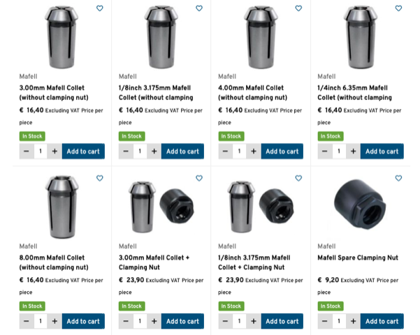
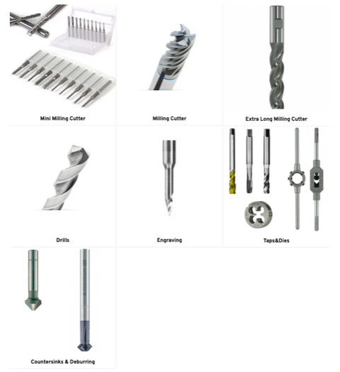

# Todo: Consider an Ooznest Workbee CNC with a Mafell milling motor?

```#b0d4214c``` *As of 2021-07-19 02:00*

[mail plain/text](mail.txt)


I want to start manufacture stuff using CNC-milling in wood and easy materials.

1) Consider an Ooznest 500x500 Workbee CNC ()

>   
> It seems I can get the smallest CNC without router for around €1500?

>   
> Shipping seems to be around 70€ - but what happened to the price (No VAT)?

2) Consider the smallest Mafell milling motor with no remote speed control?

>   
> The Mafell 800W milling motor - naked with 6 mm collet only (from <https://www.damencnc.com/en/mafell-fm-800-230vac/a2582?c=355> )

3) Consider what more I need to get started?

==&gt; I may need 8 mm collets - and more (<https://www.damencnc.com/en/milling-motors/mafell/mafell-collets> )?



==&gt; I need some milling bit set to get started (<https://www.damencnc.com/en/cutting-tools> )!



...


