# Todo: Consider to design and imagine to build a bike frame with a Pinion P1.12 C line gearbox and belt drive?

```#b167108a``` *As of 2021-08-05 23:01*

[mail plain/text](mail.txt)


Now I want to upgrade my bike to a belt driven Pinion gearbox one.

0) Pinion gearbox manufacturer seems to live here (<https://pinion.eu/en/> )?

==&gt; It seems I may consider the C-line 9 gear box for MTB (<https://pinion.eu/en/c-line/c1-9xr-gearbox/> )?

> 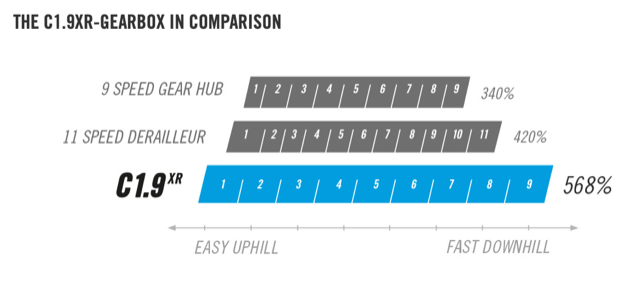

> WEIGHTS  
> Gearbox 3 2000,0 g  
> Rotary shifter DS2 95,0 g  
> Crank arms „CNC“ 175 mm 4 434,5 g  
> Crank arms „Forged“ 175 mm 4 481,5 g  
> Chain tensioner (Federstärke: 2,5 mm) 5 122,0 g  
> Chain ring 30t 51,0 g  
> Chain ring 24t 37,5 g  
> Gearbox Spider 104 mm 40,0 g  
> Rear sprocket 26t 37,5 g  
> Rear sprocket 21t 29,0 g

==&gt; It seems I may consider the (heavier) P-line 9 gear box for MTB (<https://pinion.eu/en/p-line/p1-9xr-gearbox/> )?

> *"**The increased bandwidth of the P1.9XR is also ideal for MTB trails on terrain with rapid changes of topography. The maintenance-free and permanently encapsulated drive with the wide range of gears allows lightning-fast and always reliable shifting. It guarantees perfect flow on uphill and downhill stretches. Enduro bikers and downhillers will find the perfect transmission with the P1.9XR.**"*

> *WEIGHTS  
> Gearbox 3 2350,0 g  
> Rotary shifter 95,0 g  
> Crank arms „CNC“ 175 mm 4 434,5 g  
> Crank arms „Forged“ 175 mm 4 481,5 g  
> Chain tensioner (Federstärke: 2,5 mm) 5 122,0 g  
> Chain ring 30t 51,0 g  
> Chain ring 24t 37,5 g  
> Gearbox Spider 104 mm 40,0 g  
> Rear sprocket 26t 37,5 g  
> Rear sprocket 21t 29,0 g*

==&gt; It seems I need to chose chainring, sprocket and wheel sizes to get the development range of my liking?

> 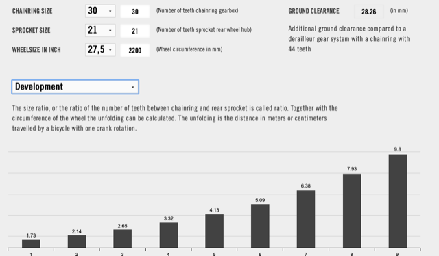

> 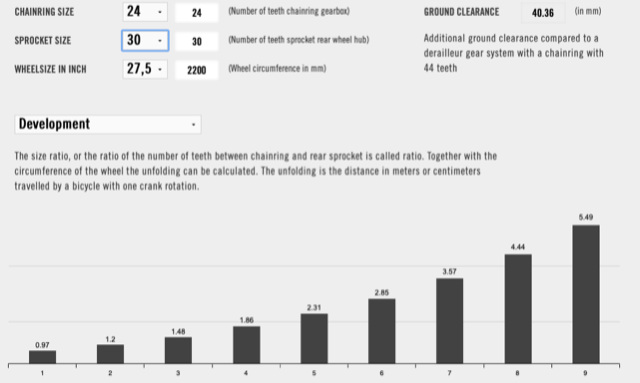

1) It seems I can buy steel tubes for building the frame from UK based Reynolds ([https://www.reynoldstechnology.biz](https://www.reynoldstechnology.biz/) )?

2) Consider this blog post "" laying out the build of a pinion gearbox steel tubing frame (<https://www.pinkbike.com/news/the-rig-v1--self-made-hardtail-frame-with-a-pinion-gearbox.html> )?

> *"**Tubing would be bought from the legendary Reynolds Technology who has been in the business for a very respectable 120-years!**"*

> *"**Although I’m going to take a second round with TIG welding, brazing was the way to get my toes wet with frame building and putting the Rig together.**"*

> *"**Just about every stage of the build process had some nuance or small detail, whether it be how to fix the tubes to the jig or the order of doing things, that would have led to many hard-learned (and expensive) lessons if I would have tackled the process by myself.**"*

=&gt;= So, it seems I will probably not be able to build the frame myself (to much details to get correct the first time)?

3) Consider where to buy the Pinion Gearbox and mounting bracket?

4) Consider if I need a bicycle frame gig?

5) Consider my buying options from Pinion listed dealers (<https://pinion.eu/en/dealer-overview/> )?

==&gt; It seems they have 9 premium partners?

>   
> <https://bit.ly/2JlUdE5> =&gt; [https://meissner-raeder.de](https://meissner-raeder.de/)

>   
> <https://pinion.eu/handler-ubersicht/velomondial/> =&gt; [https://velomondial.de](https://velomondial.de/)

> ## velophil Fahrradhandel GmbH

> Alt-Moabit 72  
> 10555 Berlin

  
> <https://bit.ly/2VJvssb> =&gt; [https://velophil.berlin](https://velophil.berlin/)

>   
> 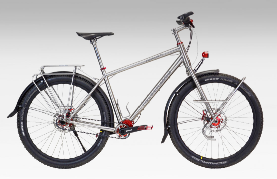

> <https://bit.ly/2JFWVnn> =&gt; [https://velophil.berlin](https://velophil.berlin/) (Falkenjagd Hoplit has Pinion gears and costs almost 100 000 SEK)

>   
> <https://bit.ly/2YxW8ZS> =&gt; [https://www.pedalwerk.de](https://www.pedalwerk.de/)

> 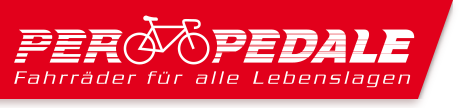  
> <https://pinion.eu/handler-ubersicht/per_pedale/> =&gt; [https://perpedale.de](https://perpedale.de/)

> 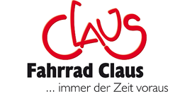  
> <http://www.fahrrad-claus.de/> =&gt; <http://www.fahrrad-claus.de/startseite.html>

>   
> <https://bit.ly/2WLxmVJ> =&gt; [https://pinion-bikes.de](https://pinion-bikes.de/) (Google wanted to translate the site and maybe that was why it took some time before it loaded)?

==&gt; It seems they have 45 top dealers?

==&gt; It seems they have 522 registered dealers?

6) Consider the Quantor Urkraft mountainbike hard tail frame with Pinion C1.12 gearbox and belt drive (<https://pinion-bikes.de/QUANTOR-URKRAFT-29-Hardtail-Mountainbike-Rahmen-Getriebe-Set-Pinion-Gates> )?

> 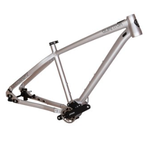  
> The Quantor Urkraft 44 cm mountainbike hard tail Frame only with C-line 12 gear pinion belt drive for almost 20 000 SEK.

==&gt; Also consider the entry lever trecking frame naked (<https://pinion-bikes.de/Boettcher-Levante-Pinion-Rahmen-Gabel-Set-Tiefeinsteiger-roh> )?

> 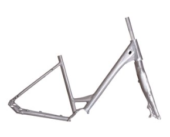  
> New frame & fork set unpainted for building a comfortable Pinion trekking & touring bike for about 5000 SEK.

==&gt; Consider the entry level C-line 12 gear pinion-bikes hard tail for 25 000 SEK (only 5000 SEK more than frame only!)

> 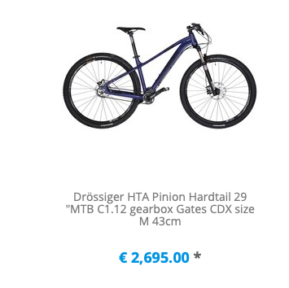

==&gt; Consider the full suspension Quantor bikes (<https://pinion-bikes.de/Mountainbike-Fully> )?

> 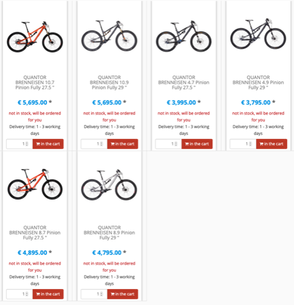

7) Consider to buy Pinion components from pinion-bikes (<https://pinion-bikes.de/Pinion-Komponenten> )?

> 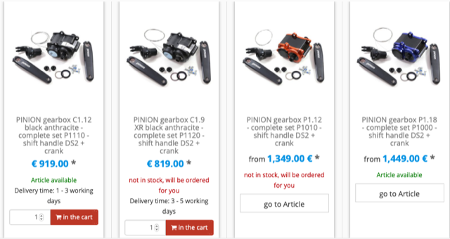  
> It seems I can order the Pinion gearbox kits C line 9 gear for 820€, C-line 12 gear for 920€, P-line 12 gear for 1400€ and P-line 18 gear for 1500€?

8) Consider to study the Bikes I have access to and have ridden myself?

==&gt; My Friend Pär has an 2020 or 2021 model of the Specialized Epic Expert Evo (<https://www.specialized.com/se/en/epic-expert/p/175236?color=281544-175236> )?

> 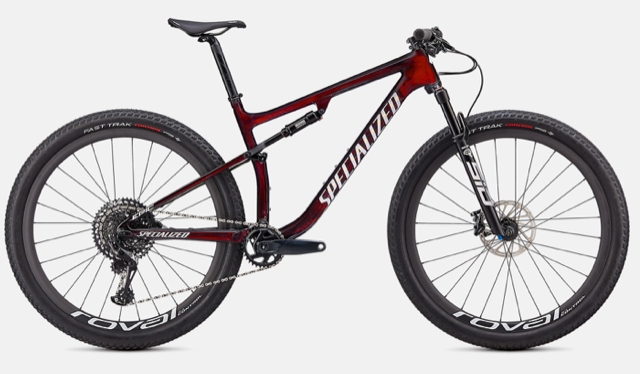

==&gt; It seems Pärs frient Peter has a Specialized Epic Comp (<https://www.specialized.com/se/en/epic-comp/p/175237?color=281543-175237> )?

> 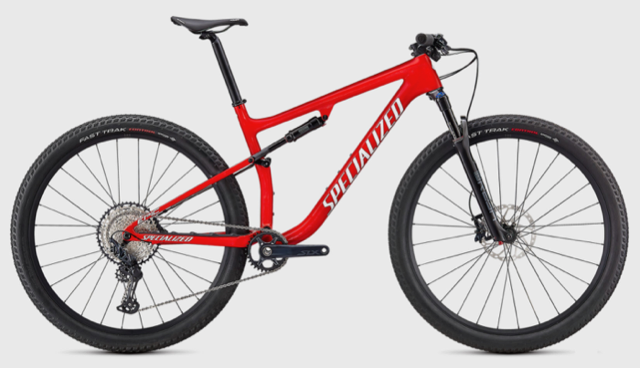

==&gt; The bike I borrowed from Pär is a hardtail Fuji (Bihhorn?) Hardtail with SLX (<https://www.fujibikes.com/usa/bikes/mountain/trail/bighorn> )?

> 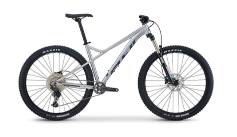

==&gt; Consider to study the components on the two Fuji Bighorn hardtail 2021 models (<https://www.fujibikes.com/usa/compare/bighorn-29-1-5/bighorn-29-1-3> )?

==&gt; It seems Pär has bought a Scott Scale 710 for his wife (<https://www.cykelkraft.se/scott-scale-710-262297> )?

> 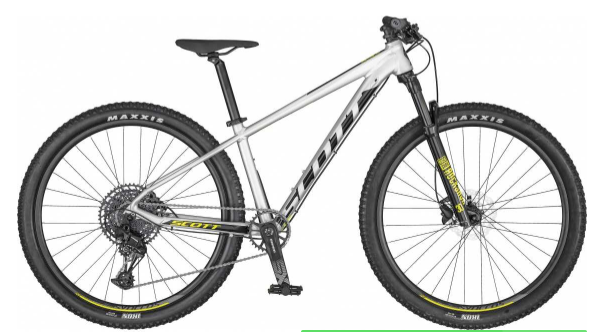

==&gt; It seems Scott no longer produce the Scale 710 but has the larger Scale 910 (<https://www.scott-sports.com/se/en/product/scott-scale-910-axs-bike?article=286318008> )?

> 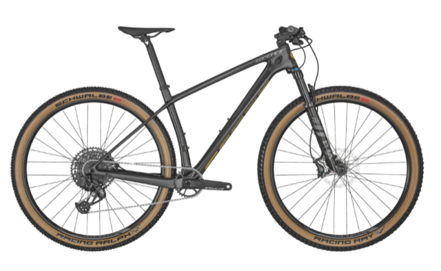

9) Consider the up to 3000€ Pinion with belt drive mountain bikes listed by Pinion ()?

> 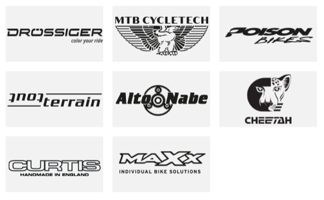

> ==&gt; Consider the Cheetah Bikes Allmountain MountainSpirit AM 2021 (<https://www.cheetah.de/produkt/allmountain-mountain-spirit-am> )?

> 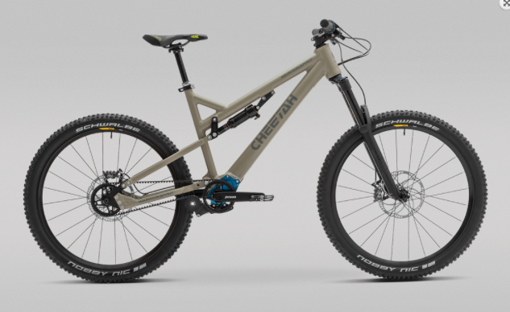

> ==&gt; Consider to ask cheetah bikes if they would sell me a nked full suspension frame ([info@cheetah.de](mailto:info@cheetah.de) )?

...


