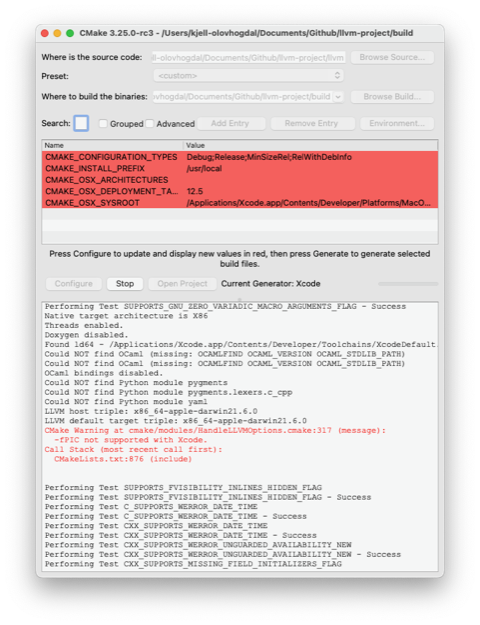

# Todo: Consider to build the LLVM trunk from Github clone on my macOS Monterey on Intel MacPro 2013 "Trashcan"?

```#b2340650``` *As of 2022-11-06 21:27*

[mail plain/text](mail.txt)


I want to start compiling C++20 ranges using clang and it seems in Nov 2022 I need the trunk version to do this?

1) Consider the instructions on how to build LLVM can be found on the LLVM Githum home page (<https://github.com/llvm/llvm-project> )?

> 1. Checkout LLVM (including related sub-projects like Clang)  
> 2. Configure and build LLVM and Clang  
> 2.1 cd llvm-project  
> 2.2 cmake -S llvm -B build -G Xcode -DLLVM_ENABLE_PROJECTS='clang;lldb' -DLLVM_ENABLE_RUNTIMES='libcxx; libcxxabi' -DCMAKE_INSTALL_PREFIX=/usr/local -DCMAKE_BUILD_TYPE=Debug  
> 2.3 cmake --build build

2) Consider It seems cloning LLVM from github is quite straight forward?

> kjell-olovhogdal@Kjell-Olovs-Mac-Pro Github % git clone <https://github.com/llvm/llvm-project.git>  
> Cloning into 'llvm-project'...  
> remote: Enumerating objects: 5106720, done.  
> remote: Counting objects: 100% (2414/2414), done.  
> remote: Compressing objects: 100% (378/378), done.  
> Receiving objects: 42% (2186500/5106720), 1.31 GiB | 6.70 MiB/s  
> ...  
> Receiving objects: 100% (5106720/5106720), 2.08 GiB | 6.65 MiB/s, done.  
> Resolving deltas: 100% (4180369/4180369), done.  
> Updating files: 100% (122134/122134), done.  
> kjell-olovhogdal@Kjell-Olovs-Mac-Pro Github %

3) Consider using cmake to generate an XCode build environment is NOT straight forward (why am I not surprised)?

==&gt;Consider the content of the LLVM project toor directory?

> kjell-olovhogdal@Kjell-Olovs-Mac-Pro Github % cd llvm-project  
> kjell-olovhogdal@Kjell-Olovs-Mac-Pro llvm-project % ls -l  
> total 64  
> -rw-r--r-- 1 kjell-olovhogdal staff 431 Nov 6 18:11 CONTRIBUTING.md  
> -rw-r--r-- 1 kjell-olovhogdal staff 15141 Nov 6 18:11 LICENSE.TXT  
> -rw-r--r-- 1 kjell-olovhogdal staff 5678 Nov 6 18:11 README.md  
> -rw-r--r-- 1 kjell-olovhogdal staff 205 Nov 6 18:11 SECURITY.md  
> drwxr-xr-x 14 kjell-olovhogdal staff 448 Nov 6 18:11 bolt  
> drwxr-xr-x 24 kjell-olovhogdal staff 768 Nov 6 18:11 clang  
> drwxr-xr-x 24 kjell-olovhogdal staff 768 Nov 6 18:11 clang-tools-extra  
> drwxr-xr-x 4 kjell-olovhogdal staff 128 Nov 6 18:11 cmake  
> drwxr-xr-x 18 kjell-olovhogdal staff 576 Nov 6 18:11 compiler-rt  
> drwxr-xr-x 7 kjell-olovhogdal staff 224 Nov 6 18:11 cross-project-tests  
> drwxr-xr-x 20 kjell-olovhogdal staff 640 Nov 6 18:11 flang  
> drwxr-xr-x 21 kjell-olovhogdal staff 672 Nov 6 18:11 libc  
> drwxr-xr-x 26 kjell-olovhogdal staff 832 Nov 6 18:11 libclc  
> drwxr-xr-x 19 kjell-olovhogdal staff 608 Nov 6 18:11 libcxx  
> drwxr-xr-x 14 kjell-olovhogdal staff 448 Nov 6 18:11 libcxxabi  
> drwxr-xr-x 10 kjell-olovhogdal staff 320 Nov 6 18:11 libunwind  
> drwxr-xr-x 21 kjell-olovhogdal staff 672 Nov 6 18:11 lld  
> drwxr-xr-x 23 kjell-olovhogdal staff 736 Nov 6 18:12 lldb  
> drwxr-xr-x 28 kjell-olovhogdal staff 896 Nov 6 18:12 llvm  
> drwxr-xr-x 6 kjell-olovhogdal staff 192 Nov 6 18:12 llvm-libgcc  
> drwxr-xr-x 18 kjell-olovhogdal staff 576 Nov 6 18:12 mlir  
> drwxr-xr-x 13 kjell-olovhogdal staff 416 Nov 6 18:12 openmp  
> drwxr-xr-x 18 kjell-olovhogdal staff 576 Nov 6 18:12 polly  
> drwxr-xr-x 11 kjell-olovhogdal staff 352 Nov 6 18:12 pstl  
> drwxr-xr-x 4 kjell-olovhogdal staff 128 Nov 6 18:12 runtimes  
> drwxr-xr-x 4 kjell-olovhogdal staff 128 Nov 6 18:12 third-party  
> drwxr-xr-x 4 kjell-olovhogdal staff 128 Nov 6 18:12 utils  
> kjell-olovhogdal@Kjell-Olovs-Mac-Pro llvm-project %

==&gt; It seems trying to generate for XCode failed?

> kjell-olovhogdal@Kjell-Olovs-Mac-Pro llvm-project % cmake -S llvm -B build -G Xcode -DLLVM_ENABLE_PROJECTS='clang;lldb' -DLLVM_ENABLE_RUNTIMES='libcxx; libcxxabi' -DCMAKE_INSTALL_PREFIX=/usr/local -DCMAKE_BUILD_TYPE=Debug  
> -- The C compiler identification is unknown  
> -- The CXX compiler identification is unknown  
> -- The ASM compiler identification is Clang with GNU-like command-line  
> -- Found assembler: /Applications/Xcode.app/Contents/Developer/Toolchains/XcodeDefault.xctoolchain/usr/bin/cc  
> CMake Error at CMakeLists.txt:47 (project):  
> No CMAKE_C_COMPILER could be found.

> CMake Error at CMakeLists.txt:47 (project):  
> No CMAKE_CXX_COMPILER could be found.

> -- Configuring incomplete, errors occurred!  
> See also "/Users/kjell-olovhogdal/Documents/Github/llvm-project/build/CMakeFiles/CMakeOutput.log".  
> See also "/Users/kjell-olovhogdal/Documents/Github/llvm-project/build/CMakeFiles/CMakeError.log".  
> kjell-olovhogdal@Kjell-Olovs-Mac-Pro llvm-project %

==&gt; It seems I get the exact same failure if I let CMake choose the default build environment (generator) itself?

> kjell-olovhogdal@Kjell-Olovs-Mac-Pro llvm-project % cmake -S llvm -B build -DLLVM_ENABLE_PROJECTS='clang;lldb' -DLLVM_ENABLE_RUNTIMES='libcxx; libcxxabi' -DCMAKE_INSTALL_PREFIX=/usr/local -DCMAKE_BUILD_TYPE=Debug  
> -- The C compiler identification is unknown  
> -- The CXX compiler identification is unknown  
> CMake Error at CMakeLists.txt:47 (project):  
> No CMAKE_C_COMPILER could be found.

> CMake Error at CMakeLists.txt:47 (project):  
> No CMAKE_CXX_COMPILER could be found.

> -- Configuring incomplete, errors occurred!  
> See also "/Users/kjell-olovhogdal/Documents/Github/llvm-project/build/CMakeFiles/CMakeOutput.log".  
> See also "/Users/kjell-olovhogdal/Documents/Github/llvm-project/build/CMakeFiles/CMakeError.log".  
> kjell-olovhogdal@Kjell-Olovs-Mac-Pro llvm-project %

==&gt; It seems the CMake GUI-App version 3.25 works out of the box?



  
> The C compiler identification is AppleClang 14.0.0.14000029  
> The CXX compiler identification is AppleClang 14.0.0.14000029  
> The ASM compiler identification is Clang with GNU-like command-line  
> Found assembler: /Applications/Xcode.app/Contents/Developer/Toolchains/XcodeDefault.xctoolchain/usr/bin/cc  
> Detecting C compiler ABI info  
> Detecting C compiler ABI info - done  
> Check for working C compiler: /Applications/Xcode.app/Contents/Developer/Toolchains/XcodeDefault.xctoolchain/usr/bin/clang - skipped  
> Detecting C compile features  
> Detecting C compile features - done  
> Detecting CXX compiler ABI info  
> Detecting CXX compiler ABI info - done  
> Check for working CXX compiler: /Applications/Xcode.app/Contents/Developer/Toolchains/XcodeDefault.xctoolchain/usr/bin/clang++ - skipped  
> Detecting CXX compile features  
> Detecting CXX compile features - done  
> Found libtool - /Applications/Xcode.app/Contents/Developer/Toolchains/XcodeDefault.xctoolchain/usr/bin/libtool  
> Found Python3: /usr/local/Frameworks/Python.framework/Versions/3.10/bin/python3.10 (found suitable version "3.10.8", minimum required is "3.6") found components: Interpreter  
> Looking for dlfcn.h  
> Looking for dlfcn.h - found  
> Looking for errno.h  
> Looking for errno.h - found  
> Looking for fcntl.h  
> Looking for fcntl.h - found  
> Looking for link.h  
> Looking for link.h - not found  
> Looking for malloc/malloc.h  
> Looking for malloc/malloc.h - found  
> Looking for pthread.h  
> Looking for pthread.h - found  
> Looking for signal.h  
> Looking for signal.h - found  
> Looking for sys/ioctl.h  
> Looking for sys/ioctl.h - found  
> Looking for sys/mman.h  
> Looking for sys/mman.h - found  
> Looking for sys/param.h  
> Looking for sys/param.h - found  
> Looking for sys/resource.h  
> Looking for sys/resource.h - found  
> Looking for sys/stat.h  
> Looking for sys/stat.h - found  
> Looking for sys/time.h  
> Looking for sys/time.h - found  
> Looking for sys/types.h  
> Looking for sys/types.h - found  
> Looking for sysexits.h  
> Looking for sysexits.h - found  
> Looking for termios.h  
> Looking for termios.h - found  
> Looking for unistd.h  
> Looking for unistd.h - found  
> Looking for valgrind/valgrind.h  
> Looking for valgrind/valgrind.h - not found  
> Looking for fenv.h  
> Looking for fenv.h - found  
> Looking for FE_ALL_EXCEPT  
> Looking for FE_ALL_EXCEPT - found  
> Looking for FE_INEXACT  
> Looking for FE_INEXACT - found  
> Looking for mach/mach.h  
> Looking for mach/mach.h - found  
> Looking for CrashReporterClient.h  
> Looking for CrashReporterClient.h - not found  
> Performing Test HAVE_CRASHREPORTER_INFO  
> Performing Test HAVE_CRASHREPORTER_INFO - Success  
> Looking for pthread_create in pthread  
> Looking for pthread_create in pthread - found  
> Looking for pthread_rwlock_init in pthread  
> Looking for pthread_rwlock_init in pthread - found  
> Looking for pthread_mutex_lock in pthread  
> Looking for pthread_mutex_lock in pthread - found  
> Looking for dlopen in dl  
> Looking for dlopen in dl - found  
> Looking for clock_gettime in rt  
> Looking for clock_gettime in rt - not found  
> Looking for pfm_initialize in pfm  
> Looking for pfm_initialize in pfm - not found  
> Performing Test CMAKE_HAVE_LIBC_PTHREAD  
> Performing Test CMAKE_HAVE_LIBC_PTHREAD - Success  
> Found Threads: TRUE  
> Found ZLIB: /Applications/Xcode.app/Contents/Developer/Platforms/MacOSX.platform/Developer/SDKs/MacOSX13.0.sdk/usr/lib/libz.tbd (found version "1.2.11")  
> Looking for compress2  
> Looking for compress2 - found  
> Found LibXml2: /Applications/Xcode.app/Contents/Developer/Platforms/MacOSX.platform/Developer/SDKs/MacOSX13.0.sdk/usr/lib/libxml2.tbd (found version "2.9.13")  
> Looking for xmlReadMemory  
> Looking for xmlReadMemory - found  
> Looking for histedit.h  
> Looking for histedit.h - found  
> Found LibEdit: /Applications/Xcode.app/Contents/Developer/Platforms/MacOSX.platform/Developer/SDKs/MacOSX13.0.sdk/usr/include (found version "2.11")  
> Performing Test Terminfo_LINKABLE  
> Performing Test Terminfo_LINKABLE - Success  
> Found Terminfo: /Applications/Xcode.app/Contents/Developer/Platforms/MacOSX.platform/Developer/SDKs/MacOSX13.0.sdk/usr/lib/libcurses.tbd  
> Looking for xar_open in xar  
> Looking for xar_open in xar - found  
> The xar file format has been deprecated: LLVM_HAVE_LIBXAR might be removed in the future.  
> Looking for arc4random  
> Looking for arc4random - found  
> Looking for backtrace  
> Looking for backtrace - found  
> backtrace facility detected in default set of libraries  
> Found Backtrace: /Applications/Xcode.app/Contents/Developer/Platforms/MacOSX.platform/Developer/SDKs/MacOSX13.0.sdk/usr/include  
> Performing Test C_SUPPORTS_WERROR_UNGUARDED_AVAILABILITY_NEW  
> Performing Test C_SUPPORTS_WERROR_UNGUARDED_AVAILABILITY_NEW - Success  
> Looking for __register_frame  
> Looking for __register_frame - found  
> Looking for __deregister_frame  
> Looking for __deregister_frame - found  
> Looking for __unw_add_dynamic_fde  
> Looking for __unw_add_dynamic_fde - found  
> Looking for _Unwind_Backtrace  
> Looking for _Unwind_Backtrace - found  
> Looking for getpagesize  
> Looking for getpagesize - found  
> Looking for sysconf  
> Looking for sysconf - found  
> Looking for getrusage  
> Looking for getrusage - found  
> Looking for setrlimit  
> Looking for setrlimit - found  
> Looking for isatty  
> Looking for isatty - found  
> Looking for futimens  
> Looking for futimens - found  
> Looking for futimes  
> Looking for futimes - found  
> Looking for lseek64  
> Looking for lseek64 - not found  
> Looking for mallctl  
> Looking for mallctl - not found  
> Looking for mallinfo  
> Looking for mallinfo - not found  
> Looking for mallinfo2  
> Looking for mallinfo2 - not found  
> Looking for malloc_zone_statistics  
> Looking for malloc_zone_statistics - found  
> Looking for getrlimit  
> Looking for getrlimit - found  
> Looking for posix_spawn  
> Looking for posix_spawn - found  
> Looking for pread  
> Looking for pread - found  
> Looking for sbrk  
> Looking for sbrk - found  
> Looking for strerror  
> Looking for strerror - found  
> Looking for strerror_r  
> Looking for strerror_r - found  
> Looking for strerror_s  
> Looking for strerror_s - not found  
> Looking for setenv  
> Looking for setenv - found  
> Looking for dlopen  
> Looking for dlopen - found  
> Looking for dladdr  
> Looking for dladdr - found  
> Performing Test HAVE_STRUCT_STAT_ST_MTIMESPEC_TV_NSEC  
> Performing Test HAVE_STRUCT_STAT_ST_MTIMESPEC_TV_NSEC - Success  
> Performing Test HAVE_STRUCT_STAT_ST_MTIM_TV_NSEC  
> Performing Test HAVE_STRUCT_STAT_ST_MTIM_TV_NSEC - Failed  
> Looking for __GLIBC__  
> Looking for __GLIBC__ - not found  
> Looking for pthread_getname_np  
> Looking for pthread_getname_np - found  
> Looking for pthread_setname_np  
> Looking for pthread_setname_np - found  
> Looking for proc_pid_rusage  
> Looking for proc_pid_rusage - found  
> Performing Test HAVE_CXX_ATOMICS_WITHOUT_LIB  
> Performing Test HAVE_CXX_ATOMICS_WITHOUT_LIB - Success  
> Performing Test HAVE_CXX_ATOMICS64_WITHOUT_LIB  
> Performing Test HAVE_CXX_ATOMICS64_WITHOUT_LIB - Success  
> Performing Test LLVM_HAS_ATOMICS  
> Performing Test LLVM_HAS_ATOMICS - Success  
> Performing Test SUPPORTS_VARIADIC_MACROS_FLAG  
> Performing Test SUPPORTS_VARIADIC_MACROS_FLAG - Success  
> Performing Test SUPPORTS_GNU_ZERO_VARIADIC_MACRO_ARGUMENTS_FLAG  
> Performing Test SUPPORTS_GNU_ZERO_VARIADIC_MACRO_ARGUMENTS_FLAG - Success  
> Native target architecture is X86  
> Threads enabled.  
> Doxygen disabled.  
> Found ld64 - /Applications/Xcode.app/Contents/Developer/Toolchains/XcodeDefault.xctoolchain/usr/bin/ld  
> Could NOT find OCaml (missing: OCAMLFIND OCAML_VERSION OCAML_STDLIB_PATH)  
> Could NOT find OCaml (missing: OCAMLFIND OCAML_VERSION OCAML_STDLIB_PATH)  
> OCaml bindings disabled.  
> Could NOT find Python module pygments  
> Could NOT find Python module pygments.lexers.c_cpp  
> Could NOT find Python module yaml  
> LLVM host triple: x86_64-apple-darwin21.6.0  
> LLVM default target triple: x86_64-apple-darwin21.6.0  
> CMake Warning at cmake/modules/HandleLLVMOptions.cmake:317 (message):  
> -fPIC not supported with Xcode.  
> Call Stack (most recent call first):  
> CMakeLists.txt:876 (include)

> Performing Test SUPPORTS_FVISIBILITY_INLINES_HIDDEN_FLAG  
> Performing Test SUPPORTS_FVISIBILITY_INLINES_HIDDEN_FLAG - Success  
> Performing Test C_SUPPORTS_WERROR_DATE_TIME  
> Performing Test C_SUPPORTS_WERROR_DATE_TIME - Success  
> Performing Test CXX_SUPPORTS_WERROR_DATE_TIME  
> Performing Test CXX_SUPPORTS_WERROR_DATE_TIME - Success  
> Performing Test CXX_SUPPORTS_WERROR_UNGUARDED_AVAILABILITY_NEW  
> Performing Test CXX_SUPPORTS_WERROR_UNGUARDED_AVAILABILITY_NEW - Success  
> Performing Test CXX_SUPPORTS_MISSING_FIELD_INITIALIZERS_FLAG  
> Performing Test CXX_SUPPORTS_MISSING_FIELD_INITIALIZERS_FLAG - Success  
> Performing Test C_SUPPORTS_CXX98_COMPAT_EXTRA_SEMI_FLAG  
> Performing Test C_SUPPORTS_CXX98_COMPAT_EXTRA_SEMI_FLAG - Success  
> Performing Test CXX_SUPPORTS_CXX98_COMPAT_EXTRA_SEMI_FLAG  
> Performing Test CXX_SUPPORTS_CXX98_COMPAT_EXTRA_SEMI_FLAG - Success  
> Performing Test C_SUPPORTS_IMPLICIT_FALLTHROUGH_FLAG  
> Performing Test C_SUPPORTS_IMPLICIT_FALLTHROUGH_FLAG - Success  
> Performing Test CXX_SUPPORTS_IMPLICIT_FALLTHROUGH_FLAG  
> Performing Test CXX_SUPPORTS_IMPLICIT_FALLTHROUGH_FLAG - Success  
> Performing Test C_SUPPORTS_COVERED_SWITCH_DEFAULT_FLAG  
> Performing Test C_SUPPORTS_COVERED_SWITCH_DEFAULT_FLAG - Success  
> Performing Test CXX_SUPPORTS_COVERED_SWITCH_DEFAULT_FLAG  
> Performing Test CXX_SUPPORTS_COVERED_SWITCH_DEFAULT_FLAG - Success  
> Performing Test CXX_SUPPORTS_CLASS_MEMACCESS_FLAG  
> Performing Test CXX_SUPPORTS_CLASS_MEMACCESS_FLAG - Failed  
> Performing Test CXX_SUPPORTS_NOEXCEPT_TYPE_FLAG  
> Performing Test CXX_SUPPORTS_NOEXCEPT_TYPE_FLAG - Success  
> Performing Test CXX_WONT_WARN_ON_FINAL_NONVIRTUALDTOR  
> Performing Test CXX_WONT_WARN_ON_FINAL_NONVIRTUALDTOR - Success  
> Performing Test CXX_SUPPORTS_SUGGEST_OVERRIDE_FLAG  
> Performing Test CXX_SUPPORTS_SUGGEST_OVERRIDE_FLAG - Success  
> Performing Test CXX_WSUGGEST_OVERRIDE_ALLOWS_ONLY_FINAL  
> Performing Test CXX_WSUGGEST_OVERRIDE_ALLOWS_ONLY_FINAL - Success  
> Performing Test C_WCOMMENT_ALLOWS_LINE_WRAP  
> Performing Test C_WCOMMENT_ALLOWS_LINE_WRAP - Success  
> Performing Test C_SUPPORTS_STRING_CONVERSION_FLAG  
> Performing Test C_SUPPORTS_STRING_CONVERSION_FLAG - Success  
> Performing Test CXX_SUPPORTS_STRING_CONVERSION_FLAG  
> Performing Test CXX_SUPPORTS_STRING_CONVERSION_FLAG - Success  
> Performing Test C_SUPPORTS_MISLEADING_INDENTATION_FLAG  
> Performing Test C_SUPPORTS_MISLEADING_INDENTATION_FLAG - Success  
> Performing Test CXX_SUPPORTS_MISLEADING_INDENTATION_FLAG  
> Performing Test CXX_SUPPORTS_MISLEADING_INDENTATION_FLAG - Success  
> Performing Test C_SUPPORTS_CTAD_MAYBE_UNSPPORTED_FLAG  
> Performing Test C_SUPPORTS_CTAD_MAYBE_UNSPPORTED_FLAG - Success  
> Performing Test CXX_SUPPORTS_CTAD_MAYBE_UNSPPORTED_FLAG  
> Performing Test CXX_SUPPORTS_CTAD_MAYBE_UNSPPORTED_FLAG - Success  
> Looking for os_signpost_interval_begin  
> Looking for os_signpost_interval_begin - found  
> Performing Test macos_signposts_usable  
> Performing Test macos_signposts_usable - Success  
> Linker detection: ld64  
> Performing Test HAS_WERROR_GLOBAL_CTORS  
> Performing Test HAS_WERROR_GLOBAL_CTORS - Success  
> Performing Test LLVM_HAS_NOGLOBAL_CTOR_MUTEX  
> Performing Test LLVM_HAS_NOGLOBAL_CTOR_MUTEX - Failed  
> Looking for __x86_64__  
> Looking for __x86_64__ - found  
> Found Git: /usr/bin/git (found version "2.37.1 (Apple Git-137.1)")  
> Targeting AArch64  
> Targeting AMDGPU  
> Targeting ARM  
> Targeting AVR  
> Targeting BPF  
> Targeting Hexagon  
> Targeting Lanai  
> Targeting Mips  
> Targeting MSP430  
> Targeting NVPTX  
> Targeting PowerPC  
> Targeting RISCV  
> Targeting Sparc  
> Targeting SystemZ  
> Targeting VE  
> Targeting WebAssembly  
> Targeting X86  
> Targeting XCore  
> Registering Bye as a pass plugin (static build: OFF)  
> Failed to find LLVM FileCheck  
> git version: v0.0.0 normalized to 0.0.0  
> Version: 1.6.0  
> Looking for shm_open in rt  
> Looking for shm_open in rt - not found  
> Performing Test HAVE_CXX_FLAG_STD_CXX11  
> Performing Test HAVE_CXX_FLAG_STD_CXX11 - Success  
> Performing Test HAVE_CXX_FLAG_WALL  
> Performing Test HAVE_CXX_FLAG_WALL - Success  
> Performing Test HAVE_CXX_FLAG_WEXTRA  
> Performing Test HAVE_CXX_FLAG_WEXTRA - Success  
> Performing Test HAVE_CXX_FLAG_WSHADOW  
> Performing Test HAVE_CXX_FLAG_WSHADOW - Success  
> Performing Test HAVE_CXX_FLAG_WSUGGEST_OVERRIDE  
> Performing Test HAVE_CXX_FLAG_WSUGGEST_OVERRIDE - Success  
> Performing Test HAVE_CXX_FLAG_PEDANTIC  
> Performing Test HAVE_CXX_FLAG_PEDANTIC - Success  
> Performing Test HAVE_CXX_FLAG_PEDANTIC_ERRORS  
> Performing Test HAVE_CXX_FLAG_PEDANTIC_ERRORS - Success  
> Performing Test HAVE_CXX_FLAG_WSHORTEN_64_TO_32  
> Performing Test HAVE_CXX_FLAG_WSHORTEN_64_TO_32 - Success  
> Performing Test HAVE_CXX_FLAG_FSTRICT_ALIASING  
> Performing Test HAVE_CXX_FLAG_FSTRICT_ALIASING - Success  
> Performing Test HAVE_CXX_FLAG_WNO_DEPRECATED_DECLARATIONS  
> Performing Test HAVE_CXX_FLAG_WNO_DEPRECATED_DECLARATIONS - Success  
> Performing Test HAVE_CXX_FLAG_FNO_EXCEPTIONS  
> Performing Test HAVE_CXX_FLAG_FNO_EXCEPTIONS - Success  
> Performing Test HAVE_CXX_FLAG_WSTRICT_ALIASING  
> Performing Test HAVE_CXX_FLAG_WSTRICT_ALIASING - Success  
> Performing Test HAVE_CXX_FLAG_WD654  
> Performing Test HAVE_CXX_FLAG_WD654 - Failed  
> Performing Test HAVE_CXX_FLAG_WTHREAD_SAFETY  
> Performing Test HAVE_CXX_FLAG_WTHREAD_SAFETY - Success  
> Performing Test HAVE_THREAD_SAFETY_ATTRIBUTES  
> Performing Test HAVE_THREAD_SAFETY_ATTRIBUTES  
> Performing Test HAVE_THREAD_SAFETY_ATTRIBUTES -- failed to compile  
> Performing Test HAVE_CXX_FLAG_COVERAGE  
> Performing Test HAVE_CXX_FLAG_COVERAGE - Failed  
> Performing Test HAVE_GNU_POSIX_REGEX  
> Performing Test HAVE_GNU_POSIX_REGEX  
> Performing Test HAVE_GNU_POSIX_REGEX -- failed to compile  
> Performing Test HAVE_POSIX_REGEX  
> Performing Test HAVE_POSIX_REGEX  
> Performing Test HAVE_POSIX_REGEX -- success  
> Performing Test HAVE_STEADY_CLOCK  
> Performing Test HAVE_STEADY_CLOCK  
> Performing Test HAVE_STEADY_CLOCK -- success  
> Configuring done  
> Generating done

==&gt; It seems the command line Cmake I was using is installed with Brew so I could upgrade it with Brew?

> kjell-olovhogdal@Kjell-Olovs-Mac-Pro llvm-project % cmake -version  
> cmake version 3.23.0

> CMake suite maintained and supported by Kitware ([kitware.com/cmake](http://kitware.com/cmake)).  
> kjell-olovhogdal@Kjell-Olovs-Mac-Pro llvm-project % brew list cmake  
> Warning: Treating cmake as a formula. For the cask, use homebrew/cask/cmake  
> /usr/local/Cellar/cmake/3.23.0/bin/ccmake  
> /usr/local/Cellar/cmake/3.23.0/bin/cmake  
> /usr/local/Cellar/cmake/3.23.0/bin/cpack  
> /usr/local/Cellar/cmake/3.23.0/bin/ctest  
> /usr/local/Cellar/cmake/3.23.0/share/aclocal/cmake.m4  
> /usr/local/Cellar/cmake/3.23.0/share/bash-completion/ (3 files)  
> /usr/local/Cellar/cmake/3.23.0/share/cmake/ (3020 files)  
> /usr/local/Cellar/cmake/3.23.0/share/doc/ (7 files)  
> /usr/local/Cellar/cmake/3.23.0/share/emacs/site-lisp/cmake/cmake-mode.el  
> /usr/local/Cellar/cmake/3.23.0/share/vim/ (2 files)  
> kjell-olovhogdal@Kjell-Olovs-Mac-Pro llvm-project % brew upgrade cmake  
> Running \`brew update --auto-update\`...  
> ==&gt; **Auto-updated Homebrew!**  
> Updated 2 taps (homebrew/core and homebrew/cask).  
> ==&gt; **New Formulae**  
> btrfs-progs cmctl hysteria mariadb@10.8

> You have **90** outdated formulae installed.  
> You can upgrade them with **brew upgrade**  
> or list them with **brew outdated**.

> Warning: Treating cmake as a formula. For the cask, use homebrew/cask/cmake  
> ==&gt; **Upgrading 1 outdated package:**  
> cmake 3.23.0 -&gt; 3.24.2  
> ==&gt; **Downloading <https://ghcr.io/v2/homebrew/core/cmake/manifests/3.24.2>**  
> ######################################################################## 100.0%  
> ==&gt; **Downloading <https://ghcr.io/v2/homebrew/core/cmake/blobs/sha256:fc9cb2aa232dacabf2c689d1c414971e76773c84a91fe65548338447a66c3860>**  
> ==&gt; **Downloading from <https://pkg-containers.githubusercontent.com/ghcr1/blobs/sha256:fc9cb2aa232dacabf2c689d1c414971e76773c84a91fe65548338447a66c3860?se=2022-11-06T17%3A50%3A00Z&sig=LwmyU4B1Wde2FJnwC5NwCwiWa2efpTl43OGhtsukCsw%3D&sp=r&spr=https&sr=b&sv=2019-12-12>**  
> ######################################################################## 100.0%  
> ==&gt; **Upgrading ****cmake**  
> **3.23.0 -&gt; 3.24.2 **

> ==&gt; **Pouring cmake--3.24.2.monterey.bottle.tar.gz**  
> 🍺 /usr/local/Cellar/cmake/3.24.2: 3,106 files, 46.8MB  
> ==&gt; **Running \`brew cleanup cmake\`...**  
> Disable this behaviour by setting HOMEBREW_NO_INSTALL_CLEANUP.  
> Hide these hints with HOMEBREW_NO_ENV_HINTS (see \`man brew\`).  
> Removing: /usr/local/Cellar/cmake/3.22.1... (2,986 files, 44.3MB)  
> Removing: /usr/local/Cellar/cmake/3.23.0... (3,042 files, 45.0MB)  
> Warning: Use python3.9 instead of deprecated freecad/freecad/python3.9  
> kjell-olovhogdal@Kjell-Olovs-Mac-Pro llvm-project % cmake -version  
> cmake version 3.24.2

> CMake suite maintained and supported by Kitware ([kitware.com/cmake](http://kitware.com/cmake)).  
> kjell-olovhogdal@Kjell-Olovs-Mac-Pro llvm-project %

==&gt; It seems now the command line cmake generator call works (apart from it does NOT allow spaces in the runtimes listing?

> kjell-olovhogdal@Kjell-Olovs-Mac-Pro llvm-project % cmake -S llvm -B build -G Xcode -DLLVM_ENABLE_PROJECTS='clang;lldb' -DLLVM_ENABLE_RUNTIMES='libcxx; libcxxabi' -DCMAKE_INSTALL_PREFIX=/usr/local -DCMAKE_BUILD_TYPE=Debug  
> -- The C compiler identification is AppleClang 14.0.0.14000029  
> -- The CXX compiler identification is AppleClang 14.0.0.14000029  
> -- The ASM compiler identification is Clang with GNU-like command-line  
> -- Found assembler: /Applications/Xcode.app/Contents/Developer/Toolchains/XcodeDefault.xctoolchain/usr/bin/cc  
> -- Detecting C compiler ABI info  
> -- Detecting C compiler ABI info - done  
> -- Check for working C compiler: /Applications/Xcode.app/Contents/Developer/Toolchains/XcodeDefault.xctoolchain/usr/bin/clang - skipped  
> -- Detecting C compile features  
> -- Detecting C compile features - done  
> -- Detecting CXX compiler ABI info  
> -- Detecting CXX compiler ABI info - done  
> -- Check for working CXX compiler: /Applications/Xcode.app/Contents/Developer/Toolchains/XcodeDefault.xctoolchain/usr/bin/clang++ - skipped  
> -- Detecting CXX compile features  
> -- Detecting CXX compile features - done  
> CMake Error at CMakeLists.txt:160 (message):  
> Runtime libcxxabi is not a supported runtime. Supported runtimes are:  
> libc;libunwind;libcxxabi;pstl;libcxx;compiler-rt;openmp;llvm-libgcc

> -- Configuring incomplete, errors occurred!  
> See also "/Users/kjell-olovhogdal/Documents/Github/llvm-project/build/CMakeFiles/CMakeOutput.log".  
> See also "/Users/kjell-olovhogdal/Documents/Github/llvm-project/build/CMakeFiles/CMakeError.log".  
> kjell-olovhogdal@Kjell-Olovs-Mac-Pro llvm-project %

NOTE: When listing the error it removes the white space so the error is totally incomprehensible!

==&gt; Anyhow, my guess was correct and listing without spaces seems to go through (although with mysterious warnings)?

> kjell-olovhogdal@Kjell-Olovs-Mac-Pro llvm-project % cmake -S llvm -B build -G Xcode -DLLVM_ENABLE_PROJECTS='clang;lldb' -DLLVM_ENABLE_RUNTIMES='libcxx;libcxxabi' -DCMAKE_INSTALL_PREFIX=/usr/local -DCMAKE_BUILD_TYPE=Debug  
> -- bolt project is disabled  
> -- clang project is enabled  
> -- clang-tools-extra project is disabled  
> -- compiler-rt project is disabled  
> -- cross-project-tests project is disabled  
> -- libc project is disabled  
> -- libclc project is disabled  
> -- lld project is disabled  
> -- lldb project is enabled  
> -- mlir project is disabled  
> -- openmp project is disabled  
> -- polly project is disabled  
> -- pstl project is disabled  
> -- flang project is disabled  
> -- Found libtool - /Applications/Xcode.app/Contents/Developer/Toolchains/XcodeDefault.xctoolchain/usr/bin/libtool  
> -- The xar file format has been deprecated: LLVM_HAVE_LIBXAR might be removed in the future.  
> -- Native target architecture is X86  
> -- Threads enabled.  
> -- Doxygen disabled.  
> -- Found ld64 - /Applications/Xcode.app/Contents/Developer/Toolchains/XcodeDefault.xctoolchain/usr/bin/ld  
> -- Could NOT find OCaml (missing: OCAMLFIND OCAML_VERSION OCAML_STDLIB_PATH)  
> -- Could NOT find OCaml (missing: OCAMLFIND OCAML_VERSION OCAML_STDLIB_PATH)  
> -- OCaml bindings disabled.  
> -- LLVM host triple: x86_64-apple-darwin21.6.0  
> -- LLVM default target triple: x86_64-apple-darwin21.6.0  
> CMake Warning at cmake/modules/HandleLLVMOptions.cmake:317 (message):  
> -fPIC not supported with Xcode.  
> Call Stack (most recent call first):  
> CMakeLists.txt:876 (include)

> -- Targeting AArch64  
> -- Targeting AMDGPU  
> -- Targeting ARM  
> -- Targeting AVR  
> -- Targeting BPF  
> -- Targeting Hexagon  
> -- Targeting Lanai  
> -- Targeting Mips  
> -- Targeting MSP430  
> -- Targeting NVPTX  
> -- Targeting PowerPC  
> -- Targeting RISCV  
> -- Targeting Sparc  
> -- Targeting SystemZ  
> -- Targeting VE  
> -- Targeting WebAssembly  
> -- Targeting X86  
> -- Targeting XCore  
> -- Looking for sys/resource.h  
> -- Looking for sys/resource.h - found  
> -- Clang version: 16.0.0  
> -- Performing Test CXX_SUPPORTS_NO_NESTED_ANON_TYPES_FLAG  
> -- Performing Test CXX_SUPPORTS_NO_NESTED_ANON_TYPES_FLAG - Success  
> -- Host linker version: 820.1  
> -- Looking for include file CoreServices/CoreServices.h  
> -- Looking for include file CoreServices/CoreServices.h - found  
> -- Not building amdgpu-arch: hsa-runtime64 not found  
> -- Enable editline support in LLDB: TRUE  
> -- Found CursesAndPanel: /Applications/Xcode.app/Contents/Developer/Platforms/MacOSX.platform/Developer/SDKs/MacOSX13.0.sdk/usr/include  
> -- Enable curses support in LLDB: TRUE  
> -- Looking for lzma_auto_decoder in /Applications/Xcode.app/Contents/Developer/Platforms/MacOSX.platform/Developer/SDKs/MacOSX13.0.sdk/usr/lib/liblzma.tbd  
> -- Looking for lzma_auto_decoder in /Applications/Xcode.app/Contents/Developer/Platforms/MacOSX.platform/Developer/SDKs/MacOSX13.0.sdk/usr/lib/liblzma.tbd - found  
> -- Looking for lzma_easy_encoder in /Applications/Xcode.app/Contents/Developer/Platforms/MacOSX.platform/Developer/SDKs/MacOSX13.0.sdk/usr/lib/liblzma.tbd  
> -- Looking for lzma_easy_encoder in /Applications/Xcode.app/Contents/Developer/Platforms/MacOSX.platform/Developer/SDKs/MacOSX13.0.sdk/usr/lib/liblzma.tbd - found  
> -- Looking for lzma_lzma_preset in /Applications/Xcode.app/Contents/Developer/Platforms/MacOSX.platform/Developer/SDKs/MacOSX13.0.sdk/usr/lib/liblzma.tbd  
> -- Looking for lzma_lzma_preset in /Applications/Xcode.app/Contents/Developer/Platforms/MacOSX.platform/Developer/SDKs/MacOSX13.0.sdk/usr/lib/liblzma.tbd - found  
> -- Found LibLZMA: /Applications/Xcode.app/Contents/Developer/Platforms/MacOSX.platform/Developer/SDKs/MacOSX13.0.sdk/usr/lib/liblzma.tbd (found version "5.2.7")  
> -- Enable LZMA compression support in LLDB: TRUE  
> -- Found SWIG: /usr/local/bin/swig (found suitable version "4.0.2", minimum required is "3.0")  
> -- Could NOT find Lua (missing: LUA_LIBRARIES LUA_INCLUDE_DIR) (Required is exact version "5.3")  
> -- Could NOT find LuaAndSwig (missing: LUA_LIBRARIES LUA_INCLUDE_DIR)  
> -- Enable Lua scripting support in LLDB: FALSE  
> -- Found Python3: /usr/local/Frameworks/Python.framework/Versions/3.10/bin/python3.10 (found version "3.10.8") found components: Interpreter Development Development.Module Development.Embed  
> -- Found PythonAndSwig: /usr/local/opt/python@3.10/Frameworks/Python.framework/Versions/3.10/lib/libpython3.10.dylib  
> -- Enable Python scripting support in LLDB: TRUE  
> -- Found LibXml2: /Applications/Xcode.app/Contents/Developer/Platforms/MacOSX.platform/Developer/SDKs/MacOSX13.0.sdk/usr/lib/libxml2.tbd (found suitable version "2.9.13", minimum required is "2.8")  
> -- Enable Libxml 2 support in LLDB: TRUE  
> -- Enable libfbsdvmcore support in LLDB: 0  
> CMake Warning at /Users/kjell-olovhogdal/Documents/Github/llvm-project/lldb/cmake/modules/LLDBConfig.cmake:107 (message):  
> When building with Xcode, we recommend using the corresponding cache  
> script. If this was a mistake, clean your build directory and re-run CMake  
> with:

> -C /Users/kjell-olovhogdal/Documents/Github/llvm-project/llvm/cmake/caches/Apple-lldb-Xcode.cmake

> See: <https://lldb.llvm.org/resources/build.html#cmakegeneratedxcodeproject>

> Call Stack (most recent call first):  
> /Users/kjell-olovhogdal/Documents/Github/llvm-project/lldb/CMakeLists.txt:36 (include)

> -- Looking for el_winsertstr  
> -- Looking for el_winsertstr - found  
> -- Looking for stdint.h  
> -- Looking for stdint.h - found  
> -- Looking for stddef.h  
> -- Looking for stddef.h - found  
> -- Check size of el_rfunc_t  
> -- Check size of el_rfunc_t - failed  
> -- Performing Test CXX_SUPPORTS_DEPRECATED_DECLARATIONS  
> -- Performing Test CXX_SUPPORTS_DEPRECATED_DECLARATIONS - Success  
> -- Performing Test CXX_SUPPORTS_UNKNOWN_PRAGMAS  
> -- Performing Test CXX_SUPPORTS_UNKNOWN_PRAGMAS - Success  
> -- Performing Test CXX_SUPPORTS_STRICT_ALIASING  
> -- Performing Test CXX_SUPPORTS_STRICT_ALIASING - Success  
> -- Performing Test CXX_SUPPORTS_STRINGOP_TRUNCATION  
> -- Performing Test CXX_SUPPORTS_STRINGOP_TRUNCATION - Failed  
> -- Performing Test CXX_SUPPORTS_DEPRECATED_REGISTER  
> -- Performing Test CXX_SUPPORTS_DEPRECATED_REGISTER - Success  
> -- Performing Test CXX_SUPPORTS_VLA_EXTENSION  
> -- Performing Test CXX_SUPPORTS_VLA_EXTENSION - Success  
> -- LLDB version: 16.0.0git  
> -- Looking for ppoll  
> -- Looking for ppoll - not found  
> -- Looking for ptsname_r  
> -- Looking for ptsname_r - found  
> -- Looking for accept4  
> -- Looking for accept4 - not found  
> -- Looking for include files sys/types.h, sys/event.h  
> -- Looking for include files sys/types.h, sys/event.h - found  
> -- Looking for process_vm_readv  
> -- Looking for process_vm_readv - not found  
> -- Looking for __NR_process_vm_readv  
> -- Looking for __NR_process_vm_readv - not found  
> -- Looking for compression_encode_buffer in compression  
> -- Looking for compression_encode_buffer in compression - found  
> -- Skipping FreeBSDKernel plugin due to missing libfbsdvmcore  
> -- Symbols (liblldb): exporting all symbols from the lldb namespace  
> -- The ASM-ATT compiler identification is Clang with GNU-like command-line  
> -- Found assembler: /Applications/Xcode.app/Contents/Developer/Toolchains/XcodeDefault.xctoolchain/usr/bin/as  
> -- Performing Test CXX_SUPPORTS_NO_GNU_ZERO_VARIADIC_MACRO_ARGUMENTS  
> -- Performing Test CXX_SUPPORTS_NO_GNU_ZERO_VARIADIC_MACRO_ARGUMENTS - Success  
> -- Performing Test CXX_SUPPORTS_NO_ZERO_LENGTH_ARRAY  
> -- Performing Test CXX_SUPPORTS_NO_ZERO_LENGTH_ARRAY - Success  
> -- Performing Test CXX_SUPPORTS_NO_EXTENDED_OFFSETOF  
> -- Performing Test CXX_SUPPORTS_NO_EXTENDED_OFFSETOF - Failed  
> -- Performing Test BUILDING_FOR_ARM64_OSX  
> -- Performing Test BUILDING_FOR_ARM64_OSX - Failed  
> CMake Warning at /Users/kjell-olovhogdal/Documents/Github/llvm-project/lldb/tools/debugserver/source/CMakeLists.txt:43 (message):  
> Development code sign identity not found: 'lldb_codesign' This will cause  
> failures in the test suite.Pass '-DLLDB_USE_SYSTEM_DEBUGSERVER=ON' to use  
> the system one instead.See 'Code Signing on macOS' in the documentation.  
> Call Stack (most recent call first):  
> /Users/kjell-olovhogdal/Documents/Github/llvm-project/lldb/tools/debugserver/source/CMakeLists.txt:116 (get_debugserver_codesign_identity)

> -- LLDB debugserver energy support is disabled  
> -- Could NOT find Doxygen (missing: DOXYGEN_EXECUTABLE)  
> -- LLDB tests use just-built debug server  
> CMake Warning (dev) at /usr/local/Cellar/cmake/3.24.2/share/cmake/Modules/ExternalProject.cmake:3940 (message):  
> Policy CMP0114 is not set to NEW. In order to support the Xcode "new build  
> system", this project must be updated to set policy CMP0114 to NEW.

> Since CMake is generating for the Xcode "new build system",  
> ExternalProject_Add will use policy CMP0114's NEW behavior anyway, but the  
> generated build system may not match what the project intends.  
> Call Stack (most recent call first):  
> cmake/modules/LLVMExternalProjectUtils.cmake:295 (ExternalProject_Add)  
> runtimes/CMakeLists.txt:222 (llvm_ExternalProject_Add)  
> runtimes/CMakeLists.txt:368 (runtime_default_target)  
> This warning is for project developers. Use -Wno-dev to suppress it.

> -- Registering Bye as a pass plugin (static build: OFF)  
> -- Failed to find LLVM FileCheck  
> -- git version: v0.0.0 normalized to 0.0.0  
> -- Version: 1.6.0  
> -- Performing Test HAVE_THREAD_SAFETY_ATTRIBUTES -- failed to compile  
> -- Performing Test HAVE_GNU_POSIX_REGEX -- failed to compile  
> -- Performing Test HAVE_POSIX_REGEX -- success  
> -- Performing Test HAVE_STEADY_CLOCK -- success  
> -- Configuring done  
> -- Generating done  
> -- Build files have been written to: /Users/kjell-olovhogdal/Documents/Github/llvm-project/build  
> kjell-olovhogdal@Kjell-Olovs-Mac-Pro llvm-project %

==&gt; I tried to delete the build sub-folder and rerun Cmake with the "-C ..." argument as sugested by the warning above, but then it failed!

==&gt; I tried again with the original arhgument list (No -C ... switch) and now it seems to have gone well again?

> kjell-olovhogdal@Kjell-Olovs-Mac-Pro llvm-project % rm -rf build  
> kjell-olovhogdal@Kjell-Olovs-Mac-Pro llvm-project % cmake -S llvm -B build -G Xcode -DLLVM_ENABLE_PROJECTS='clang;lldb' -DLLVM_ENABLE_RUNTIMES='libcxx;libcxxabi' -DCMAKE_INSTALL_PREFIX=/usr/local -DCMAKE_BUILD_TYPE=Debug  
> -- The C compiler identification is AppleClang 14.0.0.14000029  
> -- The CXX compiler identification is AppleClang 14.0.0.14000029  
> -- The ASM compiler identification is Clang with GNU-like command-line  
> -- Found assembler: /Applications/Xcode.app/Contents/Developer/Toolchains/XcodeDefault.xctoolchain/usr/bin/clang  
> -- Detecting C compiler ABI info  
> -- Detecting C compiler ABI info - done  
> -- Check for working C compiler: /Applications/Xcode.app/Contents/Developer/Toolchains/XcodeDefault.xctoolchain/usr/bin/clang - skipped  
> -- Detecting C compile features  
> -- Detecting C compile features - done  
> -- Detecting CXX compiler ABI info  
> -- Detecting CXX compiler ABI info - done  
> -- Check for working CXX compiler: /Applications/Xcode.app/Contents/Developer/Toolchains/XcodeDefault.xctoolchain/usr/bin/clang++ - skipped  
> -- Detecting CXX compile features  
> -- Detecting CXX compile features - done  
> -- bolt project is disabled  
> -- clang project is enabled  
> -- clang-tools-extra project is disabled  
> -- compiler-rt project is disabled  
> -- cross-project-tests project is disabled  
> -- libc project is disabled  
> -- libclc project is disabled  
> -- lld project is disabled  
> -- lldb project is enabled  
> -- mlir project is disabled  
> -- openmp project is disabled  
> -- polly project is disabled  
> -- pstl project is disabled  
> -- flang project is disabled  
> -- Found libtool - /Applications/Xcode.app/Contents/Developer/Toolchains/XcodeDefault.xctoolchain/usr/bin/libtool  
> -- Found Python3: /usr/local/Frameworks/Python.framework/Versions/3.10/bin/python3.10 (found suitable version "3.10.8", minimum required is "3.6") found components: Interpreter  
> -- Looking for dlfcn.h  
> -- Looking for dlfcn.h - found  
> -- Looking for errno.h  
> -- Looking for errno.h - found  
> -- Looking for fcntl.h  
> -- Looking for fcntl.h - found  
> -- Looking for link.h  
> -- Looking for link.h - not found  
> -- Looking for malloc/malloc.h  
> -- Looking for malloc/malloc.h - found  
> -- Looking for pthread.h  
> -- Looking for pthread.h - found  
> -- Looking for signal.h  
> -- Looking for signal.h - found  
> -- Looking for sys/ioctl.h  
> -- Looking for sys/ioctl.h - found  
> -- Looking for sys/mman.h  
> -- Looking for sys/mman.h - found  
> -- Looking for sys/param.h  
> -- Looking for sys/param.h - found  
> -- Looking for sys/resource.h  
> -- Looking for sys/resource.h - found  
> -- Looking for sys/stat.h  
> -- Looking for sys/stat.h - found  
> -- Looking for sys/time.h  
> -- Looking for sys/time.h - found  
> -- Looking for sys/types.h  
> -- Looking for sys/types.h - found  
> -- Looking for sysexits.h  
> -- Looking for sysexits.h - found  
> -- Looking for termios.h  
> -- Looking for termios.h - found  
> -- Looking for unistd.h  
> -- Looking for unistd.h - found  
> -- Looking for valgrind/valgrind.h  
> -- Looking for valgrind/valgrind.h - not found  
> -- Looking for fenv.h  
> -- Looking for fenv.h - found  
> -- Looking for FE_ALL_EXCEPT  
> -- Looking for FE_ALL_EXCEPT - found  
> -- Looking for FE_INEXACT  
> -- Looking for FE_INEXACT - found  
> -- Looking for mach/mach.h  
> -- Looking for mach/mach.h - found  
> -- Looking for CrashReporterClient.h  
> -- Looking for CrashReporterClient.h - not found  
> -- Performing Test HAVE_CRASHREPORTER_INFO  
> -- Performing Test HAVE_CRASHREPORTER_INFO - Success  
> -- Looking for pthread_create in pthread  
> -- Looking for pthread_create in pthread - found  
> -- Looking for pthread_rwlock_init in pthread  
> -- Looking for pthread_rwlock_init in pthread - found  
> -- Looking for pthread_mutex_lock in pthread  
> -- Looking for pthread_mutex_lock in pthread - found  
> -- Looking for dlopen in dl  
> -- Looking for dlopen in dl - found  
> -- Looking for clock_gettime in rt  
> -- Looking for clock_gettime in rt - not found  
> -- Looking for pfm_initialize in pfm  
> -- Looking for pfm_initialize in pfm - not found  
> -- Performing Test CMAKE_HAVE_LIBC_PTHREAD  
> -- Performing Test CMAKE_HAVE_LIBC_PTHREAD - Success  
> -- Found Threads: TRUE  
> -- Found ZLIB: /Applications/Xcode.app/Contents/Developer/Platforms/MacOSX.platform/Developer/SDKs/MacOSX13.0.sdk/usr/lib/libz.tbd (found version "1.2.11")  
> -- Looking for compress2  
> -- Looking for compress2 - found  
> -- Found LibXml2: /Applications/Xcode.app/Contents/Developer/Platforms/MacOSX.platform/Developer/SDKs/MacOSX13.0.sdk/usr/lib/libxml2.tbd (found version "2.9.13")  
> -- Looking for xmlReadMemory  
> -- Looking for xmlReadMemory - found  
> -- Looking for histedit.h  
> -- Looking for histedit.h - found  
> -- Found LibEdit: /Applications/Xcode.app/Contents/Developer/Platforms/MacOSX.platform/Developer/SDKs/MacOSX13.0.sdk/usr/include (found version "2.11")  
> -- Performing Test Terminfo_LINKABLE  
> -- Performing Test Terminfo_LINKABLE - Success  
> -- Found Terminfo: /Applications/Xcode.app/Contents/Developer/Platforms/MacOSX.platform/Developer/SDKs/MacOSX13.0.sdk/usr/lib/libcurses.tbd  
> -- Looking for xar_open in xar  
> -- Looking for xar_open in xar - found  
> -- The xar file format has been deprecated: LLVM_HAVE_LIBXAR might be removed in the future.  
> -- Looking for arc4random  
> -- Looking for arc4random - found  
> -- Looking for backtrace  
> -- Looking for backtrace - found  
> -- backtrace facility detected in default set of libraries  
> -- Found Backtrace: /Applications/Xcode.app/Contents/Developer/Platforms/MacOSX.platform/Developer/SDKs/MacOSX13.0.sdk/usr/include  
> -- Performing Test C_SUPPORTS_WERROR_UNGUARDED_AVAILABILITY_NEW  
> -- Performing Test C_SUPPORTS_WERROR_UNGUARDED_AVAILABILITY_NEW - Success  
> -- Looking for __register_frame  
> -- Looking for __register_frame - found  
> -- Looking for __deregister_frame  
> -- Looking for __deregister_frame - found  
> -- Looking for __unw_add_dynamic_fde  
> -- Looking for __unw_add_dynamic_fde - found  
> -- Looking for _Unwind_Backtrace  
> -- Looking for _Unwind_Backtrace - found  
> -- Looking for getpagesize  
> -- Looking for getpagesize - found  
> -- Looking for sysconf  
> -- Looking for sysconf - found  
> -- Looking for getrusage  
> -- Looking for getrusage - found  
> -- Looking for setrlimit  
> -- Looking for setrlimit - found  
> -- Looking for isatty  
> -- Looking for isatty - found  
> -- Looking for futimens  
> -- Looking for futimens - found  
> -- Looking for futimes  
> -- Looking for futimes - found  
> -- Looking for lseek64  
> -- Looking for lseek64 - not found  
> -- Looking for mallctl  
> -- Looking for mallctl - not found  
> -- Looking for mallinfo  
> -- Looking for mallinfo - not found  
> -- Looking for mallinfo2  
> -- Looking for mallinfo2 - not found  
> -- Looking for malloc_zone_statistics  
> -- Looking for malloc_zone_statistics - found  
> -- Looking for getrlimit  
> -- Looking for getrlimit - found  
> -- Looking for posix_spawn  
> -- Looking for posix_spawn - found  
> -- Looking for pread  
> -- Looking for pread - found  
> -- Looking for sbrk  
> -- Looking for sbrk - found  
> -- Looking for strerror  
> -- Looking for strerror - found  
> -- Looking for strerror_r  
> -- Looking for strerror_r - found  
> -- Looking for strerror_s  
> -- Looking for strerror_s - not found  
> -- Looking for setenv  
> -- Looking for setenv - found  
> -- Looking for dlopen  
> -- Looking for dlopen - found  
> -- Looking for dladdr  
> -- Looking for dladdr - found  
> -- Performing Test HAVE_STRUCT_STAT_ST_MTIMESPEC_TV_NSEC  
> -- Performing Test HAVE_STRUCT_STAT_ST_MTIMESPEC_TV_NSEC - Success  
> -- Performing Test HAVE_STRUCT_STAT_ST_MTIM_TV_NSEC  
> -- Performing Test HAVE_STRUCT_STAT_ST_MTIM_TV_NSEC - Failed  
> -- Looking for __GLIBC__  
> -- Looking for __GLIBC__ - not found  
> -- Looking for pthread_getname_np  
> -- Looking for pthread_getname_np - found  
> -- Looking for pthread_setname_np  
> -- Looking for pthread_setname_np - found  
> -- Looking for proc_pid_rusage  
> -- Looking for proc_pid_rusage - found  
> -- Performing Test HAVE_CXX_ATOMICS_WITHOUT_LIB  
> -- Performing Test HAVE_CXX_ATOMICS_WITHOUT_LIB - Success  
> -- Performing Test HAVE_CXX_ATOMICS64_WITHOUT_LIB  
> -- Performing Test HAVE_CXX_ATOMICS64_WITHOUT_LIB - Success  
> -- Performing Test LLVM_HAS_ATOMICS  
> -- Performing Test LLVM_HAS_ATOMICS - Success  
> -- Performing Test SUPPORTS_VARIADIC_MACROS_FLAG  
> -- Performing Test SUPPORTS_VARIADIC_MACROS_FLAG - Success  
> -- Performing Test SUPPORTS_GNU_ZERO_VARIADIC_MACRO_ARGUMENTS_FLAG  
> -- Performing Test SUPPORTS_GNU_ZERO_VARIADIC_MACRO_ARGUMENTS_FLAG - Success  
> -- Native target architecture is X86  
> -- Threads enabled.  
> -- Doxygen disabled.  
> -- Found ld64 - /Applications/Xcode.app/Contents/Developer/Toolchains/XcodeDefault.xctoolchain/usr/bin/ld  
> -- Could NOT find OCaml (missing: OCAMLFIND OCAML_VERSION OCAML_STDLIB_PATH)  
> -- Could NOT find OCaml (missing: OCAMLFIND OCAML_VERSION OCAML_STDLIB_PATH)  
> -- OCaml bindings disabled.  
> -- Could NOT find Python module pygments  
> -- Could NOT find Python module pygments.lexers.c_cpp  
> -- Could NOT find Python module yaml  
> -- LLVM host triple: x86_64-apple-darwin21.6.0  
> -- LLVM default target triple: x86_64-apple-darwin21.6.0  
> CMake Warning at cmake/modules/HandleLLVMOptions.cmake:317 (message):  
> -fPIC not supported with Xcode.  
> Call Stack (most recent call first):  
> CMakeLists.txt:876 (include)

> -- Performing Test SUPPORTS_FVISIBILITY_INLINES_HIDDEN_FLAG  
> -- Performing Test SUPPORTS_FVISIBILITY_INLINES_HIDDEN_FLAG - Success  
> -- Performing Test C_SUPPORTS_WERROR_DATE_TIME  
> -- Performing Test C_SUPPORTS_WERROR_DATE_TIME - Success  
> -- Performing Test CXX_SUPPORTS_WERROR_DATE_TIME  
> -- Performing Test CXX_SUPPORTS_WERROR_DATE_TIME - Success  
> -- Performing Test CXX_SUPPORTS_WERROR_UNGUARDED_AVAILABILITY_NEW  
> -- Performing Test CXX_SUPPORTS_WERROR_UNGUARDED_AVAILABILITY_NEW - Success  
> -- Performing Test CXX_SUPPORTS_MISSING_FIELD_INITIALIZERS_FLAG  
> -- Performing Test CXX_SUPPORTS_MISSING_FIELD_INITIALIZERS_FLAG - Success  
> -- Performing Test C_SUPPORTS_CXX98_COMPAT_EXTRA_SEMI_FLAG  
> -- Performing Test C_SUPPORTS_CXX98_COMPAT_EXTRA_SEMI_FLAG - Success  
> -- Performing Test CXX_SUPPORTS_CXX98_COMPAT_EXTRA_SEMI_FLAG  
> -- Performing Test CXX_SUPPORTS_CXX98_COMPAT_EXTRA_SEMI_FLAG - Success  
> -- Performing Test C_SUPPORTS_IMPLICIT_FALLTHROUGH_FLAG  
> -- Performing Test C_SUPPORTS_IMPLICIT_FALLTHROUGH_FLAG - Success  
> -- Performing Test CXX_SUPPORTS_IMPLICIT_FALLTHROUGH_FLAG  
> -- Performing Test CXX_SUPPORTS_IMPLICIT_FALLTHROUGH_FLAG - Success  
> -- Performing Test C_SUPPORTS_COVERED_SWITCH_DEFAULT_FLAG  
> -- Performing Test C_SUPPORTS_COVERED_SWITCH_DEFAULT_FLAG - Success  
> -- Performing Test CXX_SUPPORTS_COVERED_SWITCH_DEFAULT_FLAG  
> -- Performing Test CXX_SUPPORTS_COVERED_SWITCH_DEFAULT_FLAG - Success  
> -- Performing Test CXX_SUPPORTS_CLASS_MEMACCESS_FLAG  
> -- Performing Test CXX_SUPPORTS_CLASS_MEMACCESS_FLAG - Failed  
> -- Performing Test CXX_SUPPORTS_NOEXCEPT_TYPE_FLAG  
> -- Performing Test CXX_SUPPORTS_NOEXCEPT_TYPE_FLAG - Success  
> -- Performing Test CXX_WONT_WARN_ON_FINAL_NONVIRTUALDTOR  
> -- Performing Test CXX_WONT_WARN_ON_FINAL_NONVIRTUALDTOR - Success  
> -- Performing Test CXX_SUPPORTS_SUGGEST_OVERRIDE_FLAG  
> -- Performing Test CXX_SUPPORTS_SUGGEST_OVERRIDE_FLAG - Success  
> -- Performing Test CXX_WSUGGEST_OVERRIDE_ALLOWS_ONLY_FINAL  
> -- Performing Test CXX_WSUGGEST_OVERRIDE_ALLOWS_ONLY_FINAL - Success  
> -- Performing Test C_WCOMMENT_ALLOWS_LINE_WRAP  
> -- Performing Test C_WCOMMENT_ALLOWS_LINE_WRAP - Success  
> -- Performing Test C_SUPPORTS_STRING_CONVERSION_FLAG  
> -- Performing Test C_SUPPORTS_STRING_CONVERSION_FLAG - Success  
> -- Performing Test CXX_SUPPORTS_STRING_CONVERSION_FLAG  
> -- Performing Test CXX_SUPPORTS_STRING_CONVERSION_FLAG - Success  
> -- Performing Test C_SUPPORTS_MISLEADING_INDENTATION_FLAG  
> -- Performing Test C_SUPPORTS_MISLEADING_INDENTATION_FLAG - Success  
> -- Performing Test CXX_SUPPORTS_MISLEADING_INDENTATION_FLAG  
> -- Performing Test CXX_SUPPORTS_MISLEADING_INDENTATION_FLAG - Success  
> -- Performing Test C_SUPPORTS_CTAD_MAYBE_UNSPPORTED_FLAG  
> -- Performing Test C_SUPPORTS_CTAD_MAYBE_UNSPPORTED_FLAG - Success  
> -- Performing Test CXX_SUPPORTS_CTAD_MAYBE_UNSPPORTED_FLAG  
> -- Performing Test CXX_SUPPORTS_CTAD_MAYBE_UNSPPORTED_FLAG - Success  
> -- Looking for os_signpost_interval_begin  
> -- Looking for os_signpost_interval_begin - found  
> -- Performing Test macos_signposts_usable  
> -- Performing Test macos_signposts_usable - Success  
> -- Linker detection: ld64  
> -- Performing Test HAS_WERROR_GLOBAL_CTORS  
> -- Performing Test HAS_WERROR_GLOBAL_CTORS - Success  
> -- Performing Test LLVM_HAS_NOGLOBAL_CTOR_MUTEX  
> -- Performing Test LLVM_HAS_NOGLOBAL_CTOR_MUTEX - Failed  
> -- Looking for __x86_64__  
> -- Looking for __x86_64__ - found  
> -- Found Git: /usr/bin/git (found version "2.37.1 (Apple Git-137.1)")  
> -- Targeting AArch64  
> -- Targeting AMDGPU  
> -- Targeting ARM  
> -- Targeting AVR  
> -- Targeting BPF  
> -- Targeting Hexagon  
> -- Targeting Lanai  
> -- Targeting Mips  
> -- Targeting MSP430  
> -- Targeting NVPTX  
> -- Targeting PowerPC  
> -- Targeting RISCV  
> -- Targeting Sparc  
> -- Targeting SystemZ  
> -- Targeting VE  
> -- Targeting WebAssembly  
> -- Targeting X86  
> -- Targeting XCore  
> -- Looking for sys/resource.h  
> -- Looking for sys/resource.h - found  
> -- Clang version: 16.0.0  
> -- Performing Test CXX_SUPPORTS_NO_NESTED_ANON_TYPES_FLAG  
> -- Performing Test CXX_SUPPORTS_NO_NESTED_ANON_TYPES_FLAG - Success  
> -- Host linker version: 820.1  
> -- Looking for include file CoreServices/CoreServices.h  
> -- Looking for include file CoreServices/CoreServices.h - found  
> -- Not building amdgpu-arch: hsa-runtime64 not found  
> -- Enable editline support in LLDB: TRUE  
> -- Found CursesAndPanel: /Applications/Xcode.app/Contents/Developer/Platforms/MacOSX.platform/Developer/SDKs/MacOSX13.0.sdk/usr/include  
> -- Enable curses support in LLDB: TRUE  
> -- Looking for lzma_auto_decoder in /Applications/Xcode.app/Contents/Developer/Platforms/MacOSX.platform/Developer/SDKs/MacOSX13.0.sdk/usr/lib/liblzma.tbd  
> -- Looking for lzma_auto_decoder in /Applications/Xcode.app/Contents/Developer/Platforms/MacOSX.platform/Developer/SDKs/MacOSX13.0.sdk/usr/lib/liblzma.tbd - found  
> -- Looking for lzma_easy_encoder in /Applications/Xcode.app/Contents/Developer/Platforms/MacOSX.platform/Developer/SDKs/MacOSX13.0.sdk/usr/lib/liblzma.tbd  
> -- Looking for lzma_easy_encoder in /Applications/Xcode.app/Contents/Developer/Platforms/MacOSX.platform/Developer/SDKs/MacOSX13.0.sdk/usr/lib/liblzma.tbd - found  
> -- Looking for lzma_lzma_preset in /Applications/Xcode.app/Contents/Developer/Platforms/MacOSX.platform/Developer/SDKs/MacOSX13.0.sdk/usr/lib/liblzma.tbd  
> -- Looking for lzma_lzma_preset in /Applications/Xcode.app/Contents/Developer/Platforms/MacOSX.platform/Developer/SDKs/MacOSX13.0.sdk/usr/lib/liblzma.tbd - found  
> -- Found LibLZMA: /Applications/Xcode.app/Contents/Developer/Platforms/MacOSX.platform/Developer/SDKs/MacOSX13.0.sdk/usr/lib/liblzma.tbd (found version "5.2.7")  
> -- Enable LZMA compression support in LLDB: TRUE  
> -- Found SWIG: /usr/local/bin/swig (found suitable version "4.0.2", minimum required is "3.0")  
> -- Could NOT find Lua (missing: LUA_LIBRARIES LUA_INCLUDE_DIR) (Required is exact version "5.3")  
> -- Could NOT find LuaAndSwig (missing: LUA_LIBRARIES LUA_INCLUDE_DIR)  
> -- Enable Lua scripting support in LLDB: FALSE  
> -- Found Python3: /usr/local/Frameworks/Python.framework/Versions/3.10/bin/python3.10 (found version "3.10.8") found components: Interpreter Development Development.Module Development.Embed  
> -- Found PythonAndSwig: /usr/local/opt/python@3.10/Frameworks/Python.framework/Versions/3.10/lib/libpython3.10.dylib  
> -- Enable Python scripting support in LLDB: TRUE  
> -- Found LibXml2: /Applications/Xcode.app/Contents/Developer/Platforms/MacOSX.platform/Developer/SDKs/MacOSX13.0.sdk/usr/lib/libxml2.tbd (found suitable version "2.9.13", minimum required is "2.8")  
> -- Enable Libxml 2 support in LLDB: TRUE  
> -- Enable libfbsdvmcore support in LLDB: 0  
> CMake Warning at /Users/kjell-olovhogdal/Documents/Github/llvm-project/lldb/cmake/modules/LLDBConfig.cmake:107 (message):  
> When building with Xcode, we recommend using the corresponding cache  
> script. If this was a mistake, clean your build directory and re-run CMake  
> with:

> -C /Users/kjell-olovhogdal/Documents/Github/llvm-project/llvm/cmake/caches/Apple-lldb-Xcode.cmake

> See: <https://lldb.llvm.org/resources/build.html#cmakegeneratedxcodeproject>

> Call Stack (most recent call first):  
> /Users/kjell-olovhogdal/Documents/Github/llvm-project/lldb/CMakeLists.txt:36 (include)

> -- Looking for el_winsertstr  
> -- Looking for el_winsertstr - found  
> -- Looking for stdint.h  
> -- Looking for stdint.h - found  
> -- Looking for stddef.h  
> -- Looking for stddef.h - found  
> -- Check size of el_rfunc_t  
> -- Check size of el_rfunc_t - failed  
> -- Performing Test CXX_SUPPORTS_DEPRECATED_DECLARATIONS  
> -- Performing Test CXX_SUPPORTS_DEPRECATED_DECLARATIONS - Success  
> -- Performing Test CXX_SUPPORTS_UNKNOWN_PRAGMAS  
> -- Performing Test CXX_SUPPORTS_UNKNOWN_PRAGMAS - Success  
> -- Performing Test CXX_SUPPORTS_STRICT_ALIASING  
> -- Performing Test CXX_SUPPORTS_STRICT_ALIASING - Success  
> -- Performing Test CXX_SUPPORTS_STRINGOP_TRUNCATION  
> -- Performing Test CXX_SUPPORTS_STRINGOP_TRUNCATION - Failed  
> -- Performing Test CXX_SUPPORTS_DEPRECATED_REGISTER  
> -- Performing Test CXX_SUPPORTS_DEPRECATED_REGISTER - Success  
> -- Performing Test CXX_SUPPORTS_VLA_EXTENSION  
> -- Performing Test CXX_SUPPORTS_VLA_EXTENSION - Success  
> -- LLDB version: 16.0.0git  
> -- Looking for ppoll  
> -- Looking for ppoll - not found  
> -- Looking for ptsname_r  
> -- Looking for ptsname_r - found  
> -- Looking for accept4  
> -- Looking for accept4 - not found  
> -- Looking for include files sys/types.h, sys/event.h  
> -- Looking for include files sys/types.h, sys/event.h - found  
> -- Looking for process_vm_readv  
> -- Looking for process_vm_readv - not found  
> -- Looking for __NR_process_vm_readv  
> -- Looking for __NR_process_vm_readv - not found  
> -- Looking for compression_encode_buffer in compression  
> -- Looking for compression_encode_buffer in compression - found  
> -- Skipping FreeBSDKernel plugin due to missing libfbsdvmcore  
> -- Symbols (liblldb): exporting all symbols from the lldb namespace  
> -- The ASM-ATT compiler identification is Clang with GNU-like command-line  
> -- Found assembler: /Applications/Xcode.app/Contents/Developer/Toolchains/XcodeDefault.xctoolchain/usr/bin/as  
> -- Performing Test CXX_SUPPORTS_NO_GNU_ZERO_VARIADIC_MACRO_ARGUMENTS  
> -- Performing Test CXX_SUPPORTS_NO_GNU_ZERO_VARIADIC_MACRO_ARGUMENTS - Success  
> -- Performing Test CXX_SUPPORTS_NO_ZERO_LENGTH_ARRAY  
> -- Performing Test CXX_SUPPORTS_NO_ZERO_LENGTH_ARRAY - Success  
> -- Performing Test CXX_SUPPORTS_NO_EXTENDED_OFFSETOF  
> -- Performing Test CXX_SUPPORTS_NO_EXTENDED_OFFSETOF - Failed  
> -- Performing Test BUILDING_FOR_ARM64_OSX  
> -- Performing Test BUILDING_FOR_ARM64_OSX - Failed  
> CMake Warning at /Users/kjell-olovhogdal/Documents/Github/llvm-project/lldb/tools/debugserver/source/CMakeLists.txt:43 (message):  
> Development code sign identity not found: 'lldb_codesign' This will cause  
> failures in the test suite.Pass '-DLLDB_USE_SYSTEM_DEBUGSERVER=ON' to use  
> the system one instead.See 'Code Signing on macOS' in the documentation.  
> Call Stack (most recent call first):  
> /Users/kjell-olovhogdal/Documents/Github/llvm-project/lldb/tools/debugserver/source/CMakeLists.txt:116 (get_debugserver_codesign_identity)

> -- LLDB debugserver energy support is disabled  
> -- Could NOT find Doxygen (missing: DOXYGEN_EXECUTABLE)  
> -- LLDB tests use just-built debug server  
> CMake Warning (dev) at /usr/local/Cellar/cmake/3.24.2/share/cmake/Modules/ExternalProject.cmake:3940 (message):  
> Policy CMP0114 is not set to NEW. In order to support the Xcode "new build  
> system", this project must be updated to set policy CMP0114 to NEW.

> Since CMake is generating for the Xcode "new build system",  
> ExternalProject_Add will use policy CMP0114's NEW behavior anyway, but the  
> generated build system may not match what the project intends.  
> Call Stack (most recent call first):  
> cmake/modules/LLVMExternalProjectUtils.cmake:295 (ExternalProject_Add)  
> runtimes/CMakeLists.txt:222 (llvm_ExternalProject_Add)  
> runtimes/CMakeLists.txt:368 (runtime_default_target)  
> This warning is for project developers. Use -Wno-dev to suppress it.

> -- Registering Bye as a pass plugin (static build: OFF)  
> -- Failed to find LLVM FileCheck  
> -- git version: v0.0.0 normalized to 0.0.0  
> -- Version: 1.6.0  
> -- Looking for shm_open in rt  
> -- Looking for shm_open in rt - not found  
> -- Performing Test HAVE_CXX_FLAG_STD_CXX11  
> -- Performing Test HAVE_CXX_FLAG_STD_CXX11 - Success  
> -- Performing Test HAVE_CXX_FLAG_WALL  
> -- Performing Test HAVE_CXX_FLAG_WALL - Success  
> -- Performing Test HAVE_CXX_FLAG_WEXTRA  
> -- Performing Test HAVE_CXX_FLAG_WEXTRA - Success  
> -- Performing Test HAVE_CXX_FLAG_WSHADOW  
> -- Performing Test HAVE_CXX_FLAG_WSHADOW - Success  
> -- Performing Test HAVE_CXX_FLAG_WSUGGEST_OVERRIDE  
> -- Performing Test HAVE_CXX_FLAG_WSUGGEST_OVERRIDE - Success  
> -- Performing Test HAVE_CXX_FLAG_PEDANTIC  
> -- Performing Test HAVE_CXX_FLAG_PEDANTIC - Success  
> -- Performing Test HAVE_CXX_FLAG_PEDANTIC_ERRORS  
> -- Performing Test HAVE_CXX_FLAG_PEDANTIC_ERRORS - Success  
> -- Performing Test HAVE_CXX_FLAG_WSHORTEN_64_TO_32  
> -- Performing Test HAVE_CXX_FLAG_WSHORTEN_64_TO_32 - Success  
> -- Performing Test HAVE_CXX_FLAG_FSTRICT_ALIASING  
> -- Performing Test HAVE_CXX_FLAG_FSTRICT_ALIASING - Success  
> -- Performing Test HAVE_CXX_FLAG_WNO_DEPRECATED_DECLARATIONS  
> -- Performing Test HAVE_CXX_FLAG_WNO_DEPRECATED_DECLARATIONS - Success  
> -- Performing Test HAVE_CXX_FLAG_FNO_EXCEPTIONS  
> -- Performing Test HAVE_CXX_FLAG_FNO_EXCEPTIONS - Success  
> -- Performing Test HAVE_CXX_FLAG_WSTRICT_ALIASING  
> -- Performing Test HAVE_CXX_FLAG_WSTRICT_ALIASING - Success  
> -- Performing Test HAVE_CXX_FLAG_WD654  
> -- Performing Test HAVE_CXX_FLAG_WD654 - Failed  
> -- Performing Test HAVE_CXX_FLAG_WTHREAD_SAFETY  
> -- Performing Test HAVE_CXX_FLAG_WTHREAD_SAFETY - Success  
> -- Performing Test HAVE_THREAD_SAFETY_ATTRIBUTES  
> -- Performing Test HAVE_THREAD_SAFETY_ATTRIBUTES  
> -- Performing Test HAVE_THREAD_SAFETY_ATTRIBUTES -- failed to compile  
> -- Performing Test HAVE_CXX_FLAG_COVERAGE  
> -- Performing Test HAVE_CXX_FLAG_COVERAGE - Failed  
> -- Performing Test HAVE_GNU_POSIX_REGEX  
> -- Performing Test HAVE_GNU_POSIX_REGEX  
> -- Performing Test HAVE_GNU_POSIX_REGEX -- failed to compile  
> -- Performing Test HAVE_POSIX_REGEX  
> -- Performing Test HAVE_POSIX_REGEX  
> -- Performing Test HAVE_POSIX_REGEX -- success  
> -- Performing Test HAVE_STEADY_CLOCK  
> -- Performing Test HAVE_STEADY_CLOCK  
> -- Performing Test HAVE_STEADY_CLOCK -- success  
> -- Configuring done  
> -- Generating done  
> -- Build files have been written to: /Users/kjell-olovhogdal/Documents/Github/llvm-project/build  
> kjell-olovhogdal@Kjell-Olovs-Mac-Pro llvm-project %

4) Consider to document how the actual build goes?

==&gt; Ok, so the build failed!

> *I am not even going to bother trying to copy the behemoth of log that the build process created! The end of the output before terminating was the following,*

> *...*  
> note: Run script build phase 'Generate lib/Target/AVR/CMakeFiles/AVRCommonTableGen' will be run during every build because the option to run the script phase "Based on dependency analysis" is unchecked. (in target 'AVRCommonTableGen' from project 'LLVM')  
> note: Run script build phase 'Generate lib/Target/ARM/CMakeFiles/ARMCommonTableGen' will be run during every build because the option to run the script phase "Based on dependency analysis" is unchecked. (in target 'ARMCommonTableGen' from project 'LLVM')  
> note: Run script build phase 'Generate lib/Target/AArch64/CMakeFiles/AArch64CommonTableGen' will be run during every build because the option to run the script phase "Based on dependency analysis" is unchecked. (in target 'AArch64CommonTableGen' from project 'LLVM')  
> note: Run script build phase 'Generate lib/Target/AMDGPU/CMakeFiles/AMDGPUCommonTableGen' will be run during every build because the option to run the script phase "Based on dependency analysis" is unchecked. (in target 'AMDGPUCommonTableGen' from project 'LLVM')  
> note: Run script build phase 'CMake PostBuild Rules' will be run during every build because the option to run the script phase "Based on dependency analysis" is unchecked. (in target 'Remarks' from project 'LLVM')  
> note: Run script build phase 'Generate lib/Target/AMDGPU/CMakeFiles/InstCombineTableGen' will be run during every build because the option to run the script phase "Based on dependency analysis" is unchecked. (in target 'InstCombineTableGen' from project 'LLVM')  
> note: Run script build phase 'CMake PostBuild Rules' will be run during every build because the option to run the script phase "Based on dependency analysis" is unchecked. (in target 'liblldb' from project 'LLVM')  
> note: Run script build phase 'CMake PostBuild Rules' will be run during every build because the option to run the script phase "Based on dependency analysis" is unchecked. (in target 'libclang' from project 'LLVM')  
> note: Run script build phase 'CMake PostBuild Rules' will be run during every build because the option to run the script phase "Based on dependency analysis" is unchecked. (in target 'clang-cpp' from project 'LLVM')  
> note: Run script build phase 'CMake PostBuild Rules' will be run during every build because the option to run the script phase "Based on dependency analysis" is unchecked. (in target 'clang' from project 'LLVM')  
> note: Run script build phase 'CMake PostBuild Rules' will be run during every build because the option to run the script phase "Based on dependency analysis" is unchecked. (in target 'LTO' from project 'LLVM')  
> note: Run script build phase 'Generate tools/llvm-rc/CMakeFiles/llvm-windres' will be run during every build because the option to run the script phase "Based on dependency analysis" is unchecked. (in target 'llvm-windres' from project 'LLVM')  
> note: Run script build phase 'Generate tools/llvm-objcopy/CMakeFiles/llvm-strip' will be run during every build because the option to run the script phase "Based on dependency analysis" is unchecked. (in target 'llvm-strip' from project 'LLVM')  
> note: Run script build phase 'Generate tools/llvm-objcopy/CMakeFiles/llvm-install-name-tool' will be run during every build because the option to run the script phase "Based on dependency analysis" is unchecked. (in target 'llvm-install-name-tool' from project 'LLVM')  
> note: Run script build phase 'Generate tools/llvm-objcopy/CMakeFiles/llvm-bitcode-strip' will be run during every build because the option to run the script phase "Based on dependency analysis" is unchecked. (in target 'llvm-bitcode-strip' from project 'LLVM')  
> note: Run script build phase 'Generate tools/llvm-readobj/CMakeFiles/llvm-readelf' will be run during every build because the option to run the script phase "Based on dependency analysis" is unchecked. (in target 'llvm-readelf' from project 'LLVM')  
> note: Run script build phase 'Generate tools/llvm-symbolizer/CMakeFiles/llvm-addr2line' will be run during every build because the option to run the script phase "Based on dependency analysis" is unchecked. (in target 'llvm-addr2line' from project 'LLVM')  
> note: Run script build phase 'Generate utils/llvm-locstats/CMakeFiles/llvm-locstats' will be run during every build because the option to run the script phase "Based on dependency analysis" is unchecked. (in target 'llvm-locstats' from project 'LLVM')  
> note: Run script build phase 'Generate tools/llvm-objdump/CMakeFiles/llvm-otool' will be run during every build because the option to run the script phase "Based on dependency analysis" is unchecked. (in target 'llvm-otool' from project 'LLVM')  
> note: Run script build phase 'Generate tools/llvm-ar/CMakeFiles/llvm-ranlib' will be run during every build because the option to run the script phase "Based on dependency analysis" is unchecked. (in target 'llvm-ranlib' from project 'LLVM')  
> note: Run script build phase 'Generate tools/llvm-ar/CMakeFiles/llvm-lib' will be run during every build because the option to run the script phase "Based on dependency analysis" is unchecked. (in target 'llvm-lib' from project 'LLVM')  
> note: Run script build phase 'Generate tools/llvm-ar/CMakeFiles/llvm-dlltool' will be run during every build because the option to run the script phase "Based on dependency analysis" is unchecked. (in target 'llvm-dlltool' from project 'LLVM')  
> note: Run script build phase 'CMake PostBuild Rules' will be run during every build because the option to run the script phase "Based on dependency analysis" is unchecked. (in target 'lldb-python' from project 'LLVM')  
> note: Run script build phase 'Generate tools/lldb/CMakeFiles/lldb-python' will be run during every build because the option to run the script phase "Based on dependency analysis" is unchecked. (in target 'lldb-python' from project 'LLVM')  
> **\*\* BUILD FAILED \*\***

> The following build commands failed:  
> PhaseScriptExecution Generate\\ runtimes/runtimes-stamps/$(CONFIGURATION)$(EFFECTIVE_PLATFORM_NAME)/runtimes-build /Users/kjell-olovhogdal/Documents/Github/llvm-project/build/runtimes/LLVM.build/Debug/runtimes-build.build/Script-899FF51E0033CE6E1D9751BF.sh (in target 'runtimes-build' from project 'LLVM')  
> (1 failure)  
> kjell-olovhogdal@Kjell-Olovs-Mac-Pro llvm-project %

> **Now, what went wrong is of course utterly incomprehensible!!**

I GIVE UP!!

...


