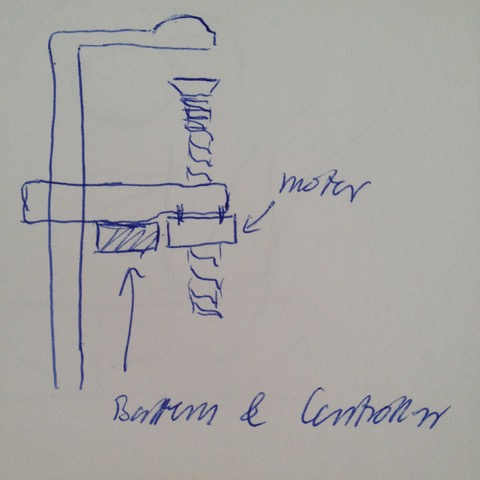

# Todo: Consider to design and implement a battery driven semi-automatic electric motor clamp?

```#b2da79a5``` *As of 2018-08-27 10:47*

[mail plain/text](mail.txt)


It seems it should be possible to design and implement an electric motor driven clamp?

1) Consider to modify an ordinary screw clamp with a stepper motor and Battery driven Arduino controller?



2) Consider ways to design the user interaction with the electric clamp?

==&gt; It seems we would like an easy way to apply and loosen the clamp?

==&gt; Consider the clamp to tighten when we put pressure on the threaded rod?

==&gt; Consider a button to release the clamp?

…

3) Consider in some way an electric clamp is in some sense a powerful servo?

TODO: Consider to research if we can use a powerful servo for the clamping mechanism?

...

…

Consider to delve into this idea of a battery driven semi-automatic electric motor clamp?


