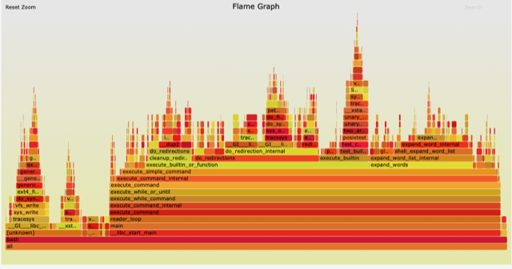
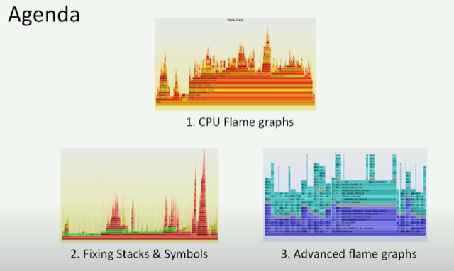

# Todo: Programming - Consider to study and try out "Flamegraphs" that visualise a plethora of stack traces shown as a kind of "mountain" with a ridge of peaks?

```#b39bb388``` *As of 2020-05-04 10:39*

[mail plain/text](mail.txt)


1) Consider this article "Flamegraph: How to Visualize Stack Traces and Performance" that seems to give a good initial decryption of flame graphs (<https://stackify.com/flamegraph-how-to-visualize-stack-traces-and-performance/> )?

> ...

2) Consider this site where a Flame graph tool seems to live, or at least is explained (<http://www.brendangregg.com/FlameGraphs/cpuflamegraphs.html#Java> )?

==&gt; It seems Flame graph takes the output from a "Profiler" and generates a graphical visualisation called a "Flame Graph"?

> *"**Flame Graphs can work with any **CPU profiler** on any operating system. My examples here use **Linux perf_events**, **DTrace**, **SystemTap**, and **ktap**. See the Updates list for other profiler examples, and github for the flame graph software.**"*

==&gt; It seems a Flame Graph shows stack traces in the y-axes and sorts the stack on the x-axis NOT as they occur in time but more on spent time or alphabetically based on stack frame function names?

>   
> *An example of a flame graph where peaks are stack traces of stack-frame-boxes sorted on longest time spent root stack frames frames*

> "*The x-axis spans the sample population. It does not show the passing of time from left to right, as most graphs do. The left to right ordering has no meaning (it's sorted alphabetically to maximize frame mergi*ng)."

> "  
> *...  
> *  
> *• Each box represents a function in the stack (a "stack frame").  
> *  
> *• The y-axis shows stack depth (number of frames on the stack). The top box shows the function that was on-CPU. Everything beneath that is ancestry. The function beneath a function is its parent, just like the stack traces shown earlier. (Some flame graph implementations prefer to invert the order and use an "icicle layout", so flames look upside down.)  
> *  
> *• The x-axis spans the sample population. It does not show the passing of time from left to right, as most graphs do. The left to right ordering has no meaning (it's sorted alphabetically to maximize frame merging).  
> *  
> *• The width of the box shows the total time it was on-CPU or part of an ancestry that was on-CPU (based on sample count). Functions with wide boxes may consume more CPU per execution than those with narrow boxes, or, they may simply be called more often. The call count is not shown (or known via sampling).  
> *  
> *• The sample count can exceed elapsed time if multiple threads were running and sampled concurrently.*"

==&gt; It seems you use a perf tool to capture CPU stacks then the tool folds the stacks and generates a flamegraph graphical representation?

> "*The code to the FlameGraph tool and instructions are on github. It's a simple Perl program that outputs SVG. They are generated in three steps:*

> *• Capture stacks  
> *  
> *• Fold stacks  
> *  
> *• flamegraph.pl*"

3) The (or one?) Flame Graph tool seems to live on Github as a perl program turning the output of a CPU perf tool into a flame graph output (<https://github.com/brendangregg/FlameGraph> )?

4) Consider this youtube video "USENIX ATC '17: Visualizing Performance with Flame Graphs" where Brendan Gregg talks about his Flame Graph tool (<https://youtu.be/D53T1Ejig1Q> )?

>   
> *The Agenda of youtube talk "USENIX ATC '17: Visualizing Performance with Flame Graphs" by Brendan Gregg*

...


