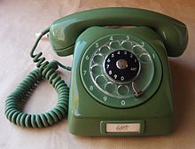

# Todo: Consider to use my old mechanical telephone rotary dial as a user interface for something(s)?

```#b3f2e50b``` *As of 2018-11-25 22:07*

[mail plain/text](mail.txt)


Just as a hunch and based on an intuition I feel that it could be fun to try and use my old telephone mechanical phone rotary dial as a user interface :)

1) Consider ways to decode the pulses from the phone rotary dial?

…

2) Consider the wikipedia page on the rotary dial (<https://en.wikipedia.org/wiki/Rotary_dial>)?

==&gt; It seems my phone is the same as this one, an LM Ericsson Dialog?



==&gt; It seems Swedish phones generates 1 pulse for zero up to 10 pulses for number nine?

> “Different pulse systems are used, varying from country to country. For example, Sweden uses one pulse to signal the number zero, and 10 pulses to signal the number nine."

…

3) So what can I control with the 0…9 rotary dialer of my old LM Ericson Dialog phone?

==&gt; Consider use it for C++ programming?

==&gt; Consider to use it for home automation?

==&gt; Consider to use it to play music over blue tooth speakers?

==&gt; Consider to use it to turn on or off stuff in my indoor shed?

...


