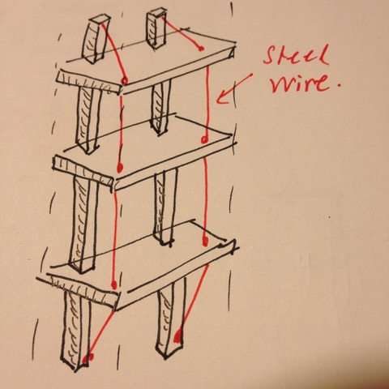

# Todo: Consider possible designs for may hall way wall storage?

```#b40f3508``` *As of 2018-12-16 16:08*

[mail plain/text](mail.txt)


So, what designs can I imagine for building my hall way wall storage for books and things (mainly to empty my indoor storage and thus freeing it up to become an electronics lab)?

1) Consider to be inspired by this Ikea wall hung shelf (<https://www.ikea.com/se/sv/assembly_instructions/varde-vagghylla__AA-23274-10_pub.pdf>)?

==&gt; The pro of this design seems to be its open design and that no sides are required (few parts)?

 

==&gt; Consider we can enhance the strength of the shelf with a “simple” steel wire ([https://www.k-rauta.se/byggvaruhus/sok/stållina](https://www.k-rauta.se/byggvaruhus/sok/st%C3%A5llina))?




hm… How do i cut out the run-throughs for the studs in the shelfs?

2) Consider to beat the price and ease of use of this steel shelf (<https://www.k-rauta.se/byggvaruhus/lagerhylla-prof-5-hyllplan-180x80x30>)?


NOTE: I need 249,5 cm hight shelfs (so there is almost 70 cm missing) ?!

...


