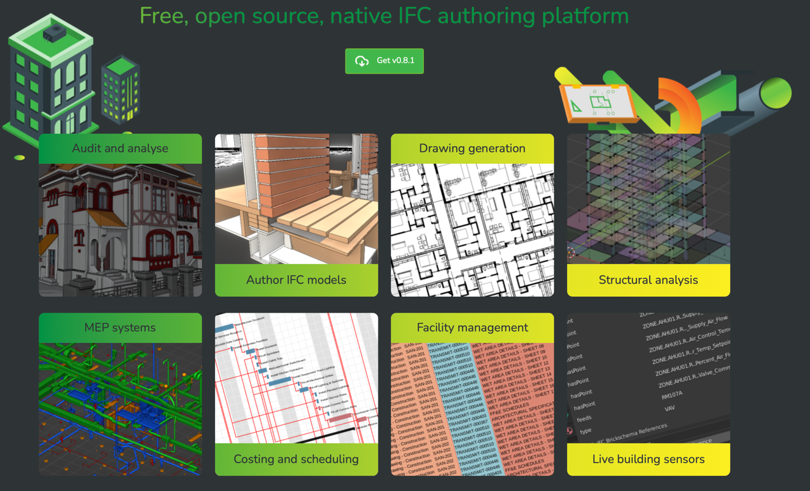
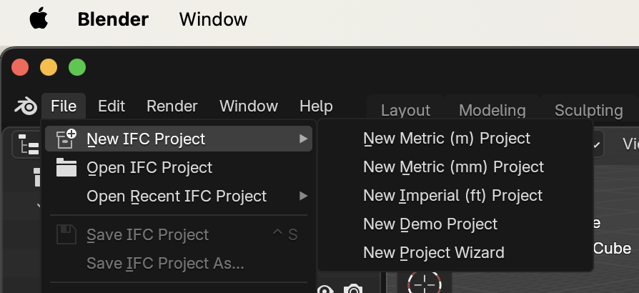

# Todo: Consider to compare 'Bonsai BIM' for Blender with Freecad 1.0 for an example house model?

```#b5d16604``` *As of 2025-04-01 16:41*

[mail plain/text](mail.txt)


I want to model my hosue that I am to build and a CAD program for this would be nice.

1) Consider youtbe video "Create Simple Building in FreeCAD | FreeCAD BIM vs. Bonsai BIM Modeling Comparison" (<https://youtu.be/7VIsx4ZfGlg> )?

2) Consider the youtube video "Bonsai Tutorial - Beginner Project - Part 1 - Modelling" (<https://youtu.be/Jc896Sob2bU> )?

3) Consider the 'Bonsai BIM' add-on fro Blender (<https://bonsaibim.org> )?



4) It seems I succeeded to install blender as instructewd (<https://docs.bonsaibim.org/quickstart/installation.html> )?

==&gt; My Blender now seem to have teh ability to 'File' and 'New IFC Project'?

> 

...


