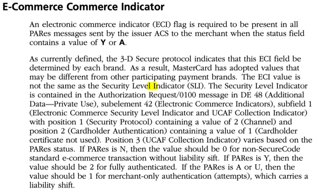
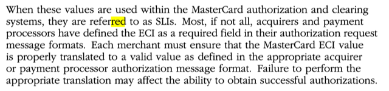

# Todo: Consider good resources for understanding Card Payment Processing under PSD2 (explicitly SCA, Soft Decline, EMV 3D Secure and Exemption mechanisms)?

```#b63c1109``` *As of 2021-05-20 19:02*

[mail plain/text](mail.txt)


1) This seems to be a good Mastercard document "Mastercard® Authentication Best Practices" on Cardholder Authentication (<https://newsroom.mastercard.com/eu/files/2021/01/Authentication-Best-Practices-December-2020-2.pdf> )?

> *"**Merchants/Acquirers must provide the DS Transaction ID and Program Protocol in authorization and clearing messages. This is very important as otherwise AAV validation will fail which leads to automatic declines by the issuers.**"*

2) Consider the youtube video "Ask me anything about SCA" (<https://youtu.be/rrFyJCBSF5U> )?

==&gt; It seems "Soft Decline" is only for Cardholder Initiated Transactions (as it is only when cardholder i present a step-up is even possible)?

> "  
> 08:34  
> we saw a lot of uh issuers incorrectly  
> 08:37  
> using soft declines for particular cases  
> 08:40  
> so we saw that happening for merchant initiated transactions or for recurring transactions  
> 08:45  
> and i'm sure there'll be specific  
> 08:46  
> questions around that uh also we saw  
> 08:49  
> more  
> 08:50  
> issues soft declining card verification transactions and i can explain why  
> 08:55  
> in this scenarios uh the issuers are  
> 08:57  
> still  
> 08:58  
> let's say fine-tuning the self-decline  
> 09:00  
> strategy  
> "

3) Consider this article "Details on Electronic Commerce Indicator Values" (<https://knowledge.broadcom.com/external/article/13636/details-on-electronic-commerce-indicator.html> )?

==&gt; It seems the The Electronic Commerce Indicator (ECI) is a 3DS defined value generated by the ACS (or the Merchant in case of 'U' response)?

> *"The Electronic Commerce Indicator (ECI) element/value represents the value as determined by the ACS (Access Control Server). The ACS provides an ECI Value to the MPI (Merchant Plug-in) in cases where the Transaction status is "Y" (Success) or "A" (Attempts). For a U (Unavailable) and N (Failed) response from the ACS, there is no ECI value received from the ACS. The Merchant must submit an appropriate ECI value for the cases with U response. The issuing bank sends the ECI to the merchant after the customer has been authenticated. The merchant needs the ECI to continue with the authorization and settlement processes. These values will reflect the authentication status. Specific values are dictated by each Card Association.*

> *As per protocol, an ECI value of 01 and 02 is used by MasterCard and ECI values of 05,06 and 07 are used by Visa. For a successful authentication, MasterCard uses an ECI of 02 and in the same scenario Visa uses an ECI of 05. For all other transaction, other than a successful authentication, MasterCard uses an ECI of 01 and for the same, Visa uses an ECI of either 06 or 07.

> *  
> *When a PARes (Payer Authentication Response) status of 'A' is seen, it indicates that the Authentication could not be completed but a proof of authentication attempt was provided. An ECI value of 01 is seen at this instance. When a PARes status of 'N' and 'U' is seen, it indicates that the cardholder authentication failed or Authentication could not be completed due to technical or other problems. In these cases, the ECI value is not seen."*

==&gt; It seems MasterCard ECI 02 corresponds to Visa ECI 05 (Successful)

==&gt; It seems MasterCard ECI 01 corresponds to Visa ECI 06, 07 (All other not Successful)

==&gt; Also see "Details on Electronic Commerce Indicator Values" (<https://knowledge.broadcom.com/external/article/13636/details-on-electronic-commerce-indicator.html> )

> "*The Electronic Commerce Indicator (ECI) element/value represents the value as determined by the ACS (Access Control Server). The ACS provides an ECI Value to the MPI (Merchant Plug-in) in cases where the Transaction status is "Y" (Success) or "A" (Attempts). For a U (Unavailable) and N (Failed) response from the ACS, there is no ECI value received from the ACS. The Merchant must submit an appropriate ECI value for the cases with U response. The issuing bank sends the ECI to the merchant after the customer has been authenticated. The merchant needs the ECI to continue with the authorization and settlement processes. These values will reflect the authentication status. Specific values are dictated by each Card Association.*

> *As per protocol, an ECI value of 01 and 02 is used by MasterCard and ECI values of 05,06 and 07 are used by Visa. For a successful authentication, MasterCard uses an ECI of 02 and in the same scenario Visa uses an ECI of 05. For all other transaction, other than a successful authentication, MasterCard uses an ECI of 01 and for the same, Visa uses an ECI of either 06 or 07.

> *  
> *When a PARes (Payer Authentication Response) status of 'A' is seen, it indicates that the Authentication could not be completed but a proof of authentication attempt was provided. An ECI value of 01 is seen at this instance. When a PARes status of 'N' and 'U' is seen, it indicates that the cardholder authentication failed or Authentication could not be completed due to technical or other problems. In these cases, the ECI value is not seen.*"

4) Consider this 2014 MasterCard document "" (<https://www.mastercard.us/content/dam/mccom/en-us/documents/SMI_Manual.pdf> )

==&gt; It seems "SLI" refers to a set of MAsterCard element values that relates to 3D Secure defined ECI values?

EGO: So it is in fact the ECI-value that determines how to populate the MAsterCard SLI:s (DE_48.SE42&#91;1&#93; Position 1,2 and 3)?

> 

> > 

> DE_48.SE42&#91;1&#93; Position 1 (Security Protocol) = 2 (Channel)  
> DE_48.SE42&#91;1&#93; Position 2 (Cardholder Authentication) = 1 (Cardholder certificate not used)  
> DE_48.SE42&#91;1&#93; Position 3 (UCAF Collection Indicator) = "SLI"

> PARes = 'Y' ==&gt; "SLI" = 2 (Fully authenticated)  
> PARes = 'A' or 'U' ==&gt; "SLI" = 1 (merchant-only authentication / attempts)

5) Consider "Quick Reference Booklet—Merchant Edition 15 November 2018" (<https://www.mastercard.us/content/dam/mccom/en-us/documents/rules/quick-reference-booklet-merchant-edition.pdf> )?

> MCC 6536

...


