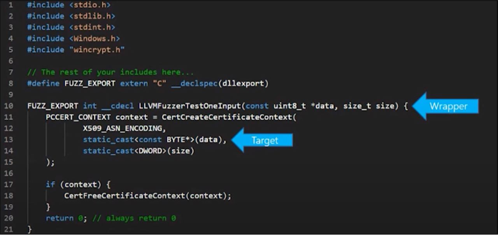
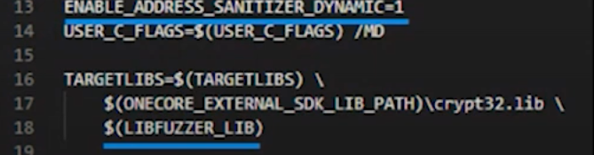
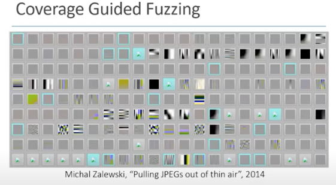

# Todo: Consider to delve into and understand the basics of "Fuzzing" as a method to test software using a somewhat "automated" way to generate test cases and analyse the result?

```#b72cbeb0``` *As of 2020-10-13 15:18*

[mail plain/text](mail.txt)


My friend Pauls Dreik has developed a good experience and expertise on applying fuzzing as a way to test C++ programs and I am curious to learn more about it.

==&gt; Also see "Todo: Consider to follow up on Paul Dreik URL to video on Smart Card hacking and fuzzing?"

1) Consider youtube video "Fuzzing Class Interfaces for Generating and Running Tests with libFuzzer - Barnabás Bágyi - CppCon" (<https://youtu.be/TtPXYPJ5_eE> )?

2) Consider youtube video "CppCon 2017: Kostya Serebryany “Fuzz or lose..."" (<https://youtu.be/k-Cv8Q3zWNQ> )?

3) Consider the youtube video "Introducing Microsoft’s New Open Source Fuzzing Platform - Michael Walker & Justin Campbell - CppCon" (<https://youtu.be/NsmRPRxhLn0> )?

==&gt; It seems Microsoft provides a framework based on macros (and more?) to utilise the existing Clang/LLVM Libfuzzer in a more convenient way?

>   
> *An example of using Microsoft open source fuzzing framework taht seems to be built on top of Clang/LLVM LibFuzzer?*

>   
> *This seems to be the CMAKE configuration required to enable fuzzing with the Microsoft fuzzing framework?*

4) Consider the 2014 Blog Article "Pulling JPEGs out of thin air" (<https://lcamtuf.blogspot.com/2014/11/pulling-jpegs-out-of-thin-air.html> )?

==&gt; Also see the reference to this blog entry in youtube video "Introducing Microsoft’s New Open Source Fuzzing Platform - Michael Walker & Justin Campbell - CppCon" at around 11:41 (<https://youtu.be/NsmRPRxhLn0?t=701> )?

> 

...


