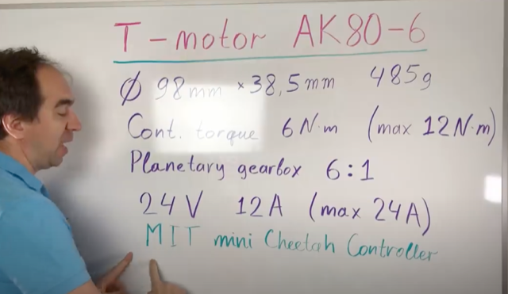
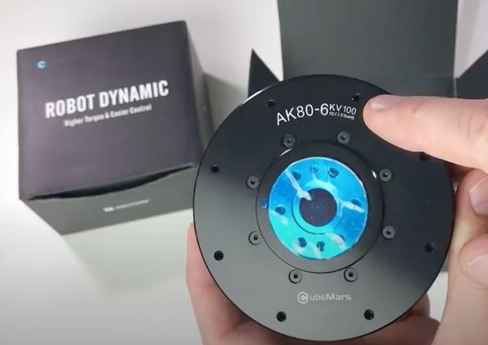
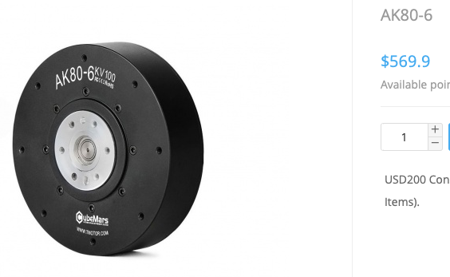
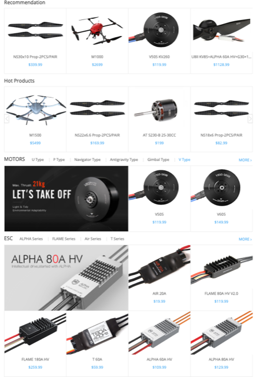

# Todo: Consider the actuators from T-Motor company with the Chinese reversed engineered "MIT mini Cheetah" Motor Controller?

```#b82aa919``` *As of 2020-08-03 13:42*

[mail plain/text](mail.txt)


I want to keep track on what actuators and controllers that are available for DIY development and build of small scale Open Hardware actuator based automation.

1) Consider this youtube video "Ideal for the Super Fast Robot (T-motor)" (<https://youtu.be/HzY9vzgPZkA>);





2) This seems to be the URL to the store to buy the T-Motor AK80-6 (<https://store-en.tmotor.com/goods.php?id=981> )?



*The AK80-6 seems to cost around $570?*

3) The T-Motor company seems to sell drone motors and propellers, actuators and motor controllers (<https://store-en.tmotor.com> )?



4) Consider this youtube video "MIT Mini Cheetah Actuator" (<https://youtu.be/ecSQZlNda6g> )?

==&gt; Hm... It seems this is a product to buy (and may or may not have anything to do with MIT in USA) (<https://hackaday.com/2019/10/19/mit-mini-cheetah-made-and-improved-in-china/> )?

> "  
> *Somewhere out there in the wild we…east of China there’s a company not only reverse engineering the Mini Cheetah, but improving it too.

> We cover a lot of **Mini Cheetah projects;** it’s a small robot that can do a **back-flip** after all. When compared to the servo quadruped of not so many years ago it’s definitely exciting magic. Many of the projects go into detail about the control boards and motor modifications required to build a Mini Cheetah of your own. So we were especially interested to discover that this AliExpress seller has gone through the trouble of not just **reverse engineering** the design, but **also improving** on it. Claiming their motors are **thinner and more dust resistant than what they’ve seen from MIT**.*  
> "

...


