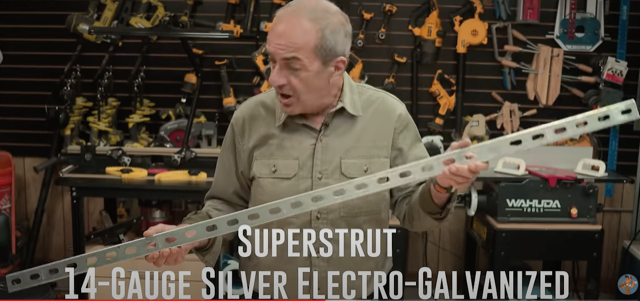
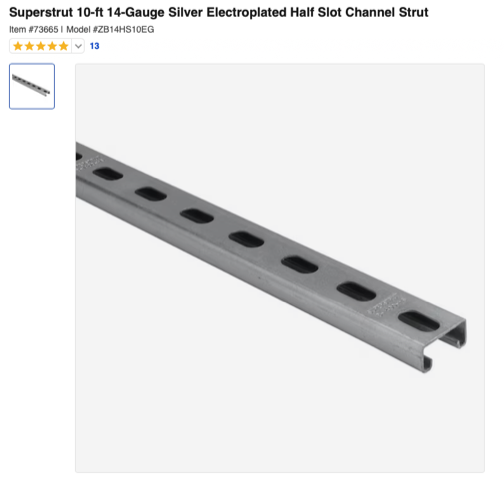
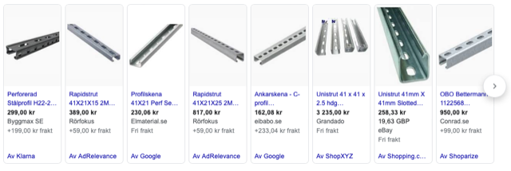
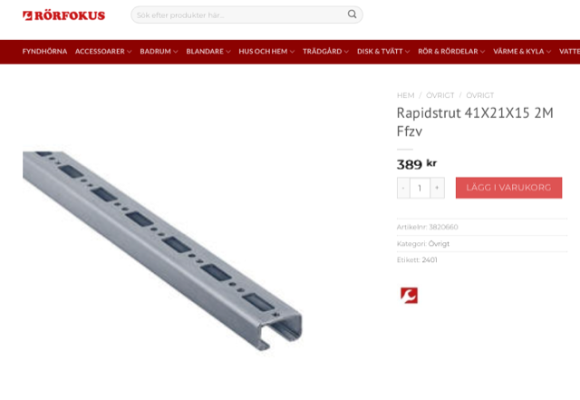
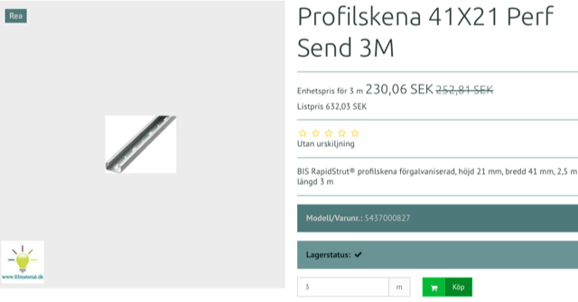

# Todo: Consider to investigate if profiles called "super struts" in the USA is available in Europe / Sweden and if I can use them for constructing light weight building frameworks?

```#b9303142``` *As of 2024-02-15 20:05*

[mail plain/text](mail.txt)


1) Consider the youtube video "Rockler doesn't want you to see this video" where the presenter uses so called "super struts" as glue cauls (<https://youtu.be/vzhILT7axcA> )?



<https://youtu.be/vzhILT7axcA?t=289>

2) Consider this example from USA store lowes "Superstrut 10-ft 14-Gauge Silver Electroplated Half Slot Channel Strut" (<https://www.lowes.com/pd/SUPERSTRUT-14-GAUGE-ELEC-GALV-CHANNEL-EG-10-F/3370630> )



[*https://www.lowes.com/pd/SUPERSTRUT-14-GAUGE-ELEC-GALV-CHANNEL-EG-10-F/3370630](https://www.lowes.com/pd/SUPERSTRUT-14-GAUGE-ELEC-GALV-CHANNEL-EG-10-F/3370630)*

3) It seems in Sweden these are called "Perforerad stålprofil", "Rapidstrut", "Profilskena", "Ankarskena", "Unitrut"...?



==&gt; Consider Rapidstrut from a plumber web store (<https://rorfokus.se/produkt/rapidstrut-41x21x15-2m-ffzv/?gad_source=1&gclid=CjwKCAiAibeuBhAAEiwAiXBoJGm_Ue3qYRaiqIcJawy3uerX6nljr3rH_xTZo3eUUOF-F_VKyDF8ChoCDJcQAvD_BwE> )?





<https://elmaterial.se/shop/858-elartikel/337279-profilskena-41x21-perf-send-3m/?gclid=CjwKCAiAibeuBhAAEiwAiXBoJNpVOdxets1xMtNw-H_4oBuuK8XPYDZSB1AWR80I1agVP3fjuo9zbhoCriQQAvD_BwE>

...


