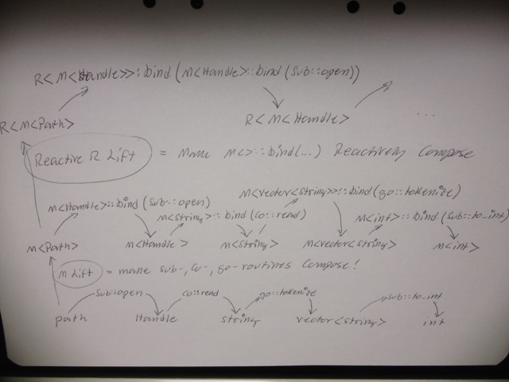

# Todo: Programming - Consider how Reactive Programming relates to Function Composition and Subroutine, Coroutine, Goroutine message passing models

```#bb416027``` *As of 2017-02-09 19:19*

[mail plain/text](mail.txt)


So, what can we say about Reactive Program and its relation to Function Composition and the take on Subroutine, Coroutoine and Goroutine as just different in how they pass messages?

==&gt; Also see ”[Todo: Programming - Consider a "thread" is just message-passing using stack-frames on the same stack (another stack is another thread of stack-frame messaging)?](../e07d2bd4/chime.md)"

==&gt; Also see ”[Todo: C++ - Consider to understand Reactive Programming from the semantics and design of RxCpp (Reactive Extensions for Cpp)?](../5068c5cc/chime.md)”

==&gt; Also see ”[Todo: Programming - Consider a Language Semantics where we can use abstractions to model subroutines, coroutines and coroutines as well as how we engage with them?](../1b520c38/chime.md)”

==&gt; Also see ”[Todo: C++ - Consider ways to turn Callback based asynchronous mechanism into a Reactive Observable model?](../4234851e/chime.md)”

==&gt; Also see ”[Todo: Programming - Consider benefits of a Protocol Library based on immutable data and Functional Reactive Programming?](../90e34eb3/chime.md)”

==&gt; Also see ”[Todo: Darwinet - Consider to apply Reactive Functional Programming to synchronize between Darwinet Nodes as well as interfacing local clients (through views)?](../b37834b2/chime.md)"

1) Consider this talk ”Functional reactive programming in C++ - Ivan Cukic - Meeting C++ 2016” (<https://www.youtube.com/watch?v=a2MmURgc6cU&t=111s>)?

==&gt; He seem to propose the definition of Reactive Program as acting on data streams (no returns are ever made)?

 data chains.tiff>)

==&gt; NOTE: The sort IS NOT Reactive (it cant react until the stream ends)

==&gt; So, this is kind of a bad example, but still...

==&gt; Consider each transform may still be functional (in-value transformed to out-value)

==&gt; Consider how the composition of the stream transformations still is isomorphic with function composition (the in-value is transformed to an out-value)?

==&gt; It seams the Event Stream is made up of Creators, Processors and Consumers?


==&gt; It seems this kind-of is isomorphic to function composition where Process is the chain-of-transformations, the Create is the initial value and Consume is the actual call?

==&gt; What can we say for parallel event streams that compose well in Reactive Programming?


==&gt; Can we imagine we can model this as currying of functions taking futures (parallel asynchronous arguments)?

==&gt; But then - how do you curry a function that takes two temporally separated arguments (from each input stream)?

**WE ARE HERE...**

…

2) Consider in what way Reactive Programming is isomorphic to Function Composition?

==&gt; There seem to be some isomorphism to be found between the C++ Ranges Proposal (space-distributed value streams) and Reactive Programming transformations (time-distributed event streams)?

==&gt; For a single value transformation chain of a composed function (e.g. h\*f\*g(x) = h(g(f(x))) ) a Reactive processing of a value stream would do the same but with ”message passing” instead of ”calls”?

==&gt; But then - If we look at Subroutines, Coroutines and Goroutines as just different message-passing schemes, then the function composition and Reactive Processing is actual equal?

==&gt; It seems we may define some "Monad Algebras” that allow function composition also for the Reactive Functions?

==&gt; In fact, it seems we should be able to ”lift” any pure function to have it applied as Reactive Function applied to temporal distributed values?

==&gt; It seems it boils down to defining a Monadic Bind that provides the ”temporal glue” to be able to wait for a future incoming value and the ”react” by calling the lifted transform function?

…

==&gt; Consider we can ”Monadicly” lift Subroutines, Coroutines and Goroutines to enable then to compose and then do a "second lift" to make them Reactively (temporarily) applied to compose event streams?

3) Consider if we can model Reactive Programming as generalized function compositions lifted in layers from ”plain” subroutine, coroutine and goroutine ”pure” functions?

==&gt; Consider an ”abstract” program (function invocation mechanism not defined):

path -&gt; **open** -&gt; Handle -&gt; **read** -&gt; string -&gt; **tokenize** -&gt; vector&lt;string&gt; -&gt; **to_int** -&gt; int

==&gt; Consider in our program we have these functions available in different flavors (sub-routine, co-routine, go-routine)?

Path -&gt; sub::**open** -&gt; Handle -&gt; co::**read** -&gt; string -&gt; go::**tokenize** -&gt; vector&lt;string&gt; -&gt; sub::**to_int** -&gt; int

==&gt; Consider we may define a Monad to lift and compose these different types of functions?

M&lt;Path&gt; —&gt; M&lt;Handle&gt;::bind(sub::open) —&gt; M&lt;Handle&gt; -&gt; M&lt;string&gt;::bind(co::read) -&gt; M&lt;string&gt; —&gt; M&lt;vector&lt;string&gt;&gt;::bind(go::tokenize) —&gt; M&lt;vector&lt;string&gt;&gt; —&gt; M&lt;int&gt;::bind(sub::to_int) —&gt; M&lt;int&gt;

==&gt; It seems we can now define another Monad to lift these to Reactive transformation on Event Streams?

R&lt;M&lt;Path&gt;&gt; —&gt; R&lt;M&lt;Handle&gt;&gt;::bind(M&lt;Handle&gt;::bind(sub::open)) —&gt; R&lt;M&lt;Handle&gt;&gt; —&gt; …

==&gt; It seems we should be able to visualize these lifted layers in one model?



==&gt; Hm… Very hard to show the pattern (but it is there I believe)!

==&gt; Consider we can do it by defining different Categories and use Arrows?

…

…

Consider to elaborate on this idea of trying to model Reactive Programming, Function Composition and Messaging-indifferent function composition into one model of layers of Monadic bind ”algebra”?

...


