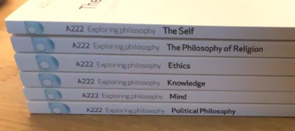

# Todo: Consider the six book of The Open University Course A222 "" as good references into contemporary basic philosophy?

```#bb9b870a``` *As of 2020-11-01 13:49*

[mail plain/text](mail.txt)


1) Consider the Linkedin post (<https://www.linkedin.com/posts/activity-6727865582974222337-4mbO> )?

>   
> The reading list of Open University course A222

2) Consider The Open University course A222 "Exploring philosophy" (<http://www.openuniversity.edu/courses/modules/a222#study-materials> )?

> *"**This introduction to philosophy considers fundamental questions from six core areas: the self; philosophy of religion; ethics; knowledge and science; the mind; and political philosophy. Examples of these questions are What makes me ‘Me’? Does God exist? Why should I act morally? Can I trust science? How can I, a physical being, have thoughts and emotions? Should I obey laws I disagree with? Philosophers – both past and present – have offered radically diverging answers to these and the other questions asked in this module. Guided engagement with this philosophical tradition will provide the platform for you to tackle the big questions of philosophy for yourself.**"*

3) Consider the youtube video "The Open University | 10 FAQs Answered | Is it a 'real' degree?" (<https://youtu.be/DqkJpEaqlT4> )?

==&gt; It seems a course costs around 6000£ per year for FULL time study (<https://youtu.be/DqkJpEaqlT4?t=278> )?

...


