# Todo: Consider to design a plunge base for my Quick Tool Change (QTC) Mafell milling motor  FM 1000 PV-WS?

```#be6ac0d1``` *As of 2022-08-20 12:31*

[mail plain/text](mail.txt)


I want to be able to use my Quick Tool Change (QTC) Mafell milling motor FM 1000 PV-WS as in a plunge base.

==&gt; Also see "[Todo: Consider how to mount my Quick Tool Change (QTC) Mafell milling motor FM 1000 PV-WS to a some router table plate?](../5a57c4f7/chime.md)"

==&gt; Also see "[Todo: Consider to make a printable drilling template for the Mafell QTC ("Quick tool change" like e.g., FM 1000 PV-WS) mounting plate?](../1288de3b/chime.md)"

==&gt; Also see "[Todo: Consider the "best" way to buy a Mafell Milling motor FM 1000 PV-WS (100W with PV control and quick tool changer)?](../a2f20a72/chime.md)"

==&gt; Also see "[Todo: Consider the Mafell tools lineup and prices for my indoor or future woodworking needs and requirements?](../cbb23bdf/chime.md)"

==&gt; Also see "[Todo: Consider an Ooznest Workbee CNC with a Mafell milling motor?](../b0d4214c/chime.md)"

==&gt; Also see "[Todo: Consider to create linear motion using threaded rods and a bicycle chain driven hex-nuts (e.g., for a router lift or super strong rip fence adjustment)?](../e7c7fec9/chime.md)"

1) Consider the basic design of a plunge base?

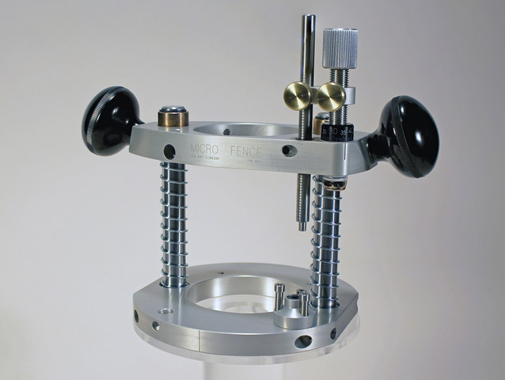

*Copyright <https://microfence.com/product/plunge-base/> *

> *Basically, we have a bottom plate to rest at the woking material, two vertical rods with some linear bearings / sliders, a top plate for mounting the milling motor and finally a depth stop mechanism with hight adjustment and three quick change depth reduction shallow, mid and full depth stops.*

2) Consider a simple design for a plunge base to which I may mount my Quick Tool Change (QTC) Mafell milling motor FM 1000 PV-WS?

> *So, it seems I need a bottom plate with an opening for the milling motor chuck and drill bit to fit through, two vertical axes on which the milling motor mount may run vertically.*

> *We need the mount to accept the *Mafell milling motor FM 1000 PV-WS mounting plate.

> We can consider to mount to the side face or the bottom face of the milling motor mount?

> > 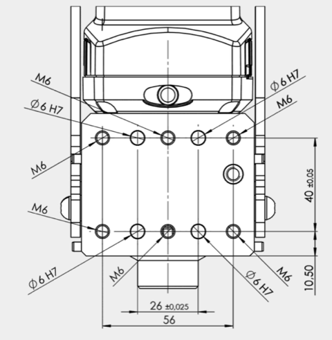

> > *The Mafell milling motor FM 1000 PV-WS side mount (Note the six stronger M6 mounting holes)*

> > 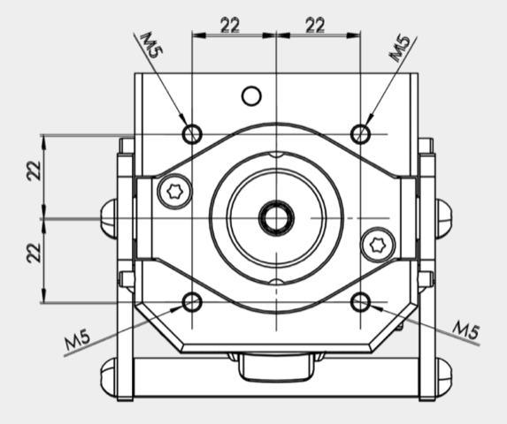

> > *Mafell milling motor FM 1000 PV-WS face mount (Note the only four and weaker M5 mounting holes)*

> > 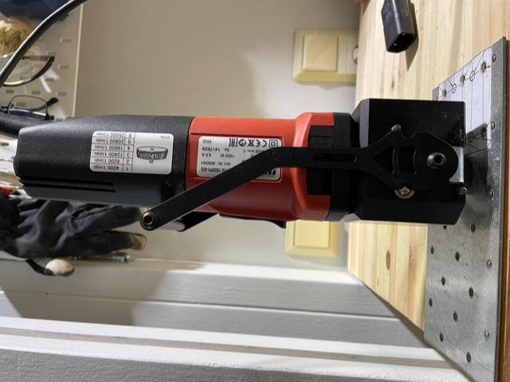

> > *Mafell milling motor FM 1000 PV-WS with tool change handle in closed position*

> > 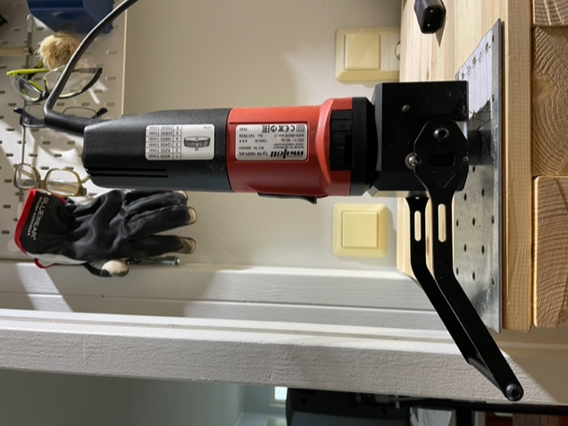

> > *Mafell milling motor FM 1000 PV-WS with tool change handle in open position*


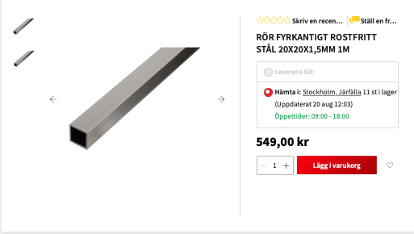

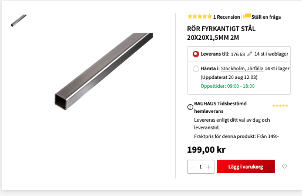

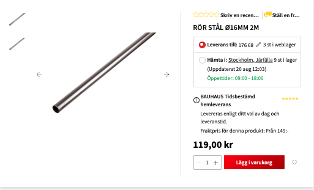

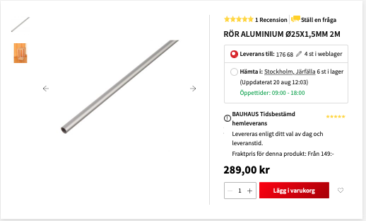

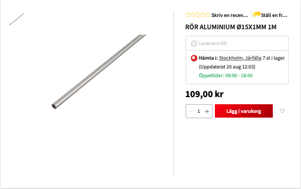

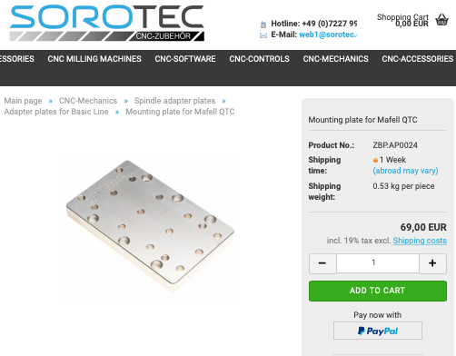

...


