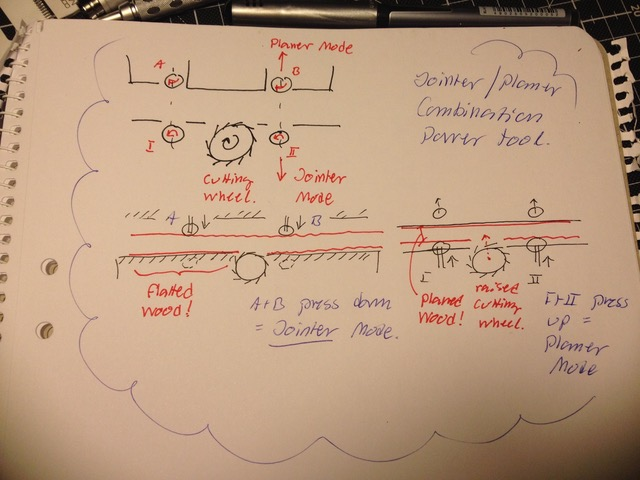
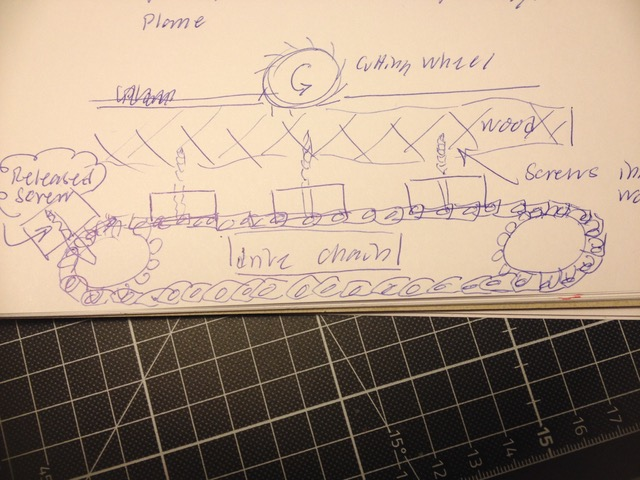

# Todo: Consider a combined jointer planer power tool design (same cutting wheel but wood pressed towards to joint it or pressed to a parallel plane to plane)?

```#beed8030``` *As of 2018-12-17 13:11*

[mail plain/text](mail.txt)


It seems we should be able to take the design of an ordinary planer but add a second parallel plane where the cutting wheel is and design a mechanism so that the wood can also be pressed towards the cutting wheel plane for jointing)?

==&gt; Also see “Todo: Consider to use a hand planer fo a combined jointer planer power tool design (mounted to a modified jig or table as numerous youtube videos show)?"

-1) Consider to not forget to check out the tool Pär Moritz has sitting in his basement?

TODO: Call Pär to discuss a visit to inspect his wood workstation tool (is it a scheppach combination machine)?

1) Consider a design where we we have one cutting wheel, one cutting wheel plane and one parallel plane plus ability to press wood onto cutting wheel plane (joining wood) or parallel plane (planing wood)?



==&gt; Consider a planer with two parallel planes (one in line with the cutting wheel and one parallel one)?

==&gt; Consider a mechanism so we can drive and press the wood onto the plane where the cutting wheel is (in effect making the cut act as a planer)?

==&gt; Consider a mechanism so we can also press the wood onto the parallel plane and slightly lift the cutting wheel to set distance from the parallel plane (in effect making the cut act as a planing cut)?

...

2) Consider if we can re-build an ordinary planer into a combined planer and jointer machine?

TODO: Consider to study the design of an ordinary home wood worker planer to see if any of them are suitable to be re-build into a combiner jointer and planer?

==&gt; Consider the problem is to add a second plane in line with the cutting wheel (before and after the wheel) in effect creating the jointer plane?

==&gt; Consider we also need to add a second set of drive and press wheels so that we can press the wood onto the cutting wheel plane?

==&gt; Thus we also need to be able to release the action of the ordinary planer feeder wheels?

==&gt; Consider a mechanism so the SAME slot is used regardless of whether we are jointing or plaining (no second slot to feed the wood through for different operation)?

-------

==&gt; Consider an ordinary planer “knows” the distance from the cutting wheel to the bottom feed plane and we do want to preserve that mechanism intact?

==&gt; Consider when jointing cut depth is determined by the protrusion of the cutting wheel from the in-line jointer plane?

==&gt; Consider the existing feeder wheels are in line with the cutting wheel (and these may be fixated relative the cutting wheel)?

==&gt; Thus, we may be unable to add a second pair of feeder wheels (and disabling the eating one on jointer mode)?

==&gt; This - It may be we have to re-design the whole feeder mechanism?

…

3) Consider how we may design the jointer and planer to cope with rough uneven boards?

==&gt; It seems the problem with uneven boards is to feed them trough the jointer to get one flat surface righty parallel to a parallel surface on board we can actually later plane (in planer mode)?

==&gt; Ir seems we may need a way to (automatically) have the feeder prevent the wood from rocking whilst in is fed for jointing (ensuing we get a flat surface all the way along the board)?

==&gt; Consider a compromise where we create a “flat frame” some distance before and after the cutting blade in jointer mode (and hope that the size of the plane frame will be enough to keep the wood close to plane over the whole wood length)?

==&gt; Consider an automatic mechanism that we can use to first “scan” the whole length of the wood (feeding it through without cutting) and parametric the shape of the wood to joint?

==&gt; Then we can (in theory) program the feed and press wheels to apply the correct press and distance when the wood is fed through for cutting?

==&gt; OR - Consider a mechanism mounted to a drive chain that screws into the wood form the opposite side and holds the wood while it is fed through the jointer (keeping it at some mean parallel plane distance from the cutting wheel)?



NOTE: Needs some thinking (I do not see how to correctly control the insertion and retraction of the grabbing screws while the drive chain feeds the wood through the jointer)?

Q: Better to grab onto the wood from the sides (preventing it from moving up or down)?

...

...


