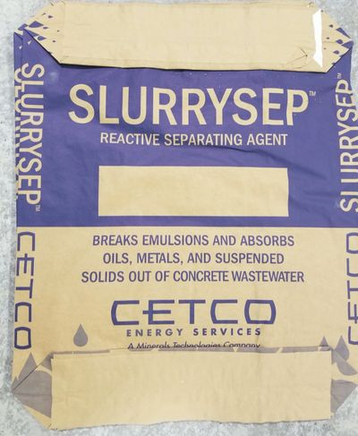

# Todo: Waste Water Treatment - Consider commercially available products for waste water treatment (coagulants, flocculants, EC systems, filters, filters, pumps etc.)?

```#bef810cf``` *As of 2019-05-31 16:50*

[mail plain/text](mail.txt)


So, what products are out there that I can use to design a Waste Water Treatment system for my "Earth Ship" house and wall paint wash up station?

==&gt; Also see "Todo: Zero Waste Water Disposal - Consider if we can use Alfa Laval ZLD (Zero Liquid Discharge) systems for the industry to also circularly re-use household waste water earth-ship style?"

==&gt; Also see "Todo: Rena Penselvatten - Överväg sätt att hemma kunna rena vatten från färgrester efter penseltvätt?"

1) Consider products by USA based Slurry Solutions (<https://slurrysolutions.com> )?

==&gt; They seem to sell a proprietary mix of Bentonite clay, pH regulating salts and

> *"SlurrySep is a proprietary blend of bentonite clay, polymers and pH reducing acids is designed for treatment of concrete slurry. Results are dramatic as solids quickly separate and condense on the bottom, leaving clean water for reuse or compliant discharge. "*



*Slurry Solutions product "SlurrySep" is a mix of Bentonite clay, pH regulating salts and flocculation polymers*

==&gt; They sell a solidifier product that seems to have the same properties as Sodium Polyacrylate or Polyacrylamide that is the absorbent in dipers (<https://slurrysolutions.com/slurrydry> )?

2) Consider UK based family owned TD Products that sells Slurry Solution products in europe (<https://www.tdproducts.co.uk> )?

> *"TD Products is a family Business who goal is to make construction and protecting the environment go hand in hand. With our specialist Slurry cleaner we hope to eliminate the use of harmful acids in the clean up and management of concrete slurry waste water."*

3) Consider German based Bölz slurry separators (<https://www.goelz.de/de/produkte/schlammrecycling/> )?


==&gt; Consider this product video "Gölz Mobile Schlammfilterpresse SFP3L - Golz SFP3L mobile Slurry filter press - Golz Presse filtre" (<https://www.youtube.com/watch?v=o1qIXjDVtro> )?

==&gt; The Gölz SFP3L seems to be a high pressure filter based separator?

4) Consider SwellGel that seems to be an anionic Polyacrylamide used for plant watering (<https://www.wexthuset.com/tradgardsskotsel-underhall/vattna-bevattna/langtidsbevattning/swellgel-20-gram> )?


...


