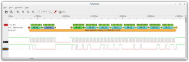

# Todo: Electronic Lab - Consider to check out the sigrok open source PC/MAC/Linux instrumentation software for a large set of electronic measurement hardware devices?

```#bf58bea1``` *As of 2018-05-02 22:41*

[mail plain/text](mail.txt)


I just stumbled on a youtube video showing off a PC-based logic analyser for serial bus decoding that uses this sigrok based application for a GUI and thought - this was really interesting!

-1) Consider to design and build a serial bus decoder instrument based on HCTEST0006 and some SBC and small colour display?

==&gt; It seems it should be possible to actually execute the PulseView on e.g., a Raspberry Pi with a colour display and touch screen overlay?

==&gt; Consider this Colour display with USB Touch interface (<https://www.electrokit.com/lcd-hdmi-800x480-touch.52718>)?


…

1) The youtube video “#99 Logic Analyzer for I2C, SPI and many more protocols” seems to live here (<https://www.youtube.com/watch?v=7_gCUZg8nAo&t=1376s>)?

...

2) Consider to try out the “PulseView” cross platform open source application (<https://sigrok.org/wiki/PulseView>)?

> “  
> PulseView (sometimes abbreviated as "PV") is a Qt based logic analyzer, oscilloscope and MSO GUI for sigrok.

> It is licensed under the terms of the GNU GPL, version 3 or later.  
> “



3) The sigrok project seems to show off a large set of supported hardware devices here (<https://sigrok.org/wiki/Supported_hardware>)?


4) Consider to check out the Hobby Components USB 8CH 24MHz Logic Analyser (HCTEST0006)” that seems to live here (<http://forum.hobbycomponents.com/viewtopic.php?COLLCC=3651579074&f=6&t=1411>)?

==&gt; This seems to be the sigrok reference page for HCTEST0006 (<https://sigrok.org/wiki/Hobby_Components_HCTEST0006>)?

> “The Hobby Components HCTEST0006 is a USB-based, 8-channel logic analyzer with up to 24MHz sampling rate.

> This device ships with the official sigrok **fx2lafw VID/PID in its I²C EEPROM**, thus can (only) be used with the fully open-source fx2lafw firmware and the sigrok software stack."

==&gt; The HCTEST0006 seems to sell on the Hobby Components web site (<http://hobbycomponents.com/newproducts/672-hobby-components-usb-8ch-24mhz-logic-analyser-and-test-hook-clip-bundle?search_query=HCTEST0006&results=3>)?



