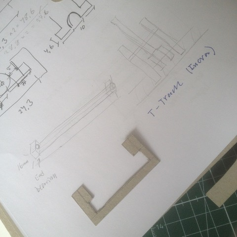
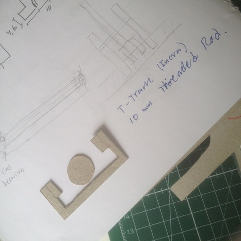
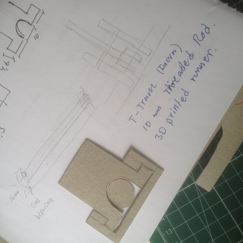

# Todo: Consider to build a table saw rip fence using a threaded rod in an Incra T-slot?

```#bf959e20``` *As of 2018-04-16 14:30*

[mail plain/text](mail.txt)


Could it be a good idea to build a rip fence based on a runner in an infra T-slot with a threaded rod in it for east positioning and micro adjustment?

1) Consider the Incra panel connector (with T-slot) and threaded M10 rod?

==&gt; Consider to buy the Incra Panel Connector from fine tools in Germany (


==&gt; It seems to be 2 pieces for € 18.50?

==&gt; It seems to ship for €10 to sweden?


1) Consider this possible design?

==&gt; Consider the Incra T-slot dimensions?



==&gt; Consider a M10 threaded rod in the T-slot?



==&gt; Consider a runner in the T-slot with the threaded Rod running through it (and being able to clamp to it)?



2) Consider we may design a clamp mechanism round the threaded rod using cut-off M10 nuts?

TODO. Design the clamping mechanism?

…

3) Consider to 3D-rpint the runner and clamping mechanism?

Todo: 3D model the runner and clamping mechanism in Fusion 360?

…

...


