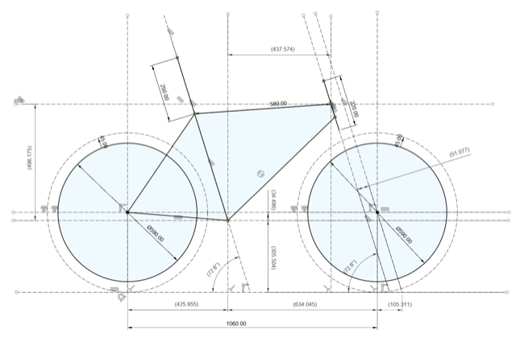
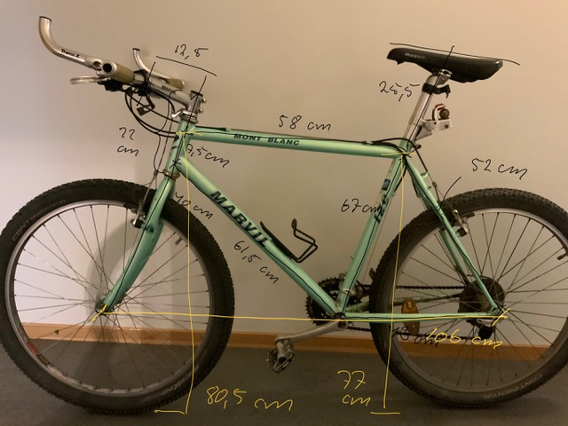
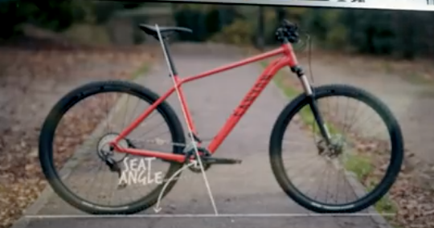
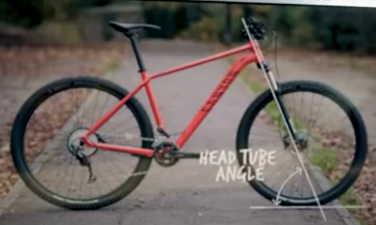
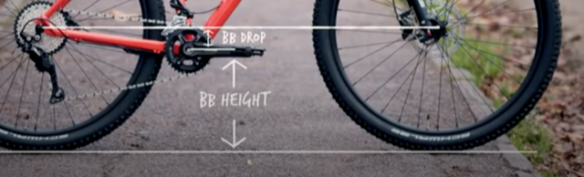
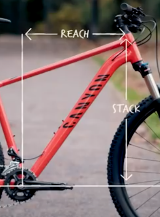
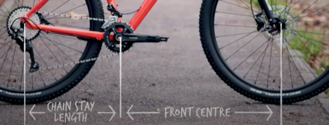
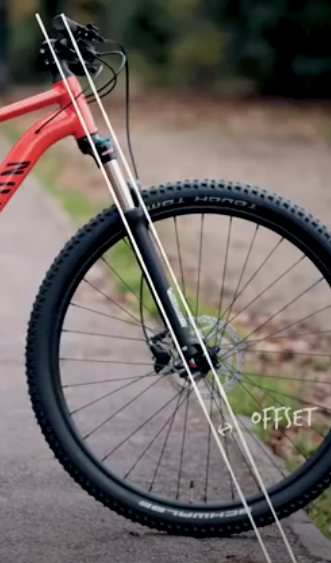
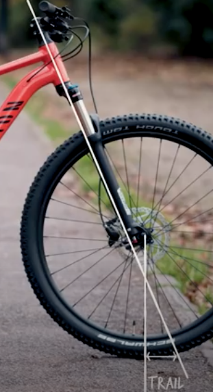

# Todo: Consider to study the geometry and dimensions of my Marvil Mont Blanc 521 26" Vintage MTB?

```#bfad5a4d``` *As of 2021-08-08 17:55*

[mail plain/text](mail.txt)


Since the 90s I have ridden a Marvil Mont Blanc 521 26" Vintage MTB.

1) Consider the geometry and measurement I get from modelling it from a photograph into a Canvas in Fusion 360?

> 

> Seat Angle: 72,8ª  
> Head Tube Angle: 72,8ª  
> Bottom Bracket (BB) Height: 306 mm  
> Bottom Bracket (BB) Drop: 35 mm  
> Stack: 496 mm  
> Reach: 438 mm  
> Chain stay length: 426 mm  
> Front Center: 634 mm  
> Fork Offset: 51 mm  
> Trail: 105 mm

2) Consider the measurements I got using an ordinary tape measure?

==&gt; Also see my iOS Note "26” Marvil Mont Blanc 521 mountainbike bike "

> 

> Rim 20mm  
> Tyre width 55mm  
> Wheel radius 29,5  
> Cranks 175 mm  
> Pedals 80x70 mm  
> Cantilevers 80mm cc

3) Consider youtube video "Mountain Bike Geometry 101 | A Complete Guide To Geometry + How It Affects Your MTB" (<https://youtu.be/zfX7GSG3G2M> )?

>   
> <https://youtu.be/zfX7GSG3G2M?t=357>

>   
> <https://youtu.be/zfX7GSG3G2M?t=573>

>   
> <https://youtu.be/zfX7GSG3G2M?t=641>

>   
> <https://youtu.be/zfX7GSG3G2M?t=756>

>   
> <https://youtu.be/zfX7GSG3G2M?t=912>

>   
> <https://youtu.be/zfX7GSG3G2M?t=1020>

>   
> <https://youtu.be/zfX7GSG3G2M?t=1042>

...


