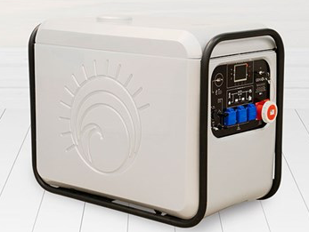
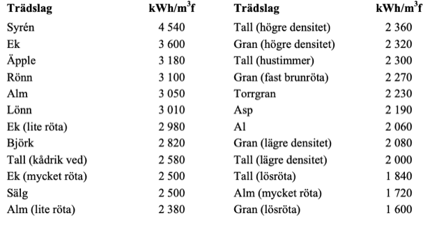

# Todo: House Build - Consider to find options to generate electricity from burning wood e.g., using a string engine driven generator?

```#bff71726``` *As of 2020-01-08 19:16*

[mail plain/text](mail.txt)


I can imagine it would be good to be able to burn wood and generate electricity and energy during the dark winter months or just when some additional power is required?

1) Consider the failed product from bankrupted "Inresol" (<https://www.vvsforum.se/nyheter/2019/mars/jag-ar-overtygad-om-att-stirlingmotorn-kommer-igen/> )?

>   
> *The Stirling engine driven electric generator from Inresol that failed but that still seem like a good idea*

> *"**Valle Andersson på Stråles el i Uppsala har installerat den omskrivna stirlingmotorn från Gävleföretaget Inresol som förra måndagen &#91;Mars 2019&#93; försattes i konkurs. ”Idén är klockren”.**"*

2) Consider the energy density of wood and the efficiency factor when turning it to electricity by burning it?

==&gt; It seems the energy density in terms of heat is around (<https://www.diva-portal.org/smash/get/diva2:522819/FULLTEXT01.pdf> )?

>   
> *Example of heat energy content of different solid volume of woods*

> *So from this we can see that Birch (Swedish "Björk") carries 2820 kWh / cubic meter. To get 20 000 kWh heat from burning with 80% efficiency we need 20 000 \* 1.2 / 2820 = 8.5 cubic meters solid volume.*

> *"Vid ett värmebehov på 20 000 kWh/år behövs mellan 5,6 m3f ved (syrén) och 15,8 m3f (gran med lösröta) beroende på trädslag och vedkvalitet. Vid beräkningarna har antagits att pann- verkningsgraden är 80 %, vedens fukthalt 20 % och askhalten 1 %. Om veden är av björk be- hövs ca 9 m3f/år, vilket motsvarar ca 14 m3t/år, eller ca 18 m3s/år. Vid beräkningarna har an- tagits att 1 m3t motsvarar 0,65 m3f och att 1 m3s motsvarar 0,50 m3f."*

> *Note: The m3f refers to cubic meters solid wood (Swedish "Fastvolym" as in no packing or stacking air included)*

==&gt; It would seem I can now speculate that to generate 1 kWh of electricity using a wood burning heated sterling engine I would need to burn 10/3 kWh worth of wood (at 30% efficiency)?

> *If I can get a Stirling Engine with 30% efficiency I would need to burn wood with the heat energy of 10/3 kWh to get 30% electric energy of 1 kWh? This would then correspond to 3.33 / 2820 = 1.2 liter of birch wood.*

> *Now I do not know if the 35% efficiency stated for the Inresol Sterling engine is with or without the actual burning efficiency?*

> *If we assume just to be causes that we need to account for an additional 20% loss in the inefficiency of the actual burning of wood we get close to 90% lost and only 10% actually used to generate electricity. A factor 1:10. To get **20 kWh** I need to burn wood with heat energy 200 kWh which amounts to 200 / 2820 = **70 liters of birch wood**.*

...


