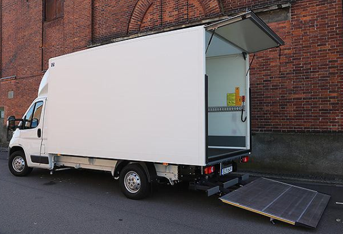
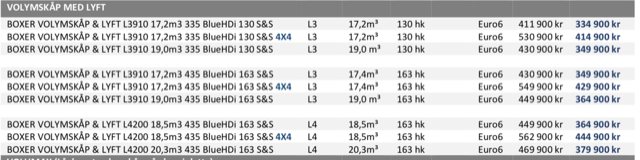
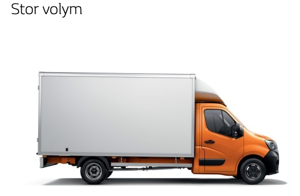
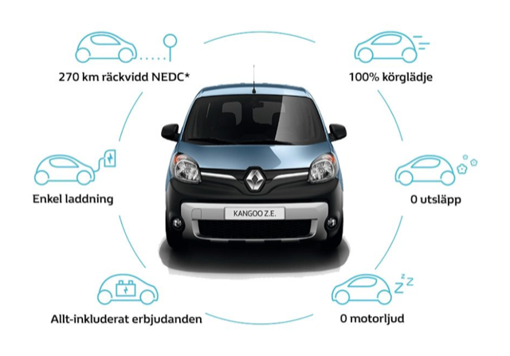
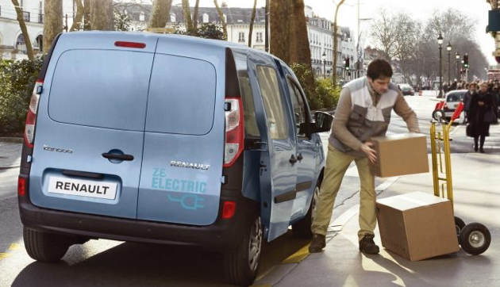
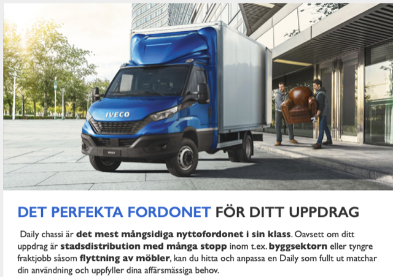
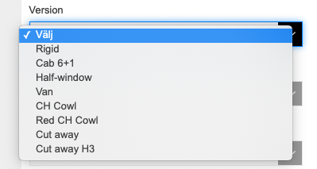
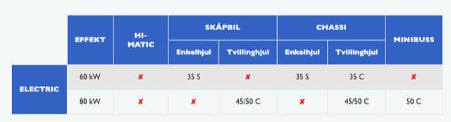
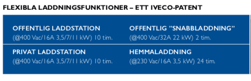
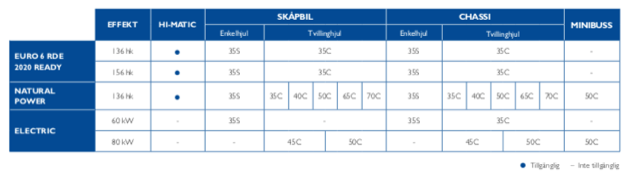

# Todo: Överväg att köpa en täkt lätt lastbil med lyft för att ha som transportmedel (och eventuellt bostad under etablering på tomten)?

```#c03515ff``` *As of 2019-10-02 23:56*

[mail plain/text](mail.txt)


Kanske är det ändå så att jag borde etablera mig på en ny tomt med hjälp av en lätt lastbil med lyft?

1) Överväg Peugot Boxer med Volymskåp och lyft (<https://media.peugeot.se/file/08/1/pop-boxer-volymsk-p-190906.pdf> )?

> 

> 

2) Överväg Renault Master med lyft som OKQ8 använder som hyrbil (<https://www.renault.se/bilar/transportbilar/nya-master/mattangivelser.html#open-transport> )?

> *Alltså Renaults hemsida SUGER! Jag ser att jag vill veta om deras flakmodell av MASTER som beskrivs under "Stor Volym" med modeller i tabellen som märkts med "L3 FWD" eller "L4 FWD". Men där tar det STOPP!! Jag kan inte bygga en sådan modell. Jag hittar inga priser eller utrustingsbeskrivningar av någon sådan modell? \*suck\**

> 

==&gt; OJ! Renault Kango Z.E är en elbil (<https://www.renault.se/bilar/elbilar/nya-kangoo-ze.html> )?

>   
> 

3) Överväg Iveco Daily flakbil med kran som OKQ8 har som hyrbil (<https://www.iveco.com/sweden/produkter/pages/nya-daily-chassis-cab.aspx#overview> )?

> *Alltså Ivecos svenska hemsida SUGER! När man väljer konfiguratorn så är det första valet "Version" helt obegripligt. Innan jag klickade mig till "konfigureraren" hade ja kommit fram till att jag var intresserad av en modell de kallade "Daily Chassi".*

> 

> *Men när jag kom till konfigureraren så fanns det ingen version "Chassi"?!!*

> 

> *Från här går det bara utför. Jag lyckas inte fylla i någon kombination som visar mig några bilar alls!! Alltså - hur dålig kan en säljsida bli?!!*

==&gt; OJ! Iveco verkar sälja lätta lastbilar "DAILY ELECTRIC. DET FÖRSTA UTSLÄPPSFRIA LÄTTA NYTTOFORDONET" som går på EL (<https://www.iveco.com/sweden/produkter/pages/daily-blue-power-electric.aspx> )?

> 

> *Det verkar dock som om Iveco Daily Electric kräver en ladd-effekt på minst 3,5 kW? Detta försvårar om jag vill ladda direkt från producerad förnybar el. Jag måste då på något sätt kunna producera 3.5 kW för att kunna ladda lastbilen direkt.*

>   
> Och det verkar också som Iveco Daily Electric inte är tillgänglig ännu?

> 

...


