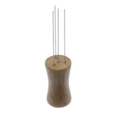

# Todo: Consider to make the espresso puck rake out of a wine cork an 0.4 mm acupuncture needles?

```#c051e1e0``` *As of 2021-06-18 19:47*

[mail plain/text](mail.txt)


1) Consider this youtube video "Puck Rake" (<https://youtu.be/HIexlhxP0Ig> )?

2) They seem to seel the rake here (<https://decentespresso.com/rake> )



3) Consider where I can buy acupuncture needles in Sweden?

==&gt; It seems to be NO 0,4 mm needles selling on the sites I looked at?

==&gt; The thickest needle I found was 0,32 mm (is thus sufficient to "fluff" coffee)?

...


