# Todo: Consider electric vehicles with towing capability and V2L (Vehicle to load) option to drive lifts and winches on the towed trailer?

```#c1218a8f``` *As of 2023-11-28 13:52*

[mail plain/text](mail.txt)


I want to live on an electrical platform (non fossil fuel) and an electric card with tow hitch and V2L output seems like a good solution?

1) Consider to document what electric cards there are with tow with and V2L option?

Todo: Make a spreadsheet listing car, towing capacity and V2L option?

2) Consider to go through the electric cars listed by article "Lista på Elbilar 2023" (<https://www.laddningsbox.se/elbilar/> )?

> *"**Snabbnavigering*

> *• Polestar 2 Long Range Dual Motor  
> *  
> *• Volkswagen ID.5 Pro  
> *  
> *• Tesla Model Y Performance  
> *  
> *• Volkswagen ID.5 GTX  
> *  
> *• Skoda Enyaq iV RS  
> *  
> *• Audi Q4 e-tron 35  
> *  
> *• Mercedes EQE 350  
> *  
> *• Kia EV6 Long Range AWD  
> *  
> *• Tesla Model X Plaid  
> *  
> *• Audi e-tron GT RS  
> *  
> *• Porsche Taycan GTS Sport Turismo  
> *  
> *• Mercedes EQA 250  
> *  
> *• Volvo C40 Recharge  
> *  
> *• Hyundai IONIQ 5 Long Range AWD  
> *  
> *• Dacia Spring Electric  
> *  
> *• BMW iX3  
> *  
> *• Honda e Advance  
> *  
> *• Peugeot e-2008 SUV  
> *  
> *• Renault Megane E-Tech  
> *  
> *• Toyota bZ4X AWD  
> *  
> *• Mercedes EQS AMG 53 4MATIC+  
> *  
> *• Lightyear One  
> *  
> *• Volvo XC40 Recharge Pure Electric  
> *  
> *• Opel Mokka-e  
> *  
> *• Ford Mustang Mach-E GT**"*

...

> Polestar 2 Long Range Dual Motor

> 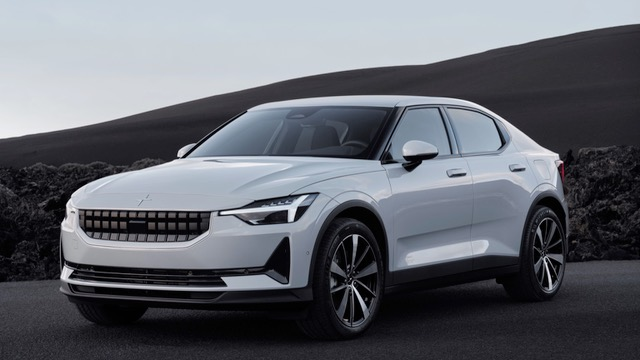  
> Elbil: Polestar 2 Long Range Dual Motor  
> Räckvidd (WLTP): 480 km  
> Max hastighet: 205 km/h  
> Acceleration 0-100 km/h: 4.7 sekunder  
> Batteristorlek: 78 kWh  
> Lansering: 09-2021  
> Volkswagen ID.5 Pro

> 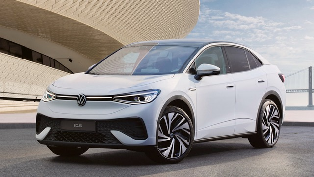  
> Elbil: Volkswagen ID.5 Pro  
> Räckvidd (WLTP): 520 km  
> Max hastighet: 160 km/h  
> Acceleration 0-100 km/h: 10.4 sekunder  
> Batteristorlek: 82 kWh  
> Lansering: 03-2022  
> Tesla Model Y Performance

> 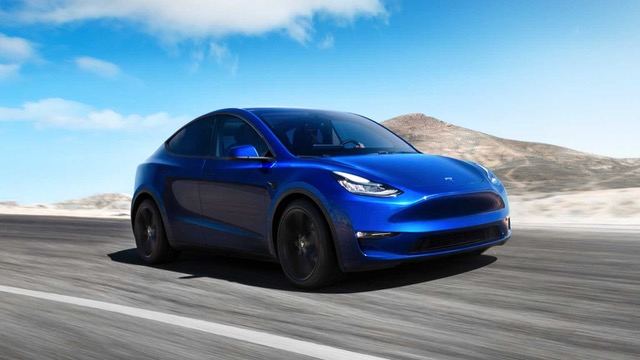  
> Elbil: Tesla Model Y Performance  
> Räckvidd (WLTP): 480 km  
> Max hastighet: 241 km/h  
> Acceleration 0-100 km/h: 3.7 sekunder  
> Batteristorlek: 82 kWh  
> Lansering: 02-2022  
> Volkswagen ID.5 GTX

> 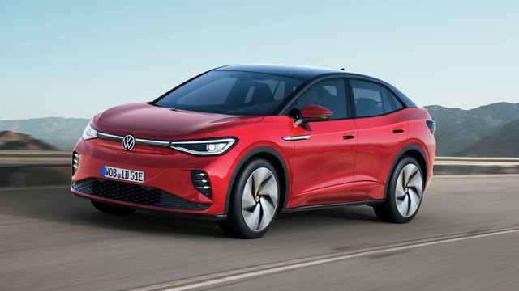  
> Elbil: Volkswagen ID.5 GTX  
> Räckvidd (WLTP): 490 km  
> Max hastighet: 180 km/h  
> Acceleration 0-100 km/h: 6.3 sekunder  
> Batteristorlek: 82 kWh  
> Lansering: 03-2022  
> Skoda Enyaq iV RS

> 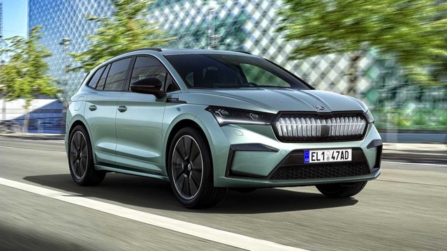  
> Elbil: Skoda Enyaq iV RS  
> Räckvidd (WLTP): 460 km  
> Max hastighet: 180 km/h  
> Acceleration 0-100 km/h: 6.2 sekunder  
> Batteristorlek: 82 kWh  
> Lansering: 02-2022  
> Audi Q4 e-tron 35

> 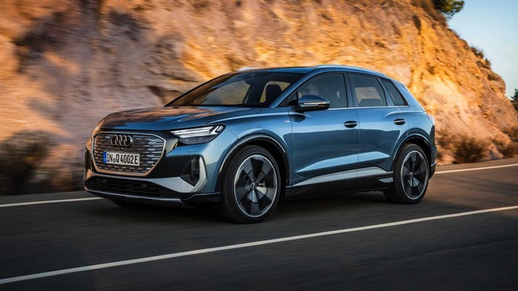  
> Elbil: Audi Q4 e-tron 35  
> Räckvidd (WLTP): 341 km  
> Max hastighet: 160 km/h  
> Acceleration 0-100 km/h: 9 sekunder  
> Batteristorlek: 55 kWh  
> Lansering: 06-2021  
> Mercedes EQE 350

> 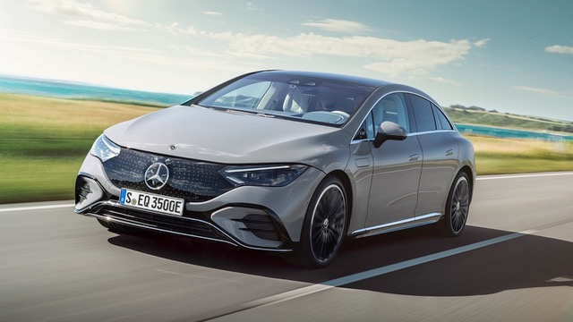  
> Elbil: Mercedes EQE 350  
> Räckvidd (WLTP): 660 km  
> Max hastighet: 160 km/h  
> Acceleration 0-100 km/h: 6 sekunder  
> Batteristorlek: 100 kWh  
> Lansering: 06-2022  
> Kia EV6 Long Range AWD

> 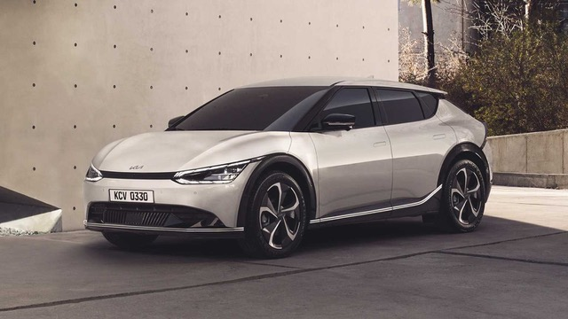  
> Elbil: Kia EV6 Long Range AWD  
> Räckvidd (WLTP): 506 km  
> Max hastighet: 185 km/h  
> Acceleration 0-100 km/h: 5.2 sekunder  
> Batteristorlek: 82.5 kWh  
> Lansering: 10-2021  
> Tesla Model X Plaid

> 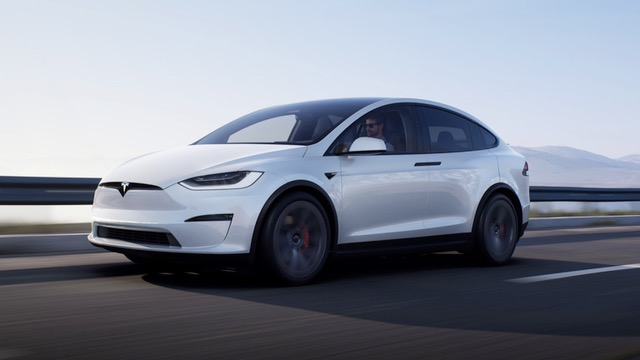  
> Elbil: Tesla Model X Plaid  
> Räckvidd (WLTP): 547 km  
> Max hastighet: 262 km/h  
> Acceleration 0-100 km/h: 2.6 sekunder  
> Batteristorlek: 100 kWh  
> Lansering: 06-2022  
> Audi e-tron GT RS

> 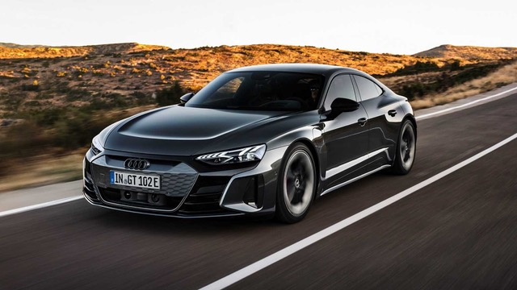  
> Elbil: Audi e-tron GT RS  
> Räckvidd (WLTP): 472 km  
> Max hastighet: 250 km/h  
> Acceleration 0-100 km/h: 3.3 sekunder  
> Batteristorlek: 93.4 kWh  
> Lansering: 05-2021  
> Porsche Taycan GTS Sport Turismo

> 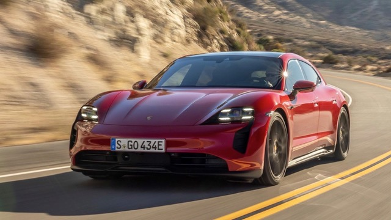  
> Elbil: Porsche Taycan GTS Sport Turismo  
> Räckvidd (WLTP): 490 km  
> Max hastighet: 250 km/h  
> Acceleration 0-100 km/h: 3.7 sekunder  
> Batteristorlek: 93.4 kWh  
> Lansering: 04-2022  
> Mercedes EQA 250

> 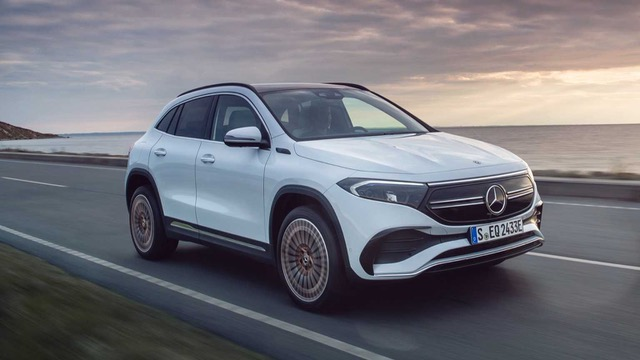  
> Elbil: Mercedes EQA 250  
> Räckvidd (WLTP): 426 km  
> Max hastighet: 160 km/h  
> Acceleration 0-100 km/h: 8.9 sekunder  
> Batteristorlek: 79.8 kWh  
> Lansering: 04-2021  
> Volvo C40 Recharge

> 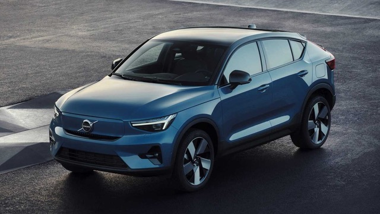  
> Elbil: Volvo C40 Recharge  
> Räckvidd (WLTP): 420 km  
> Max hastighet: 180 km/h  
> Acceleration 0-100 km/h: 4.7 sekunder  
> Batteristorlek: 78 kWh  
> Lansering: 08-2021  
> Hyundai IONIQ 5 Long Range AWD

> 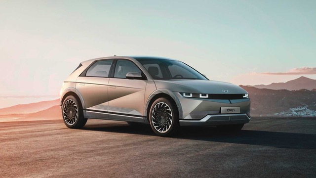  
> Elbil: Hyundai IONIQ 5 Long Range AWD  
> Räckvidd (WLTP): 462 km  
> Max hastighet: 185 km/h  
> Acceleration 0-100 km/h: 5.2 sekunder  
> Batteristorlek: 77.4 kWh  
> Lansering: 07-2021  
> Dacia Spring Electric

> 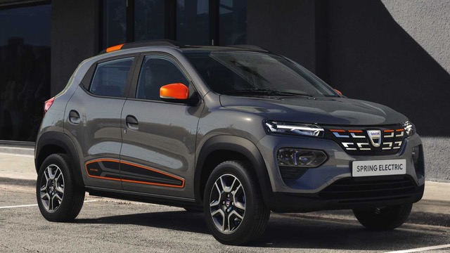  
> Elbil: Dacia Spring Electric  
> Räckvidd (WLTP): 225 km  
> Max hastighet: 125 km/h  
> Acceleration 0-100 km/h: 15 sekunder  
> Batteristorlek: 26.8 kWh  
> Lansering: 08-2021  
> BMW iX3

> 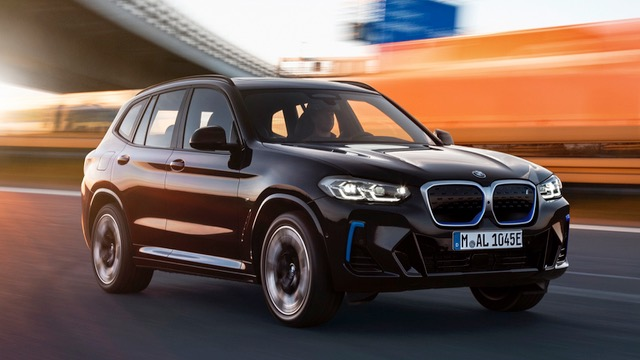  
> Elbil: BMW iX3  
> Räckvidd (WLTP): 461 km  
> Max hastighet: 180 km/h  
> Acceleration 0-100 km/h: 6.8 sekunder  
> Batteristorlek: 80 kWh  
> Lansering: 09-2021  
> Honda e Advance

> 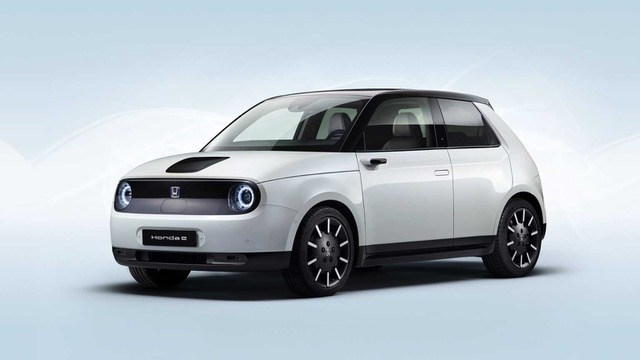  
> Elbil: Honda e Advance  
> Räckvidd (WLTP): 222 km  
> Max hastighet: 145 km/h  
> Acceleration 0-100 km/h: 8.3 sekunder  
> Batteristorlek: 35.5 kWh  
> Lansering: 08-2020  
> Peugeot e-2008 SUV

> 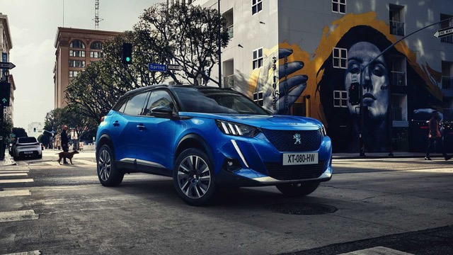  
> Elbil: Peugeot e-2008 SUV  
> Räckvidd (WLTP): 342 km  
> Max hastighet: 150 km/h  
> Acceleration 0-100 km/h: 8.5 sekunder  
> Batteristorlek: 50 kWh  
> Lansering: 11-2021  
> Renault Megane E-Tech EV60 220hp

> 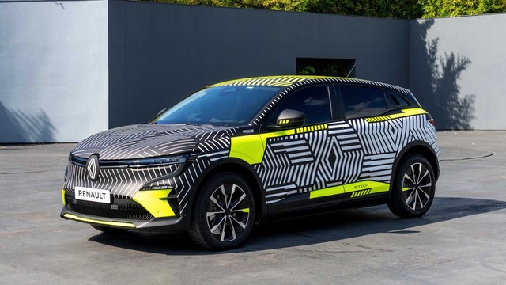  
> Elbil: Renault Megane E-Tech EV60 220hp  
> Räckvidd (WLTP): 450 km  
> Max hastighet: 160 km/h  
> Acceleration 0-100 km/h: 7.4 sekunder  
> Batteristorlek: 60 kWh  
> Lansering: 04-2022  
> Toyota bZ4X AWD

> 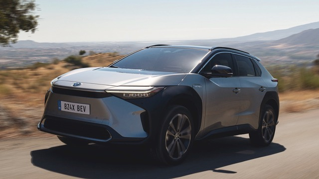  
> Elbil: Toyota bZ4X AWD  
> Räckvidd (WLTP): 400 km  
> Max hastighet: 160 km/h  
> Acceleration 0-100 km/h: 7.7 sekunder  
> Batteristorlek: 71.4 kWh  
> Lansering: 06-2022  
> Mercedes EQS AMG 53 4MATIC+

> 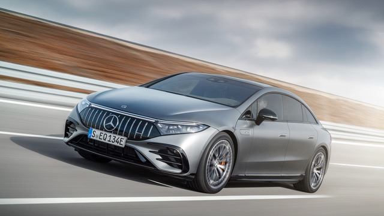  
> Elbil: Mercedes EQS AMG 53 4MATIC+  
> Räckvidd (WLTP): 580 km  
> Max hastighet: 250 km/h  
> Acceleration 0-100 km/h: 3.4 sekunder  
> Batteristorlek: 120 kWh  
> Lansering: 02-2022  
> Lightyear One

> 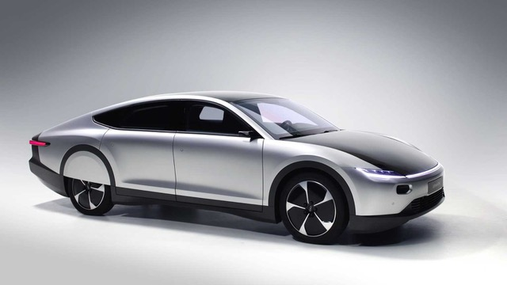  
> Elbil: Lightyear One  
> Räckvidd (WLTP): 725 km  
> Max hastighet: 150 km/h  
> Acceleration 0-100 km/h: 10 sekunder  
> Batteristorlek: 60 kWh  
> Lansering: 09-2022  
> Volvo XC40 Recharge Pure Electric

> 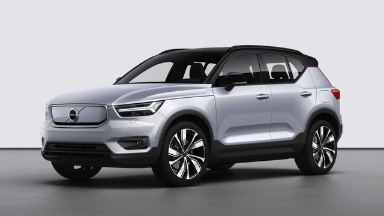  
> Elbil: Volvo XC40 Recharge Pure Electric  
> Räckvidd (WLTP): 423 km  
> Max hastighet: 160 km/h  
> Acceleration 0-100 km/h: 7.4 sekunder  
> Batteristorlek: 70 kWh  
> Lansering: 10-2021  
> Opel Mokka-e

> 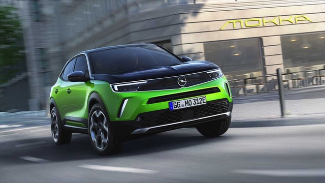  
> Elbil: Opel Mokka-e  
> Räckvidd (WLTP): 338 km  
> Max hastighet: 150 km/h  
> Acceleration 0-100 km/h: 9.2 sekunder  
> Batteristorlek: 50 kWh  
> Lansering: 11-2021  
> Ford Mustang Mach-E GT

> 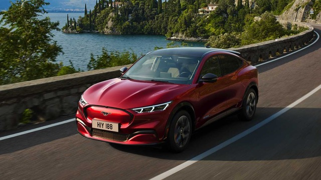  
> Elbil: Ford Mustang Mach-E GT  
> Räckvidd (WLTP): 500 km  
> Max hastighet: 200 km/h  
> Acceleration 0-100 km/h: 4.4 sekunder  
> Batteristorlek: 98.7 kWh  
> Lansering: 07-2021

3) Consider to go through the electric cards from china listed in article "Kinesisk elbil allt vanligare – Lista med kinesiska bilmärken med elbilar" (<https://laddboxbolaget.se/kinesisk-elbil-lista-med-kinesiska-bilmarken/>)?

> *"Vanliga kinesiska elbilar i Sverige

> Det finns en rad olika kinesiska elbilar i Sverige som du kan välja mellan. Som tidigare nämnt finns det några märken som redan nu sticker ut ur mängden och som du återkommande hittar på den svenska marknaden. Några exempel är bland annat BYD och Ora, samt MG, Zeekr och Polestar. Här nedan listar vi några av de vanligaste elbilarna i landet just nu.

> MG

> Den biltillverkare som har gjort sig mest känd i Sverige är troligtvis MG. Idag finns det redan ett flertal mycket populära och väletablerade modeller från MG i landet och här är det främst bilarnas design som får de att sticka ut. De har även fantastiskt låga priser, vilket har gjort MGs bilar till ett självklart val för många privatpersoner som inte vill lägga ut alldeles för mycket pengar på en laddningsbar bil. Den första modellen som lanserades i Sverige var ZS EV därefter kom Marvel R, samt kombibilen MG5.

> BYD

> BYD är ett bilvarumärke som är välkänt, men som samtidigt inte är fullt så populärt i Sverige riktigt än. Varumärket är dock mycket känt världen över och främst för sina bussar, transportfordon och personbilar. BYD är en av de mest uppskattade tillverkarna av just elbilar och studier visar att de ligger i framkant när det kommer till tillverkningsprocessen. Idag tillverkar BYD fler elbilar än självaste Tesla gör, samtidigt som de är leverantörer till flera andra märken. I Sverige är det Hedin Bil som kommer ligga bakom lanseringen av fordonen, där modellerna Tang, Atto 3 och BYD Han står på listan.

> Lynk & Co

> Även om Lynk & Co är ett systerföretag till Volvo Cars, så ägs det fortfarande av Geely och anses således vara en kinesisk biltillverkare. Både deras SUV och deras Lynk & Co 01 har blivit populära i Sverige såväl som i många andra delar av Europa. Bilarna är inte bara mycket bekväma och tysta att föra fram, utan de lämpar sig också för all typ av körning – både på landsbygden och vid längre sträckor, såväl som vid storstadskörning.

> Ora

> Under hösten 2022 lanserade Ora en mycket liten och smart elbil vid namn Funky Cat. Den här eldrivna halvkombin får dig helt klart att andas nostalgi, då man hämtat inspiration till designen från Folksvagnsbubblan. Bilen har dock, till skillnad från många andra elbilar, en mycket anmärkningsvärd räckvidd på 31-42 mil. Som det ser ut nu kommer bilen att säljas på ett flertal anläggningar runt om i Sverige, bland annat i Göteborg, Malmö och i Stockholm, men även i Uppsala.

> Aiways

> Det tog inte många år för Aiways att förvandlas från en klassisk startup firma till ett mycket multinationellt och stort bilvarumärke. Det är kanske inte så konstigt egentligen, eftersom en av företagets grundare har arbetat som försäljningschef på självaste Volvo. Den första elbilen du kommer kunna hitta i Sverige går under namnet Aiways U5. Aiways U5 kan du hitta hos ett flertal återförsäljare, men den kan även privatleasas för cirka 5300 kronor i månaden. Vill du däremot bli ägare av en Aiways U5 är det ett från-pris på 459 990 kronor som gäller.

> Xpeng

> Är det en Xpeng-elbil du är intresserad av behöver du varken importera från Kina eller hitta en återförsäljare i Sverige. Xpeng har nämligen öppnat upp en egen butik, som du hittar i det stora shoppingcentret Mall of Scandinavia i Stockholm. I dagsläget finns det två olika modeller från bilmärket, prestanda bilen P7 såväl som sedanen P5. Den förstnämnda elbilen har dessutom en förvånansvärt bra räckvidd på 40 mil.

> Nio

> Man kan inte prata om kinesiska elbilar utan att nämna bilmärket Nio. Nio är nämligen riktiga fenor på högteknologiska funktioner och modern teknik, vilket också är orsaken bakom deras stora framgång. Det som gör bilar från Nio extra speciella är att du inte bara får en räckvidd på hela 100 mil, utan att du även kan byta ut bilens batteri när du behöver ha en full laddning direkt. På endast 3,8 sekunder kan modellen ET7 dessutom ta sig från 0 till 100 km i timmen med hela 644 hästkrafter.

> Skywell

> Skywell är ett relativt nytt kinesiskt bilmärke som lanserades i Sverige under den första delen av 2023. Den första bilen som fick göra entré på marknaden var Skywell ET5 Electric. Den här snygga SUV:en kommer i en mycket bekväm storlek som efterliknar Volvo XC60. Skillnaden är att ET5 är en elbil med ett laddningsbart batteri på hela 72 kWh, samt en total räckvidd på 40 mil. Skywells elbil kännetecknas även av sin framhjulsdrift och sin elmotor på 204 hk.

> Hongqi

> Hedin Bil är en av Sveriges kändaste återförsäljare av bilar från Kina. Det är alltså dit du ska vända dig om du är intresserad av en Hongqi. Hongqi har valt att skippa allt vad medelmåttigt heter och satsat på en design som känns både lyxig och pampig. En bilmodell som verkligen skiljer sig från mängden är SUV:en vid namn E-HS9. Inte nog med att bilen är riktigt rymlig och hela 25 cm längre än Volvos stora XC90. Den har också plats för hela sju personer, vilket gör den utmärkt för den större familjen."

> *

==&gt; It seems it may be possible to order directly from china although transport and customs can be some work?

> *"*  
> *Så beställer du en kinesisk elbil

> Det finns flera sätt som du kan gå tillväga för att investera i en kinesisk elbil. Du kan antingen välja att vända dig till en av många professionella återförsäljare som finns här i Sverige, eller så kan du importera direkt från Kina. Fördelen med det sistnämnda alternativet är att du kan pressa priserna rejält och få en bil med ett mycket lågt nypris. Nackdelen är att det kan vara ganska knepigt att transportera och frakta bilen hela vägen från Kina. Det är en hel del pappersarbete som du kommer behöva ta dig igenom, såväl som ett flertal kostnader och avgifter.

> Att handla från en återförsäljare i Sverige är således det smidigaste alternativet, men räkna med att priserna blir högre. Dock kommer de fortfarande att ligga lägre än om du hade valt ett elbilsmärke från ett annat land, t.ex. en amerikansk eller europeisk elbil. Du kan dessutom vara säker på att du får en bra garanti på bilen och har möjlighet att både provköra och inspektera bilen på plats innan du gör någon betalning.*  
> *"*

...


